# 心拍分类与可视化系统设计

副标题：基于一维卷积网络的患者独立评估

## 摘要

针对心电图标注心拍分类与课程实验展示需求，本文基于MIT-BIH心律失常数据库，比较逻辑回归、随机森林和一维卷积神经网络，并实现ECG-AI可视化系统。实验排除四条含起搏心拍记录，将保留的44条记录归为43个患者组，以31、6、6个患者组划分训练、验证和测试分区。信号经固定带通滤波后，围绕专家位置截取253点窗口，归一化参数仅以训练数据拟合。原N/V二分类CNN测试Accuracy为0.9957、Macro-F1为0.9865，但验证Macro-F1为0.6630；重新推理、标签及数据对应检查支持原结果可复现，验证误报高度集中于患者109。原四分类随机森林和CNN的Macro-F1分别为0.4656和0.4460，较高总体准确率没有转化为可靠的S/F识别。

进一步保留固定患者分区，预声明逆频率交叉熵、平方根交叉熵、Focal Loss及增加过去RR分支的四个方案，各训练三个随机种子，按平均验证Macro-F1锁定平方根Focal＋RR分支，其验证与旧测试Macro-F1分别为0.6047±0.0060和0.5002±0.0036。验证与测试的患者组成不同，大量相关心拍不能代替独立患者证据；新增策略没有使S、F同时改善，指标上升与漏检退步均完整保留。旧测试集此前已查看，新增结果属于冻结协议后的探索性复用，不能视为独立盲测。真实模型的梯度归因用于补充错误分析，不证明医学因果机制。系统贯通真实波形、专家标注、三模型推理、历史回放、错误展示与教学互动，六个原生产模型保持独立保留。结果表明，训练策略应结合逐类误报、患者覆盖和随机性共同评价；本项目贡献主要是可复现实验、受控对照和教学系统整合，适用范围限于既有数据库中的专家标注心拍，不构成临床诊断有效性证据。

关键词：心电图，心拍分类，类别不平衡，患者独立评估，可视化系统

## Abstract

This study addresses the classification of annotated electrocardiographic heartbeats and the presentation of reproducible course experiments. Logistic regression, random forests and a one-dimensional convolutional neural network were compared using the MIT-BIH Arrhythmia Database, and their trained artifacts were integrated into the ECG-AI visualization system. Four recordings containing paced beats were excluded. The remaining 44 recordings represented 43 patient groups, which were assigned to training, validation and test partitions containing 31, six and six groups. Fixed band-pass filtering preceded extraction of 253-sample windows around expert annotations. Normalization statistics were fitted using training data only.

The original N/V convolutional model achieved a test accuracy of 0.9957 and a macro-F1 of 0.9865, whereas its validation macro-F1 was 0.6630. Replay and correspondence checks supported reproducibility of these outputs; most validation false positives originated from patient 109. For the original four-class task, random forests and the convolutional model obtained macro-F1 values of 0.4656 and 0.4460, respectively. High overall accuracy therefore coexisted with poor recognition of the S and F classes. A controlled extension retained the same patient split and compared inverse-frequency cross-entropy, square-root-weighted cross-entropy, focal loss and a focal model with past RR context. Three predeclared random seeds were retained for every configuration. The configuration focal_sqrt_rr was locked using mean validation macro-F1 before the final evaluation stage. Its validation and previously viewed test macro-F1 values were 0.6047±0.0060 and 0.5002±0.0036, respectively, reported as mean and sample standard deviation across seeds. Patient composition differed between partitions, and correlated beats did not provide independent patient evidence. The selected extension did not improve both minority classes: improved S recognition coexisted with poorer F recall and F1 than the retrained inverse-frequency baseline. Reuse of an already inspected test set was treated as exploratory, rather than as a new blinded or external evaluation.

Integrated Gradients from actual model computations supplemented the error analysis without establishing clinical mechanisms. The application connects real waveforms, expert annotations, three-model inference, historical playback, error inspection and interactive teaching. The six original production artifacts were retained separately from the new experimental models. The findings emphasize that weighting, minority-class false positives, patient coverage and training randomness must be assessed together. The contribution is a reproducible comparison, a controlled training investigation and an integrated teaching system. The evidence applies to expert-centered beats in this database and does not establish clinical diagnostic effectiveness or reliable performance on arbitrary unannotated recordings.

Key words: electrocardiogram, heartbeat classification, class imbalance, patient-independent evaluation, visualization system

<!--TOC-->

# 第1章 绪论

## 1.1 研究背景

心电图通过体表电极记录心脏电活动，是观察心律和心拍形态的重要信号。长时间记录包含大量连续心拍，人工逐拍核对需要时间，且噪声、导联差异与个体差异会增加分析难度。自动心拍分类把连续信号中的局部片段映射到预定义标签，可用于辅助整理数据、定位值得复核的片段，以及开展信号处理和机器学习教学。MIT-BIH数据库提供可复查的信号与专家标注，为这类算法实验提供了共同基础[1-3]。

传统机器学习通常依赖特征表达与分类器的配合；一维卷积网络则能够在局部时间轴上进行多层特征变换[4-6]。但模型是否适用，不能仅由一个较高的总体准确率判断。多数类占比、同一患者心拍的相似性、少数类来源患者数量，以及训练与测试的划分方式，都会影响评价。对于课程实践，展示一段真实心拍、对应标签、预测分数和错误案例，有助于把抽象指标与实际数据联系起来，也便于识别实验的适用边界。

## 1.2 相关研究与研究定位

传统心拍分类通常先形成波形形态、心拍间期或频域描述，再由分类器建立标签边界。形态特征描述局部信号变化，RR间期则提供相邻心拍的时间关系，两者对应不同输入信息。de Chazal等将形态与间期特征用于线性判别分类，在44条非起搏记录上采用五类标签，分别使用DS1与DS2进行配置选择和最终评估[4]。该评价采用不同记录集合，患者互斥性仍需额外核查。Breiman提出的随机森林以树模型集成表达非线性关系[5]。本文采用逻辑回归和随机森林比较同一波形向量上的线性与非线性建模，未复现上述研究的全部手工特征。

一维CNN沿时间轴学习局部表示，将特征变换与分类目标共同优化。Kiranyaz等使用通用样本及患者特异标注训练各患者模型[6]；这一设置回答的是适配后对该患者的识别问题，与不使用测试患者标注训练的任务不同。Acharya等以多层CNN开展五类心拍识别，并比较原始不平衡数据与平衡增强条件[7]。因此，端到端分类仍以明确的切拍、信号处理和标签约定为前提，不能推断模型已直接解决任意未标注长记录的分析。作为输入条件的补充，Mondéjar-Guerra等将形态描述与RR间期用于SVM集成[8]，说明比较模型时还需区分是否使用节律上下文；原始比较中的CNN输入为253点单心拍窗口，没有显式RR特征；新增RR分支另作受控对照。

类别不平衡与跨患者评价需要共同考察。SMOTE研究讨论了总体准确率掩盖少数类错误的问题，并提出合成少数类样本的处理方法[9]；本文未使用该方法，而是复核已有权重对照。重采样或权重调整可以改变训练分布或损失贡献，却不能自动增加少数类的独立患者来源。患者特异模型允许使用目标患者标注，患者独立模型则要求患者组跨分区互斥，二者的分数应分别解释。因此，应把样本频率与患者覆盖作为两个层次的证据：前者影响各类对总体指标的贡献，后者涉及训练和评价包含多少独立来源。输出较多少数类标签也不等于识别改善，仍需结合Precision、Recall和错误方向检查；这些是评价设计要求，具体原因应回到保存预测核对。MIT-BIH记录201与202来自同一人[3]，进一步说明记录互斥并不总等于患者互斥。表1-1比较了代表性工作的输入和评价条件，不排列跨论文性能名次。本文定位为既有模型的受试者分组比较、错误诊断与系统实现，通过逐类指标、患者覆盖和分组交叉验证界定结果的适用范围，不提出新的网络算法。

表1-1 代表性心拍分类研究的输入与评价条件

| 作者与年份 | 主要任务 | 使用的特征或模型 | 数据与评价协议 | 与本项目的关系 |
|---|---|---|---|---|
| de Chazal等 2004[4] | 五类心拍分类 | 形态与间期特征 线性判别 | MIT-BIH 44条非起搏记录 DS1选配置 DS2最终评估 | 参考标签分组与评估分工 本文不复现其手工特征 |
| Kiranyaz等 2016[6] | 患者特异心拍分类 | 一维CNN | MIT-BIH 通用样本与患者特异标注共同训练 | 支持局部特征学习 与本文目标患者不参与训练的设置不同 |
| Acharya等 2017[7] | 五类心拍分类 | 多层CNN | MIT-BIH 原始分布与平衡增强条件 本次未确认逐患者分区细节 | 提示输入与类别处理应明确 不认定其协议与本文相同 |
| Mondéjar-Guerra等 2019[8] | N S V F四类分类 | 形态 RR间期 SVM集成 | MIT-BIH 按文中DS1与DS2记录集合训练和测试 | 提供RR输入对照 记录分区不视为与本文患者合并规则等价 |

表中只列本次能够核实的条件。文献[8]的公开记录列表将201与202置于不同集合，故即使使用“跨患者”名称，也不能据此认定与本文严格合并同源记录的评价等价；本文不以该差异推断其全部实现行为。文献[7]的逐患者分区尚未复核，相关性能不与本文横向排名。

近年来，心拍分类研究继续探索更丰富的表示与跨患者评价。Oliveira等的图表示与图卷积工作仍指出类别不平衡及室上性心拍识别的困难[10]；该来源为公开预印本，不能据此建立跨论文性能名次。Chen等将注意力增强卷积用于跨患者室性早搏识别，并结合形态与间期信息[11]。这些研究提示节律上下文具有比较价值，但其标签、训练和评估条件与本文不同。本文仅据此设置过去RR输入对照，不声称复现其模型或性能。

## 1.3 研究目标

本文的目标是建立可追溯的心拍分类实验与展示流程：比较三种模型在相同N/V任务上的表现；观察四分类扩展后的类别差异；从患者分布、权重策略与折间波动分析局限；将训练工件整合到可交互系统。研究范围是标注心拍的分类，不包含任意原始ECG的自动事件发现，也不以提出新网络算法为目标。

## 1.4 主要工作

本项目完成患者分组数据集、三类模型比较和ECG-AI系统整合。实验以逐类指标和患者来源解释N/V与四分类的差异，增加三随机种子的损失与RR上下文受控对照，并用真实梯度归因补充错误复核。系统把波形、专家标签、保存模型与课堂互动贯通。图1-1概括数据与模型流程。这些工作属于实验设计、结果分析和教学工程贡献，不提出全新的网络算法。

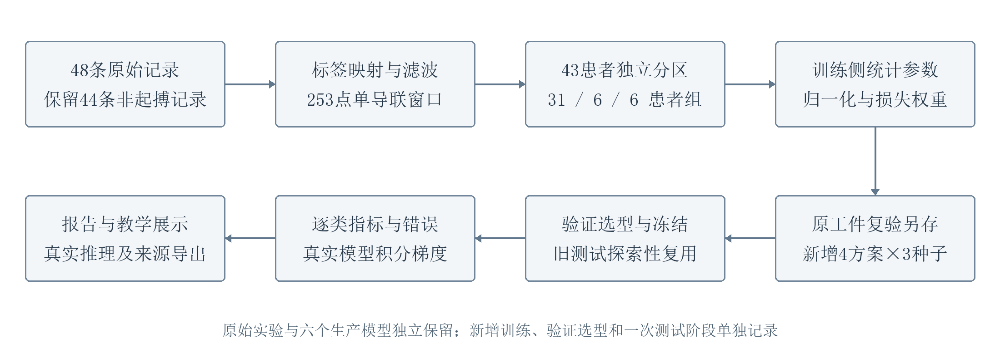

# 第2章 数据集与预处理

## 2.1 数据来源与记录选择

MIT-BIH Arrhythmia Database包含47名受试者的48段约半小时双通道动态心电记录，采样率为360 Hz，并提供经专家检查的心拍标注[1,3]。本文采用已有正式实验版本，排除102、104、107和217四条含起搏心拍记录。保留的44条记录对应43个受试者组；记录201与202来自同一受试者[3]，在代码中统一为同一分组键，不能当成两名独立患者。

原始标注总量、映射心拍数量与有效输入窗口数量具有不同含义。本文模型结果表统计通过窗口和信号有效性规则、实际进入模型数据集的心拍；数据构建流程表另列原始事件与映射阶段数量。N/V任务保留96554拍，四分类任务保留100115拍。两者并非两套独立采集队列，而是同一记录分区下的不同标签子集。

## 2.2 心拍标签及任务边界

项目根据显式、大小写敏感的符号映射归并AAMI类别，映射实践参考已有研究[4]。表2-1列出实际规则。N组包含正常心拍、左/右束支传导阻滞心拍及部分逸搏，因而N标签不能解释为受试者绝对健康；V组代表本任务中的室性异位心拍。N/V二分类只能评价这两个标签之间的区分，不能代表全部心律失常或心脏疾病检测。四分类纳入N、S、V、F，Q组仍未进入正式分类任务，非心拍标注也不被当作一个心拍类别。

表2-1 项目采用的AAMI类别映射

| 类别 | 原始符号 | 组别含义 |
|---|---|---|
| N | N、L、R、e、j | 正常 束支阻滞及部分逸搏心拍 |
| S | A、a、J、S | 室上性异位心拍 |
| V | V、E | 室性异位心拍 |
| F | F | 室性与正常心拍融合 |
| Q | /、f、Q | 起搏 相关融合或无法分类心拍 |

表2-2 数据构建的记录与心拍数量流程

| 构建阶段 | 记录范围 | 数量与单位 | 统计含义 |
|---|---|---|---|
| 原始记录与保留记录 | 全库→正式实验 | 48→44条；保留43受试者组 | 排除102、104、107、217；201/202同组 |
| 全部原始注释事件 | 48条 / 44条 | 112647 / 103724条 | 包含节律、质量等非心拍事件 |
| 显式AAMI映射覆盖心拍 | 48条 / 44条 | 109494 / 100733拍 | 仅N/S/V/F/Q映射符号，不等于注释事件总数 |
| N/V目标心拍 | 44条 | 97134拍 | 窗口技术排除前 |
| N/V有效窗口 | 44条 | 96554拍 | 排除540拍保护区与40拍边界不足 |
| N/S/V/F目标心拍 | 44条 | 100718拍 | 未纳入Q，窗口技术排除前 |
| N/S/V/F有效窗口 | 44条 | 100115拍 | 排除562拍保护区与41拍边界不足 |

表2-2区分注释事件、映射心拍和有效窗口，所有数量均由原始符号统计、逐拍元数据及校验文件交叉核对。每个有效心拍对应一个253点窗口，不能将253个采样点计作253个独立训练样本。预处理先对连续信号实施固定滤波，再围绕标注截窗；患者划分后仅用训练窗口拟合归一化和损失权重。固定滤波不利用标签拟合，训练侧统计参数则不能从验证或测试侧估计。

## 2.3 信号预处理

正式构建流程优先选择名称为MLII的导联；若不存在，则使用实际第一导联并在元数据中记录。核验元数据后，本实验全部有效输入实际均为MLII单导联。原始信号以mV读取，使用0.5—40 Hz Butterworth带通滤波。配置中的原型阶数为4，带通变换后单次滤波为8阶，并以二阶节前后向滤波实现零相位处理。该方法使用未来上下文，属于离线、非因果预处理；网页回放不意味着实现了因果实时监护。图2-1展示真实信号的滤波前后对比，滤波削弱的频率成分不应直接解释为病理信息。

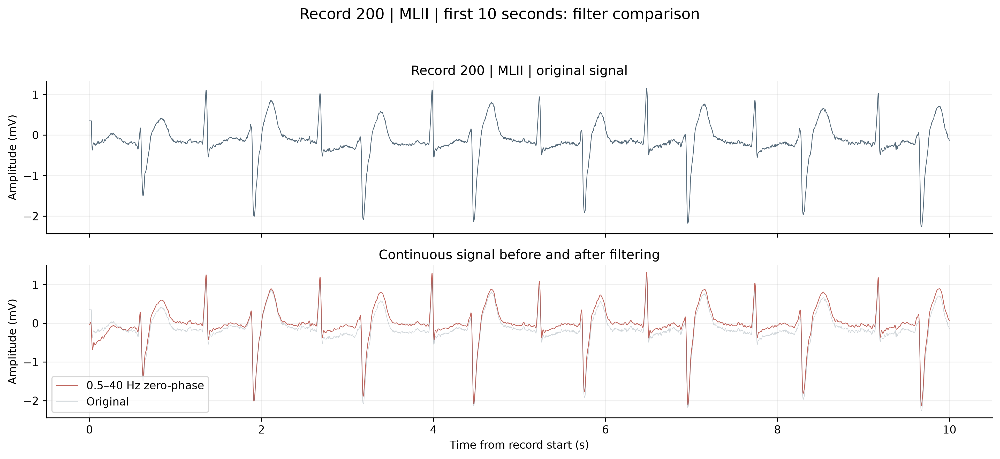

以专家标注样本r为中心，截取前0.3 s与后0.4 s，分别对应108点与144点，并包含中心点。因此输入长度为108+1+144=253点，覆盖端点间0.7 s。截取过程如图2-2。每个连续有限信号段两端设置5秒保护区；窗口越界、保护区内、非有限、平坦或重复目标位置等技术失败窗口排除；不根据模型预测修改专家标签，也不把质量提示直接转换为诊断标签。

$$ xᵢ[j] = s_f[rᵢ − 108 + j]，j = 0，…，252 （2-1）

其中s下标f表示滤波信号，rᵢ为第i个专家心拍标注的位置，j为窗口内索引。数据采用训练窗口全部数值拟合的全局标量z-score：

$$ zᵢ[j] = (xᵢ[j] − μ_train) / σ_train （2-2）

训练均值μ与标准差σ分别为训练窗口的均值与总体标准差。N/V版本相应数值为0.010123 mV和0.342253 mV；验证、测试与部署复用既定参数。四分类使用其自身训练集参数。该过程不是逐拍单位幅值缩放，也没有为每个测试患者重新拟合归一化。逻辑回归在此基础上另用仅训练向量拟合的逐特征StandardScaler。

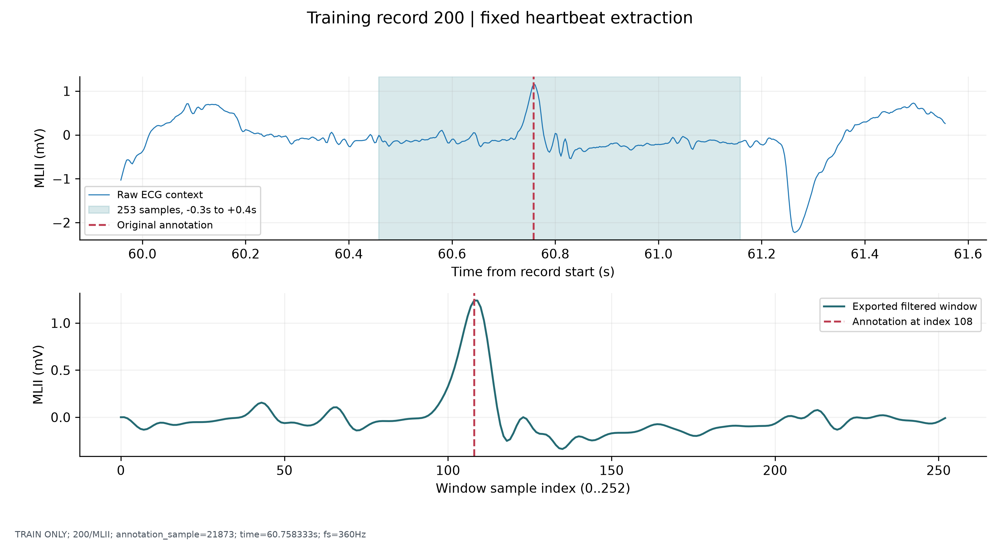

## 2.4 数据集划分

项目按受试者组以约70%/15%/15%的目标比例划分，随机种子为20261027；最终形成31/6/6个受试者的训练、验证和测试分区。划分还按V注释数是否达到100分层并约束留出V数量；已用于探索的记录100、200固定留在训练侧，未按模型成绩反复选择分区。训练区包含32条记录，其余各6条，原因是201与202同属训练患者。表2-3报告实际心拍数，不能由患者比例推算各类心拍比例。两任务患者分区相同，训练、验证和测试患者集合互斥，归一化与类别权重均只从训练侧估计。

表2-3 两项任务的实际数据划分

| 任务 | 训练拍数 | 验证拍数 | 测试拍数 | 患者数 训练 验证 测试 |
|---|---|---|---|---|
| N/V | 70183 | 12923 | 13448 | 31 / 6 / 6 |
| N/S/V/F | 71941 | 14345 | 13829 | 31 / 6 / 6 |

## 2.5 数据探索

四分类中N、S、V、F分别为89577、2761、6977和800拍，N占89.47%，F仅占0.80%。图2-3同时显示样本支持与患者覆盖，提示大量心拍并不自动带来同等充分的患者多样性。类别级患者数由元数据重新聚合，未采用曾把整个分区患者数重复填入各类的旧派生统计。典型波形用于观察数据形态，不被视为每个类别的唯一模板。

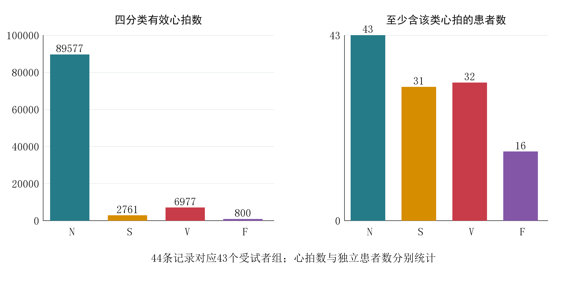

# 第3章 模型设计

模型选择分别覆盖线性基线、非线性树集成和局部时序卷积三种建模方式。它们使用相同任务分区和253点输入，但归纳偏置、损失权重及训练机制不同。因此该比较回答当前输入条件下哪种方案表现更好，不用于把所有差异归因于单个网络组件。

## 3.1 逻辑回归

逻辑回归将253点标准化波形展平为向量，通过线性得分产生分类输出，作为检验线性可分性的基线。多分类时采用相应多类概率建模。正式配置使用C=1.0、lbfgs求解器、最大迭代1000、容差0.001和balanced类别权重。各时间位置的StandardScaler仅在训练向量上拟合。本文没有把额外的RR间期、手工QRS宽度或患者身份输入该模型，所以其不足也受到当前波形表达的限制。

## 3.2 随机森林

随机森林以多棵决策树的集成表示非线性关系[5]，输入同样为253维波形向量。正式配置为100棵树、最大深度18、叶节点最少2个样本，分裂候选特征采用sqrt，每棵树bootstrap抽样比例0.8，类别权重为balanced_subsample。随机森林与逻辑回归共享任务分区，但训练机制及权重方式不同。因此它们是相同数据条件下的模型对照，不是仅替换一个数学算子的严格结构消融。

## 3.3 一维卷积神经网络

项目采用紧凑一维卷积结构，输入张量形状为B×1×253，B表示批大小。三个卷积层依次提取局部时序表示，ReLU提供非线性，前两层后接最大池化，最后用自适应平均池化聚合时间维，再由线性层输出类别logits。实际网络没有批归一化、Dropout、循环层或注意力层。图3-1和表3-1均由现有模型定义整理，避免把文献中的其他网络结构误写入本项目。

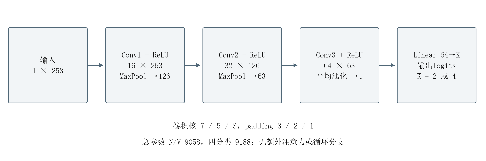

表3-1 一维卷积网络层结构

| 层或模块 | 输入尺寸 不含批维 | 输出尺寸 | 主要参数 |
|---|---|---|---|
| Conv1D 与 ReLU | 1×253 | 16×253 | 核7 padding3 |
| MaxPool1D | 16×253 | 16×126 | 核2 步长2 |
| Conv1D 与 ReLU | 16×126 | 32×126 | 核5 padding2 |
| MaxPool1D | 32×126 | 32×63 | 核2 步长2 |
| Conv1D 与 ReLU | 32×63 | 64×63 | 核3 padding1 |
| AdaptiveAvgPool1D | 64×63 | 64×1 | 输出长度1 |
| Linear | 64 | K | K为2或4 |

网络输出经softmax转换为类别分数，取最大分数对应类别。分数反映模型在给定标签集合下的相对输出，并未经过临床概率校准。训练使用加权交叉熵：

$$ L = −Σᵢ w_(yᵢ) log p_(i,yᵢ) / Σᵢ w_(yᵢ) （3-1）

其中yᵢ为真实类别，p_(i,yᵢ)为对应真实类别的预测概率，w_(yᵢ)为类别权重；求和在批内进行，分母对应加权均值。正式逆频率权重为w_c=n_train/(K n_c)，n_c为训练类c的拍数，K为类别数。该目标调整不同标签在损失中的相对贡献，不等于增加少数类患者。

## 3.4 训练与模型选择

CNN使用Adam，学习率0.001，weight decay为0.00001，批大小256，最多训练25个epoch，早停耐心值为5，以验证集Macro-F1选择检查点。随机种子为20261027，正式运行设备记录为CPU；N/V与四分类最佳epoch分别为12和11。验证集用于早停及已有权重策略比较，不能再当作独立泛化证据。原始实验的检查点及预测独立保留；新增训练另按3.5节方案执行，不用错误案例重新选择原模型。

表3-2 正式模型训练与选择条件

| 项目 | LR | RF | 1D-CNN |
|---|---|---|---|
| 主要规模参数 | C=1；最大迭代1000 | 100棵树；深度18 | 三层卷积；通道16/32/64 |
| 输入与缩放 | 253维；训练侧逐特征缩放 | 253维；全局标量标准化 | 单通道253点；全局标量标准化 |
| 类别处理 | balanced | balanced_subsample | 训练集逆频率交叉熵 |
| 优化设置 | lbfgs；容差0.001 | 叶节点最少2；抽样比例0.8 | Adam；lr=0.001；batch=256 |
| 选择与随机性 | 固定配置；seed=20261027 | 固定配置；同一seed | 最多25轮；patience=5；同一seed |
| CNN最佳轮次 | 不适用 | 不适用 | N/V第12轮；四分类第11轮 |

表3-2中的正式配置与权重探索实验分开记录。CNN输出logits直接送入交叉熵，推理时才转换为softmax分数；测试结果不参与检查点选择。两层最大池化分别缩短时间维，最后的自适应平均池化将每个通道聚合为一个数值，故线性分类器仅接收64维表示。

## 3.5 类别不平衡与RR上下文方案

在保留原始CNN及六个生产工件的基础上，增加四分类受控实验。四个预声明方案依次为逆频率加权交叉熵（ce_inverse）、平方根平滑加权交叉熵（ce_sqrt）、平方根加权Focal Loss（focal_sqrt）和增加过去RR上下文分支的Focal方案（focal_sqrt_rr）。Focal Loss通过对易分类样本施加较小调制权重，改变损失贡献[12]；本实验取γ=2，先对每拍的负对数概率乘以类别权重α和调制项(1−p)的γ次幂，再以批内α之和归一化。γ=0时退化为同α的加权交叉熵，因此对照中的损失均值口径一致。α为训练侧逆频率权重的平方根，全局乘常数不改变该加权均值。方法的价值由完整逐类结果检验，不因名称而预设优于基线。

RR方案保留原三层波形编码器，将四维时间特征经4→16的ReLU分支，与64维波形表示拼接，再由80→4线性层分类。该方案比原结构增加144个参数。特征包括上一RR间期、过去最多十个RR间期均值、上一RR与该均值之比、上一RR与再前一RR之比；均由过去专家心拍位置计算，不使用类别标签、下一RR、患者编号或记录编号作为输入。附加StandardScaler仅以训练样本拟合。记录开始缺少历史间隔时按协议使用0.8 s默认值。RR方案同时增加时间信息和可训练分支，因此比较评价的是这一组合，不能把差异完全归因于单个特征。

四个方案均使用原患者分区、253点波形、标签与训练侧标量归一化。三个随机种子为20261027、20261116和20261117，训练上限25轮，早停耐心值5，学习率0.001，批大小256。每次训练依据验证集四类Macro-F1选择检查点；之后按三个种子的平均验证Macro-F1选定方案，完全同分按预声明配置顺序处理，不挑选最好种子。所有检查点及选型结果冻结后，才进入一次最终测试评估阶段。原测试集此前已经查看，故这一阶段属于旧测试集的探索性复用，不是新的盲测或外部患者验证。

# 第4章 实验设计与评价指标

## 4.1 实验环境

原数据处理环境记录Python 3.12.10、NumPy 2.5.4、SciPy 1.18.1、WFDB 4.3.1、scikit-learn 1.9.1，依赖锁记录PyTorch 2.14.1。新增受控训练实际使用Python 3.12.10、NumPy 2.5.4与PyTorch 2.14.1+cpu，固定CPU线程数4。项目在Windows环境组织和运行；具体硬件型号未纳入已有实验记录，因此不补写。前后端依赖由各自配置维护，与训练环境分开记录。

## 4.2 评价指标

设混淆矩阵M的第a行、第b列表示真实为a、预测为b的心拍数。对类别c采用一对其余方式定义TP_c、FP_c、FN_c：

$$ Accuracy = Σ_c M_(c,c) / n （4-1）

$$ Precision_c = TP_c / (TP_c + FP_c)，Recall_c = TP_c / (TP_c + FN_c) （4-2）

$$ F1_c = 2 Precision_c Recall_c / (Precision_c + Recall_c) （4-3）

$$ Macro-F1 = (1/K) Σ_c F1_c （4-4）

n为被评价心拍总数。当分母为零时，项目评估实现把对应分数记为0，并同时报告真实支持数。Accuracy按心拍计数，容易受到多数类支配；Macro-F1等权汇总各类F1，便于暴露稀有类别的不足。Recall衡量实际该类心拍被找回的比例，Precision反映预测为该类的结果中正确比例，两者需要结合解读。按心拍计算的分数并非按患者平均的分数。

## 4.3 对照实验与证据范围

主实验在固定患者分区上比较N/V三模型；扩展实验使用同一记录分区的N/S/V/F标签。类别权重实验仅比较既有训练与验证结果，包括无权重、平方根平滑逆频率、截断逆频率和完整逆频率；平滑方案对逆频率开平方后按权重均值归一化，截断方案先将原始逆频率截到10再按均值归一化；该比较属于验证侧探索，未产生新的测试结论。

四分类五折StratifiedGroupKFold仅使用原训练加验证的86286拍、37个患者组。每位患者在外层仅进入一次折外评估；CNN在外层训练患者内部生成四折分组候选，按类别覆盖与固定序号选择一个内层早停划分，选定epoch后在整个外层训练侧重新拟合。该流程及折内归一化、类别权重已有日志记录。模型设置在此前实验中形成，故交叉验证定位为探索性稳定性分析，不称为外部验证。正式测试集此前已被查看，本文对保存预测的复算与错误图均为回顾性分析，未获得新的盲测数据。

表4-1 各实验的设置与证据范围

| 实验 | 分类任务 | 模型 | 数据范围 | 主要指标 | 目的 |
|---|---|---|---|---|---|
| 固定测试主实验 | N/V | LR RF CNN | 固定31/6/6患者分区 | Accuracy 逐类P/R/F1 Macro-F1 | 比较两组心拍识别 |
| 固定测试扩展 | N/S/V/F | LR RF CNN | 同一患者分区 | 同上及混淆方向 | 观察任务扩展的变化 |
| 类别权重探索 | N/S/V/F | CNN四策略；既有LR/RF对照 | train训练 val早停与比较 | Macro-F1 逐类P/R 预测份额 | 分析损失权重取舍 |
| 分组五折CV | N/S/V/F | LR RF CNN | 仅train+val的37患者组 | 折均值 样本标准差 OOF汇总 | 探索患者组成敏感性 |
| 部署一致性 | 两任务 | 三模型 | 每任务100样本×3，任务间有重合 | 类别相同次数 最大概率差 | 工程复现验证 |

表4-1最后一项的比较对象是同一模型的历史输出与部署输出，不以专家标签作为一致性判据，因此它不是新增的分类性能实验。原始固定测试在训练后执行；新增重推和受控训练均记录其回顾性复用边界，不能恢复测试集未被触碰的状态。

# 第5章 实验结果与分析

## 5.1 N/V二分类结果

表5-1由三份测试预测CSV重新计算，并与保存JSON逐项核对。固定测试集包含12287拍N与1161拍V。CNN的Accuracy为0.9957，Macro-F1为0.9865，均高于本实验中的两种传统模型。图5-1并列展示二分类与四分类结果，说明优势具有任务条件，不能从二分类直接推断多类识别能力。

表5-1 N/V固定测试集三模型总体指标

| 模型 | Accuracy | Macro-F1 | N类F1 | V类F1 |
|---|---|---|---|---|
| 逻辑回归 | 0.8369 | 0.6961 | 0.9030 | 0.4892 |
| 随机森林 | 0.9835 | 0.9494 | 0.9909 | 0.9079 |
| 一维CNN | 0.9957 | 0.9865 | 0.9976 | 0.9754 |

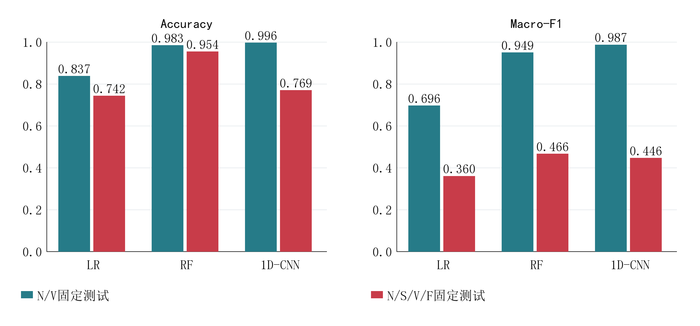

表5-2给出两类Precision和Recall。逻辑回归V类Recall达到0.9044，但Precision仅0.3352，意味着较多N心拍被报为V；因此不能只依据较高召回率认定其分类可靠。随机森林的V类Precision提高到0.8759，Recall为0.9423，在当前测试集上，随机森林相较逻辑回归减少了N→V误报，同时仍存在V→N漏分。CNN在两项指标间取得较好平衡，V类Precision为0.9607、Recall为0.9905。

表5-2 N/V测试集逐类Precision与Recall

| 模型 | N Precision | N Recall | V Precision | V Recall |
|---|---|---|---|---|
| 逻辑回归 | 0.9892 | 0.8306 | 0.3352 | 0.9044 |
| 随机森林 | 0.9945 | 0.9874 | 0.8759 | 0.9423 |
| 一维CNN | 0.9991 | 0.9962 | 0.9607 | 0.9905 |

图5-2中CNN正确识别12240拍N和1150拍V，N→V为47拍，V→N为11拍，共58次错误。两个方向的绝对数量与相对比例含义不同：N类基数更大，误报47拍仍对应较低的N类错误率；V类11拍漏分对应约0.95%的实际V心拍。本文没有根据这组错误调整阈值，也没有给这些数据库标签赋予临床处置优先级。

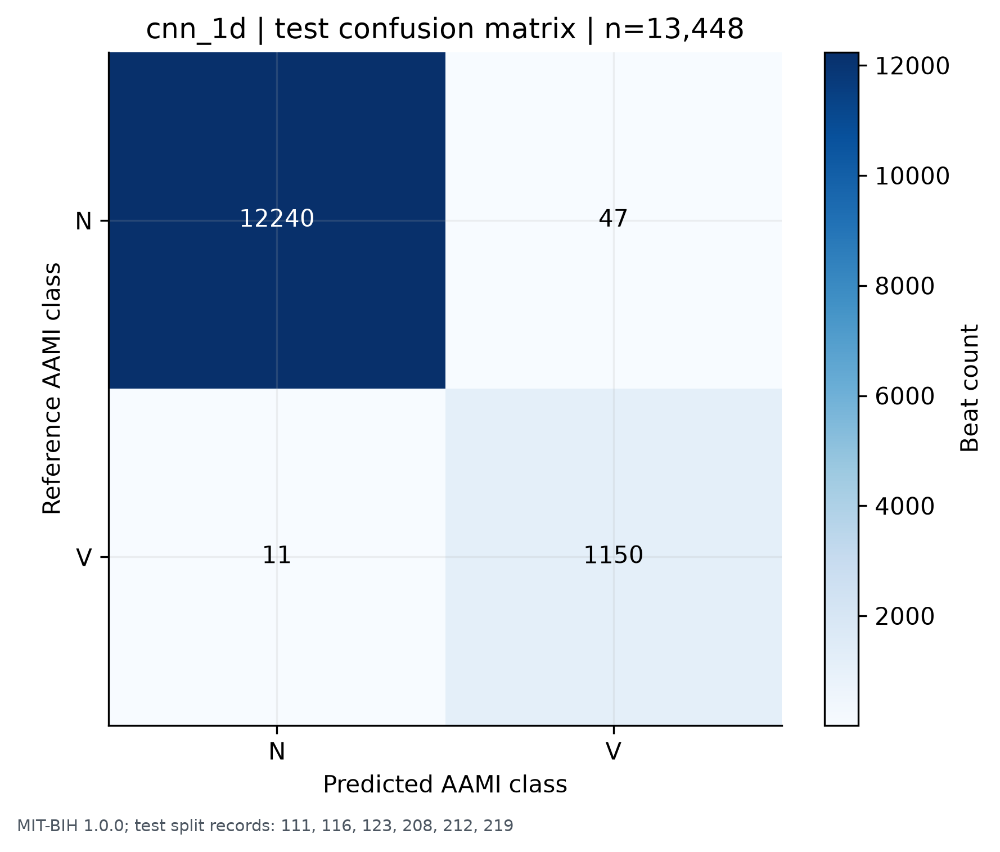

CNN相对随机森林的Accuracy提高约1.22个百分点，Macro-F1提高约0.0371。该差异仅是当前固定分区下的观测值；同一患者的心拍具有相关性，本文没有将13448拍视为独立患者样本进行显著性检验。也没有通过多随机种子重复训练给出置信区间，因此结论应限定为本次保存实验中的比较。验证侧与测试侧的差异进一步在5.1.1节按患者来源分析。

### 5.1.1 验证集与测试集结果差异讨论

表5-3汇总两分区的逐类指标。为分析N/V CNN验证Macro-F1为0.6630、测试为0.9865的差异，本文回顾既有两份逐拍预测，并核对标签、模型与计算约定。两者均采用N=0、V=1的类别顺序、相同AAMI映射和固定二类Macro-F1；预处理配置及训练集归一化参数一致。训练记录与检查点均指向第12轮，当前最佳与最终最佳检查点的全部参数张量一致，生成程序也对同一最佳模型对象分别保存验证和测试预测。CSV未记录检查点哈希，因此这些交叉证据支持结果可比，但不能仅据文件完全重建历史运行过程。

验证集包含11854拍N、1069拍V，测试集分别为12287和1161拍，V占比约8.27%与8.63%，这一接近的频率不足以解释指标差距。验证V的Precision为0.2905、Recall为0.9616、F1为0.4462；测试相应为0.9607、0.9905和0.9754。主要差别是验证N→V为2511拍，而测试仅47拍；验证与测试V→N分别为41与11拍。验证N→V中2477拍来自患者109，占98.65%；该患者2478拍N仅1拍判对，其他验证患者未呈现同等规模的误报。因此较低验证分数具有明确的患者集中现象，不能笼统归因为V类召回不足。

两分区各有6个患者组，但有真实V的患者分别为4与5个；验证V的77.17%来自患者233，测试V的84.84%来自患者208。大量相关心拍会提高某一患者对按拍汇总指标的影响，且V支持仅1拍或3拍的患者不能提供稳定的逐患者召回估计。上述统计说明患者组成需要纳入差异解释，尚不能证明记录109的具体失误由何种形态、噪声或模型机制引起，也不能据分数反差直接认定过拟合、数据泄漏或模型随时间退化。本分析未改变阈值、模型或划分，属于已存在数据的回顾性诊断，仍需新的患者来源和独立验证检验稳定性。

表5-3 N/V CNN验证与测试逐类指标对比

| 分区 | 类别 | 支持拍数 | Precision | Recall | F1 |
|---|---|---|---|---|---|
| 验证 | N | 11854 | 0.9956 | 0.7882 | 0.8798 |
| 验证 | V | 1069 | 0.2905 | 0.9616 | 0.4462 |
| 测试 | N | 12287 | 0.9991 | 0.9962 | 0.9976 |
| 测试 | V | 1161 | 0.9607 | 0.9905 | 0.9754 |

图5-3将患者真实V支持与N→V误分率并列展示。患者109的误分率为2477/2478，而患者111只有1拍真实V，其V召回即使达到1/1也不能视为稳定估计。完整12名患者的P/R/F1、支持数及错误方向保留于本轮核验表；图中不把没有V的患者填成V召回为0。

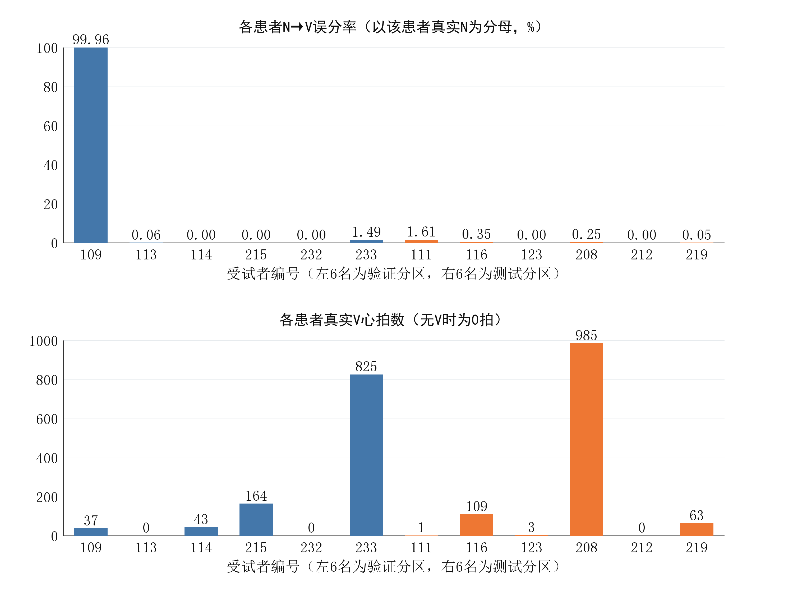

数据完整性复验核对全部样本编号、原符号、映射标签、采样位置、导联及数组行次；训练、验证和测试的患者、记录及样本编号集合互斥，同记录跨分区重叠窗口计数为0。滤波后mV窗口及归一化窗口的规范字节哈希均未发现跨分区精确重复。该检查不能穷举不同患者之间的近似形态，也不把形态相似直接当作同源泄漏。当前生产工件在eval模式下重新推理，支持原N/V验证与测试指标复现；没有通过修改分区、标签或剔除患者109来消除差异。历史CSV缺少检查点哈希，故仍不能完整重建最初的全部选择历史。

## 5.2 N/S/V/F四分类结果

表5-4显示，四分类随机森林以0.9536的Accuracy高于CNN的0.7690，Macro-F1也以0.4656高于CNN的0.4460。CNN没有在四分类上保持全面优势。测试集S仅10拍，F为371拍，而N仍为12287拍；总体Accuracy可主要由N类表现支撑，故需要同时查看每类结果。

表5-4 四分类固定测试集总体指标与逐类F1

| 模型 | Accuracy | Macro-F1 | N F1 | S F1 | V F1 | F F1 |
|---|---|---|---|---|---|---|
| 逻辑回归 | 0.7423 | 0.3599 | 0.8528 | 0.0083 | 0.4952 | 0.0833 |
| 随机森林 | 0.9536 | 0.4656 | 0.9800 | 0.0000 | 0.8825 | 0.0000 |
| 一维CNN | 0.7690 | 0.4460 | 0.8621 | 0.0000 | 0.9179 | 0.0039 |

随机森林的S、F类F1均为0，说明较高总体准确率与稀有类别识别不足可以同时出现。CNN的V类Recall为0.9914，但S类Recall为0，F类仅正确1拍，Recall为0.0027。其N类Recall降为0.7718，2626拍N被分到S。它预测S共2630拍却未正确识别真实S，并不能因输出了较多少数类标签，就认为少数类识别得到了改善。

逻辑回归正确找回6/10拍S，Recall为0.6000，但S类Precision仅0.0042，对应大量其他心拍被误报为S。因此极少数真实正例上的Recall尤其需要与误报规模及患者来源并读。F类融合形态及短窗上下文不足可以作为后续研究问题，但现有预测本身不能证明某种特定生理机制导致了这些错误。

## 5.3 类别不平衡与患者集中度

总体统计显示，F类800拍由16个受试者提供，其中最大来源患者贡献46.25%，前三名贡献93.25%。训练分区F仅411拍，由10名患者提供，其中患者213贡献88.08%；测试分区371拍F中370拍来自患者208，占99.73%。因此看似数百次的F类测试，实质上主要反映一个患者的心拍形态，不能代表稳定的跨患者F泛化估计。

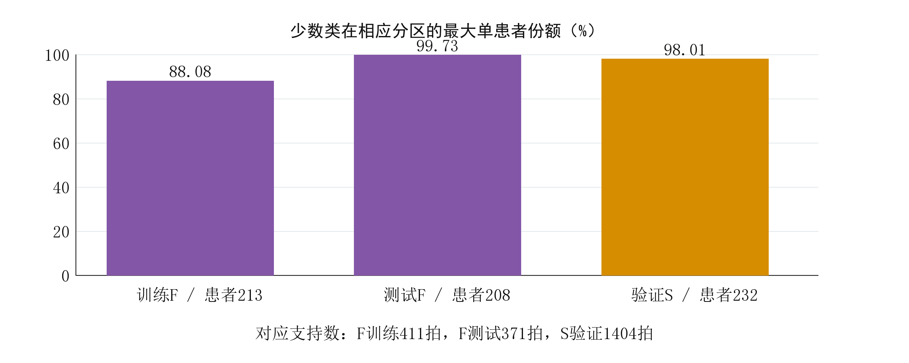

图5-4进一步展示关键分区的集中现象。S类验证集虽有1404拍，却有98.01%来自患者232；测试S仅来自3名患者、共10拍。这种分布使验证侧选择可能受到特定患者支配，并使测试召回率对少数单拍变化敏感。既有按心拍权重调整并未增加形态来源的多样性，也未保证每个分区都有充分患者覆盖。

项目曾修正类别级subject_count与record_count的派生统计错误。本次核验以逐拍metadata重新聚合患者数，确认N/V训练V类实际覆盖23名患者、24条记录，而非整个训练分区的31名患者、32条记录。该修正改变的是描述统计，不改变原始样本、标签、模型和预测，不能被解释为模型性能提升。

## 5.4 类别权重消融

表5-5与图5-5展示既有CNN训练实验的验证侧结果。无权重时，验证Accuracy为0.8519，Macro-F1为0.3914，S/F预测占比均为0。完整逆频率权重使S类Recall提高至0.9309，但S类Precision为0.4693；F类Recall为0.1111，Precision仅0.0036。少数类被找回的比例提高，同时也带来更多错误预测，不能把权重作用概括为所有指标同步改善。

表5-5 CNN权重策略的验证集结果

| 权重方案 | Accuracy | Macro-F1 | S Recall | F Recall | N Recall |
|---|---|---|---|---|---|
| 无权重 | 0.8519 | 0.3914 | 0.0000 | 0.0000 | 0.9760 |
| 平方根平滑 | 0.8335 | 0.3962 | 0.0000 | 0.1111 | 0.9490 |
| 截断逆频率 | 0.6590 | 0.4138 | 0.6980 | 0.0000 | 0.6313 |
| 完整逆频率 | 0.7185 | 0.4735 | 0.9309 | 0.1111 | 0.6897 |

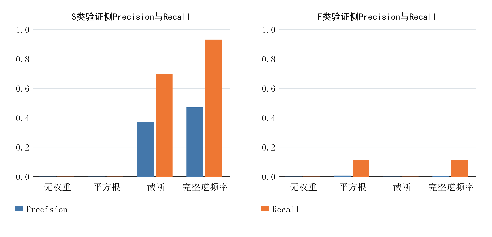

平方根平滑策略的验证Macro-F1约0.396，F类Precision约0.006，仍未解决S类预测缺失；截断策略的Macro-F1约0.414，也不优于完整逆频率的约0.473。完整逆频率在当前验证对照中的Macro-F1最高，但同一验证集参与早停，故该排序具有探索性。不能据此把它推广为其他患者、其他随机种子或其他数据集上的最优策略。

传统模型的既有加权与无权重比较呈现不同模式：随机森林验证Macro-F1分别约0.402与0.409，权重没有带来相同的收益；逻辑回归加权后Recall、Precision与总体表现也有不同取舍。这说明权重效果与模型决策方式共同作用。当前证据支持“权重改变了预测分布”的描述，尚不足以把四分类失效完全归因为单一权重设置。

## 5.5 患者级泛化与折间波动

五折分析汇总见表5-6，标准差使用五个折结果的样本标准差，不能解释为标准误或置信区间。随机森林平均Macro-F1为0.4173，CNN为0.3564，逻辑回归为0.3047；图5-6中CNN的折间变化较大。CNN的Accuracy标准差约0.187，而随机森林约0.033，提示前者对当前患者组成更敏感。

表5-6 四分类探索性受试者分组五折结果

| 模型 | Accuracy 均值±标准差 | Macro-F1 均值±标准差 | 合并折外Macro-F1 |
|---|---|---|---|
| 逻辑回归 | 0.6038±0.0908 | 0.3047±0.0377 | 0.2931 |
| 随机森林 | 0.9011±0.0332 | 0.4173±0.0424 | 0.4054 |
| 一维CNN | 0.6418±0.1870 | 0.3564±0.0624 | 0.3535 |

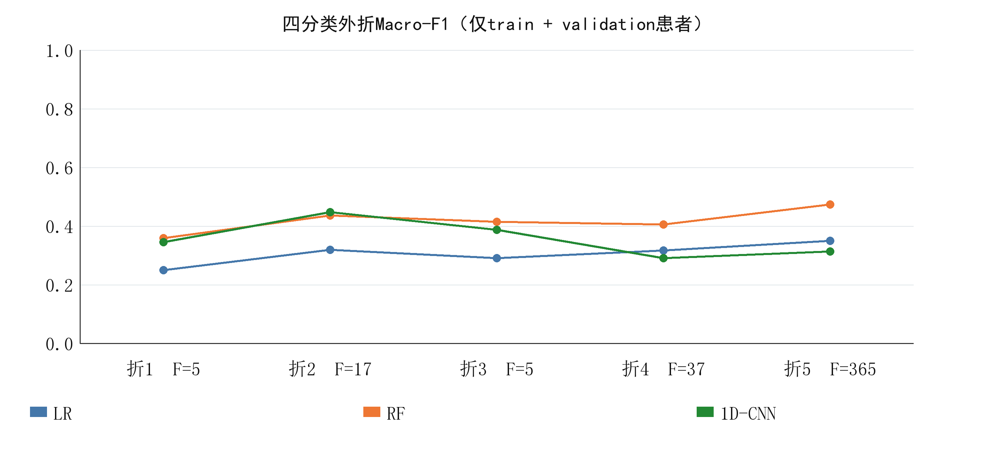

按拍汇总与逐患者平均也不等价：前者使心拍多的患者权重更大，后者需事先规定缺类患者如何处理。本文正式表格报告的是各折按拍Macro-F1，再对五折求均值，不是对37名患者F1的简单平均。五折均值与合并全部折外预测后计算的Macro-F1并不相同，因为F1是非线性汇总，而且各折支持数与类别构成不同。正式固定测试集与这组CV使用的患者集合也不同，因此不宜把两者的差值直接当成时间上的性能退化。相同的是，两种分析都提示S/F的跨患者识别仍不足。

CV的86286拍仅来自37个训练加验证患者组，其中F总计429拍。五个外折的F真实支持分别为5、17、5、37和365拍，折间指标同时受到患者构成与少数类支持变化影响。随机森林的F类平均Recall为0，CNN约0.0632。分组评估阻断了同一患者直接跨越训练和评估两侧，但无法补足稀有类别来源不足，也无法消除既有模型设定的选择历史。本文据此将结果用于稳定性诊断，而不宣称完成了临床外部验证。

## 5.6 错误样本分析

图5-7从已保存的四分类测试预测中精选N→S、F→N、F→V及V→N各一个案例，按各错误方向内预测类别置信度的中位附近选择，不代表随机样本。曲线读取对应NPZ的滤波后mV信号，横轴以专家标注为零点，标题给出记录及原始采样位置，完整样本编号由元数据追溯。

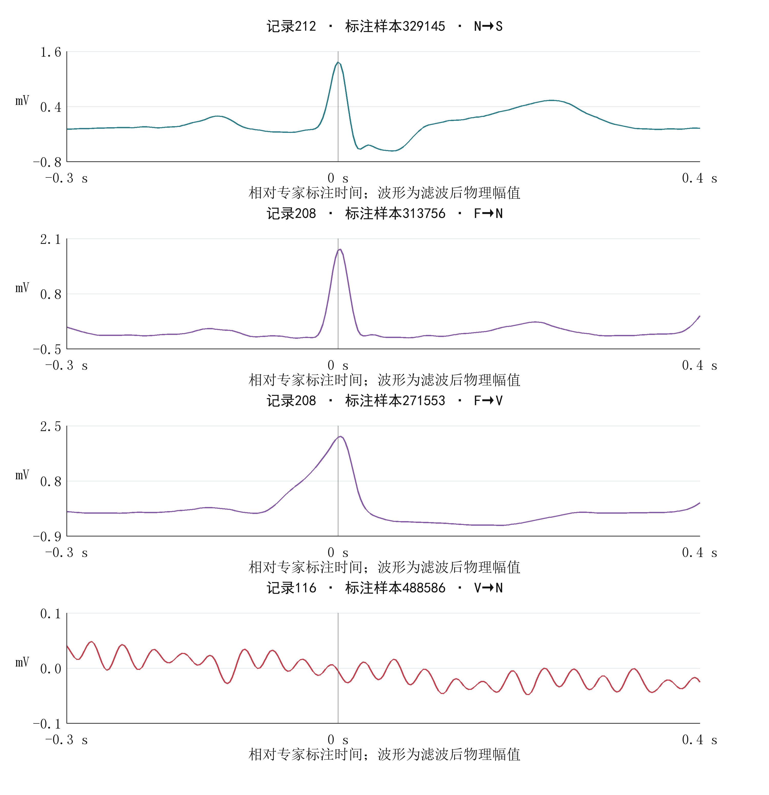

记录212在采样点329145（914.292 s）的心拍原始符号为R，经映射属N，却被预测为S。这提示N组内部包含束支阻滞等不同符号，不能将N→S一律解释为健康心拍误报。记录208在313756（871.544 s）处为F→N，在271553（754.314 s）处为F→V；两例展示同一患者F心拍的不同误分方向。记录116在488586（1357.183 s）处为V→N，提示高V总体召回仍可包含局部漏分。

这些观察支持对错误类别和数据来源的复核，但没有完成临床专家盲评、特征遮挡或因果归因，不能仅由局部形态断言网络使用了特定P波或QRS规则。四分类F→N和F→V分别为216、154拍，且F测试几乎由患者208提供；病例与分布应结合解读。二分类模型的47拍N→V和11拍V→N属于另一标签任务，不能被四分类图例替代。错误案例仅用于描述性复核，没有用它们调整阈值或重新选择原检查点。

## 5.7 实验结果综合讨论

线性模型、树集成与卷积网络对输入关系采用不同假设：逻辑回归在波形向量上建立线性边界，随机森林表达分段非线性关系，CNN共享局部时序卷积参数。当前固定划分下，CNN在N/V任务中获得较好的按拍汇总结果，但扩展为四分类后，优势没有继续保持。变化同时涉及标签边界、各类支持、患者来源及训练权重，现有对照不能把结果归因于单一因素。总体Accuracy容易受N类支撑，Macro-F1则暴露了稀有类F1接近零的情况，两者分别回答不同问题。

患者集中现象使大量相关心拍不能等同于大量独立患者证据。验证N→V主要集中在患者109、测试F几乎来自患者208，均说明按拍指标可能被少数来源主导；这并未证明模型记忆患者身份。权重改变了各类损失贡献与预测分布，但没有增加新的患者或节律上下文。探索性CV进一步揭示折间波动，仍不能替代外部数据。因而本研究支持既定数据库和协议下的模型比较及工程复现，并为进一步独立验证提出具体问题。

## 5.8 多种子受控改进实验

新增12组训练均按3.5节预声明方案完成。Balanced Accuracy定义为四个固定类别Recall的等权均值；表中均值及样本标准差由三个随机种子计算，既不是患者间标准差，也不是置信区间。原表5-1—表5-6保留历史实验口径，新增ce_inverse是同方法多种子重训，不能与历史单次训练混写为同一结果。

表5-7 新训练四方案的三种子总体结果

| 方案 | 分区 | Accuracy | Macro-F1 | Balanced Accuracy |
|---|---|---|---|---|
| 逆频率CE | 验证 | 0.6441±0.0609 | 0.4806±0.0651 | 0.5947±0.0227 |
| 逆频率CE | 旧测试 | 0.7946±0.0607 | 0.4670±0.0210 | 0.4940±0.0455 |
| 平方根CE | 验证 | 0.8427±0.0085 | 0.3911±0.0042 | 0.4121±0.0154 |
| 平方根CE | 旧测试 | 0.9691±0.0008 | 0.4841±0.0011 | 0.4954±0.0010 |
| 平方根Focal | 验证 | 0.8399±0.0151 | 0.3937±0.0102 | 0.4084±0.0158 |
| 平方根Focal | 旧测试 | 0.9648±0.0043 | 0.4769±0.0048 | 0.4833±0.0108 |
| 平方根Focal＋RR分支 | 验证 | 0.9014±0.0101 | 0.6047±0.0060 | 0.5849±0.0146 |
| 平方根Focal＋RR分支 | 旧测试 | 0.9584±0.0046 | 0.5002±0.0036 | 0.6056±0.0169 |

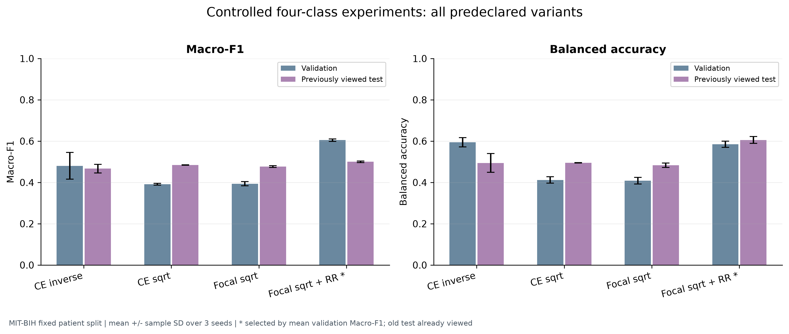

验证均值预先选定的方案为平方根Focal＋RR分支（focal_sqrt_rr），其验证Macro-F1为0.6047±0.0060，旧测试Macro-F1为0.5002±0.0036。相对本轮逆频率CE基线，旧测试Macro-F1均值变化为+0.0332，Accuracy变化为+0.1639。此处报告验证选型后的观察，不依据测试表重排优胜方案，也不将新方案直接替换到生产模型注册表。

表5-8 新训练方案的测试侧逐类结果

| 方案 | S Recall / F1 | F Recall / F1 | V Recall / F1 |
|---|---|---|---|
| 逆频率CE | 0.0667±0.1155 / 0.0006±0.0010 | 0.1276±0.1159 / 0.0637±0.0518 | 0.9842±0.0090 / 0.9253±0.0061 |
| 平方根CE | 0.0000±0.0000 / 0.0000±0.0000 | 0.0027±0.0047 / 0.0050±0.0086 | 0.9808±0.0081 / 0.9445±0.0140 |
| 平方根Focal | 0.0000±0.0000 / 0.0000±0.0000 | 0.0036±0.0062 / 0.0055±0.0095 | 0.9320±0.0450 / 0.9149±0.0233 |
| 平方根Focal＋RR分支 | 0.4333±0.0577 / 0.0457±0.0083 | 0.0108±0.0140 / 0.0207±0.0266 | 0.9940±0.0030 / 0.9538±0.0054 |

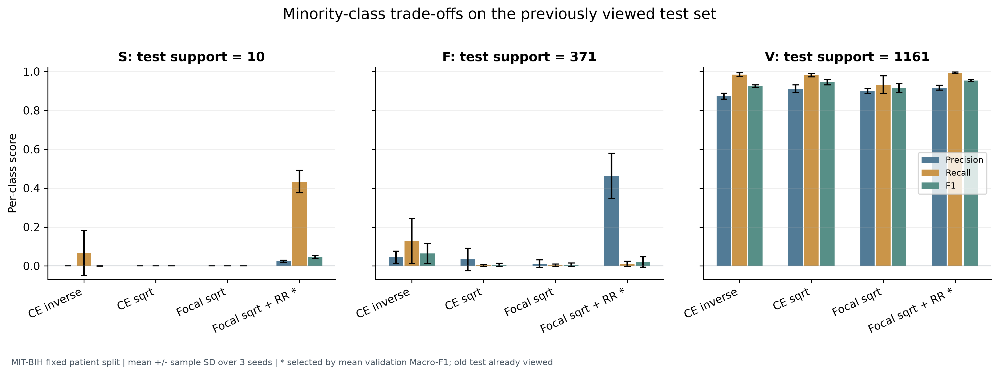

所选方案在旧测试侧S类Precision、Recall、F1均值分别为0.0242、0.4333、0.0457，F类分别为0.4630、0.0108、0.0207，V类Recall与F1为0.9940和0.9538。召回上升与误报增加可以同时发生，因此这些结果须与总体Accuracy和逐类Precision共同解释。三个种子仍共享相同心拍和六个测试患者，不等于三批独立患者证据。

与新训练逆频率CE相比，所选方案的S类F1从0.0006升至0.0457，但F类Recall从0.1276降至0.0108，F1从0.0637降至0.0207。因此本轮没有实现S与F同时改善；F类Precision较高仍伴随大部分真实F被漏分。新增策略的实际收益主要体现在S、V和总体指标的组合变化，不能宣称已解决融合心拍识别。相对于仅改变Focal调制的方案，RR分支组合在本分区的整体表现较好，仍需与其额外参数和患者来源一同解释。

相邻方案分别比较权重平滑、Focal调制及RR分支组合，图5-10以相同种子的成对差值展示变化；负值同样保留。前两组在波形结构不变时更接近损失因素对照，RR组则同时改变输入信息和参数量。研究问题是这些改动如何影响少数类识别与误报，而非通过大量方案搜索最高测试分数。

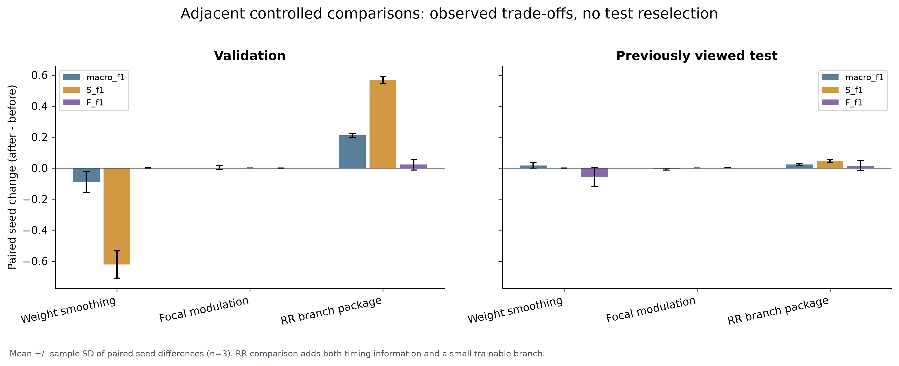

本轮没有删除困难患者或修改S/F标签。验证S高度集中于患者232，旧测试S仅10拍、来自3个患者，F的371拍中370拍来自患者208；损失函数与RR上下文均不能增加独立形态来源。即使某项均值上升，患者组成的限制仍然存在。新增对照支持比较当前固定条件下的训练策略，不能据此认定已经解决少数类的临床泛化问题。

## 5.9 真实模型的梯度归因分析

采用Integrated Gradients对真实CNN的预测类别logit进行输入归因[13]。该方法沿参考输入到实际输入的路径累计梯度；本项目以归一化波形零输入和标准化RR零输入作为参考，分别对应训练均值，并非生理正常心拍模板。使用验证选定方案focal_sqrt_rr，从三个种子中取验证排序居中的20261117，再取验证集每个真实类别的中间位置样本，共4例，不按测试表现筛选。图5-11的波形及波形/RR归因均来自实际前向与梯度计算，样本来源、目标类别与检查点哈希由清单记录。

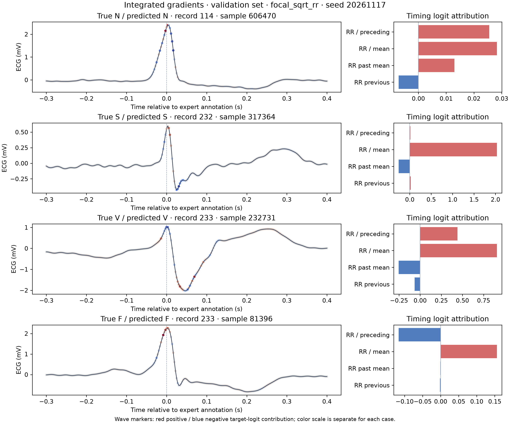

数值积分采用128步，并保存64步到128步的波形归因变化。四例的完整性最大绝对误差为0.003493、最大相对误差为0.001663，用于检查近似积分的一致性，不是分类性能指标。归因值描述给定模型、参考输入和目标输出的局部数值关系，可能随参考基线和目标类别变化。某个时间区间贡献较大，不足以证明模型具有医学知识，也不等于该区间具备因果诊断意义。RR分支方案还包含波形以外的输入，单看波形归因不能解释全部决策。归因用于定位值得复核的区域，并补充定量错误分析；本研究没有以归因图片代替分类指标，也没有宣称模型经专家验证地识别了P波或QRS机制。

# 第6章 ECG-AI系统设计与实现

## 6.1 系统总体架构

系统前端使用React与TypeScript，通过Umi组织路由，Ant Design提供交互组件，ECharts绘制信号与结果图，Motion负责界面动效。FastAPI接收浏览器请求，并按职责调用数据读取、模型推理、科研结果和互动教学模块。ECGStore从本地WFDB记录读取真实物理信号与专家标注，同时读取处理配置、受试者划分和训练集归一化参数。InferenceService负责组织选拍、输入构建及预测；Model Registry读取已有六个模型工件，核对输入维度与类别次序，再执行指定模型的推理。接口将类别、逐类分数、工件哈希及数据来源返回前端。

科研结果展示与请求内推理使用不同的数据路径。实验中心、错误分析及图库通过research模块读取保存的指标表、逐拍预测和图像；这些历史预测CSV不代替单心拍推理。互动教学模块读取独立的真实关卡索引，通过ECGStore取得历史信号，以专家标注进行结算，并用SQLite保存匿名会话。游戏分数不进入分类模型的输入。模型推理和科研展示不反向写入原始ECG、训练权重或正式实验结果。

图6-1区分请求调用、标准化输入和文件读取。InferenceService承担推理编排，ECGStore提供信号与窗口，模型注册模块只读装载工件；科研图表沿独立的历史结果路径提供。

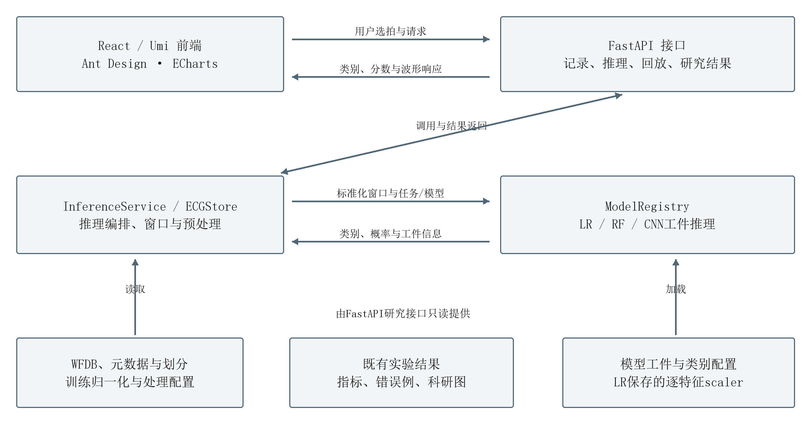

## 6.2 真实心拍推理流程与界面

用户首先选择记录、分类任务和专家标注位置。GET /api/ecg/window读取选定时间窗，GET /api/ecg/annotations返回该范围的专家标注；局部心拍由GET /api/ecg/beat展示。实际预测使用POST /api/inference/beat，参数为记录编号、专家采样点、任务与模型标识。服务先确认记录属于允许列表，推理时进一步要求记录纳入当前44记录实验且导联为MLII；不把任意文件路径或任意未标注采样点作为合法模型请求。

ECGStore复用保存配置中的连续带通滤波，对专家采样点前108点、后144点及中心点组成的253点窗口检查边界、有限值、平坦段与滤波保护区。任务对应归一化参数仅由训练集拟合。LR另应用保存的逐维StandardScaler，RF不增加训练时不存在的缩放，CNN将输入组织为1×1×253的张量，以CPU推理。模型注册模块在应用启动或首次使用时加载工件，后续复用内存对象。专家类别用于回顾性对照，不加入波形输入特征。

预测响应包含predicted_class、class_probabilities、model_sha256、preprocessing_version及记录和采样点等字段。POST /api/inference/compare对同一标准化窗口依次执行三个模型；/api/inference/batch和/api/ecg/playback/segment用于有限批量和历史片段回放，最大处理128个标注位置。前端把返回结果与真实波形关联展示。该流程仍以专家标注中心为前提，离线双向滤波和历史回放也不等同于实时采集监护。

图6-2放大工作台中的实际波形和标注，图6-3集中展示同一心拍的三个真实模型输出。用户可以比较预测是否一致，专家标签仍是回顾性对照依据；单拍模型分数不代表总体性能。

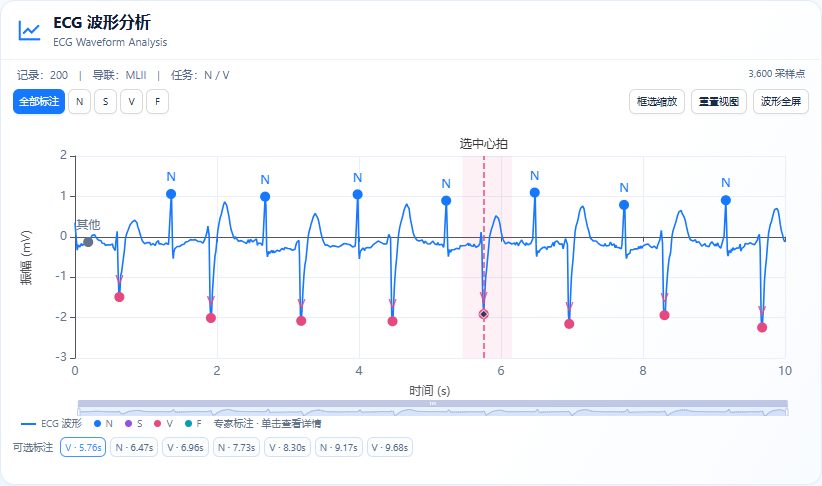

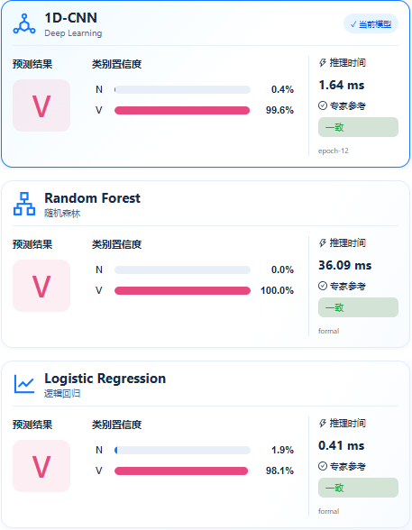

图6-2和图6-3来自2026年11月4日的真实浏览器页面，其中图6-3仅重排结果卡片便于阅读，未重绘波形或修改预测值；最终验收页面另在6.3节展示。

## 6.3 功能实现与验证

软件验证覆盖真实数据读取、模型预处理、推理、错误定位、报告导出及异常反馈。原58项Python测试全部保留，新增完整性、损失、RR时序、归因、报告及健康检查回归后共73项通过，前端类型检查与生产构建通过。生产构建在Chrome完成11项流程检查，包括真实游戏开局，未出现页面异常。新增导出接口重新运行原三模型，并保存当前心拍、专家标注、逐类分数、模型与输入来源哈希；模型未全部就绪时健康接口返回503。公网直连的波形、实际推理及三模型比较也已验证，当前公网仍运行既有版本，新增导出与健康修复尚未远程发布。上述软件验证不等于医学泛化或教学效果验证。

表6-1 系统功能与最终实际验证

| 检查项目 | 实际结果 | 证据 |
|---|---|---|
| Python回归 | 73项通过，含原58项 | final_tests.log；数据、训练机制、接口、游戏和部署更新规则 |
| 前端检查 | 类型检查及生产构建通过 | typecheck.log；frontend_build.log |
| 真实浏览器流程 | 11项流程检查通过，页面异常0 | demo_20261117/acceptance.json；生产构建、隔离游戏数据库 |
| 报告导出 | 真实JSON下载及模型/专家/输入来源核对通过 | report_export_success.png与实际下载文件 |
| 异常与健康状态 | 导出失败可反馈重试；六模型未齐时503 | 受控故障注入；health_before.log与修复后73项回归 |
| 公网直连 | 网页、健康、真实推理及三模型比较通过 | public_probe.json；public_browser.json；配置网络出口502，直连200 |

软件测试验证文件读取、接口行为与预期交互；模型对新患者的有效性仍需单独的统计与医学评价。前端构建成功和接口返回正常，不等于已经验证临床适用性。

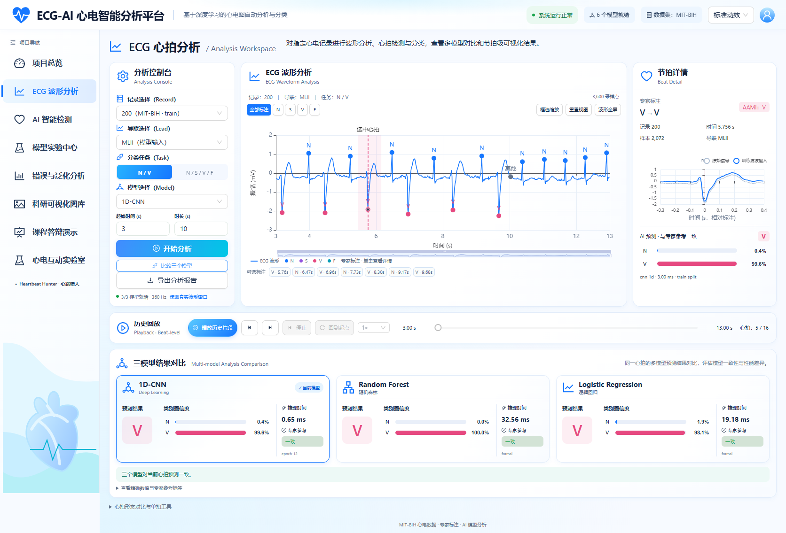

图中显示实际运行页面，模型输出与对应工件一致。

## 6.4 模型部署一致性

部署一致性对照来自phase3_validation保存记录，结果见表6-2。六组每组100次对照，预测类别均一致，输入最大绝对差均为0。

表6-2 部署与保存预测的一致性分组结果

| 任务 | 模型 | 验证心拍| 类别相同 | 最大概率绝对差 |
|---|---|---:|---:|---:|
| N/V | LR | 100 | 100/100 | 2.9802×10⁻⁷ |
| N/V | RF | 100 | 100/100 | 2.2204×10⁻¹⁶ |
| N/V | CNN | 100 | 100/100 | 1.6295×10⁻⁷ |
| N/S/V/F | LR | 100 | 100/100 | 4.7684×10⁻⁷ |
| N/S/V/F | RF | 100 | 100/100 | 2.2204×10⁻¹⁶ |
| N/S/V/F | CNN | 100 | 100/100 | 3.2846×10⁻⁷ |

两任务分别使用100条心拍，三模型复用同一任务样本，因此合计200个任务内样本条目；跨任务去重后为143个心拍位置（57个位置重合），而非200个独立来源或600个不同心拍。N/V抽样为N=50、V=50；四分类为N=32、S=25、V=25、F=18。当前六模型工件的SHA-256仍与该验证汇总一致。此项对照验证部署路径复现了同一模型的历史预测，不能称作分类准确率100%，也不构成新的独立分类性能或临床验证。

## 6.5 互动教学模块

Heartbeat Hunter使用记录100、105、106、108、109、114的真实MIT-BIH MLII信号，360 Hz；关卡索引含原始文件哈希和专家采样点。现有索引共62个窗口，新手、标准、挑战分别为21、21、20关。片段只保留N/V可判定内容，排除S/F/Q、未知心拍及不安全区。用户寻找V组心拍，服务端按±0.10 s容差与专家位置作一对一匹配，正确选择、误选和漏选分别计分，并结合连击和限定条件下的时间奖励形成教学反馈。专家答案在结算后揭示，随后可查看局部波形并跳转至同一心拍的真实模型推理。

欢迎引导和首次教程用于说明操作，读取教程不会自动开始计时；欢迎中的SVG明确标为视觉示意，不能作为真实ECG结果。界面动效支持减少动态效果。游戏评分仅描述当前规则下的选拍表现，未开展学习效果用户研究，不能声称已显著提升学习效果，更不能将其换算为医学诊断能力。关卡筛选与历史平台可查阅标注的条件，也不同于未知患者的独立测验。

# 结论

本项目围绕MIT-BIH单导联专家标注心拍，完成数据处理、模型对照、患者来源分析和ECG-AI教学系统整合。原患者独立N/V测试中，CNN的Accuracy为0.9957、Macro-F1为0.9865；验证Macro-F1仅0.6630的差异在重新推理后仍存在，且验证误报集中于患者109。数据与工件复核支持结果一致性，没有发现已检查范围内的跨分区同源窗口或精确波形重复；这不等于证明所有潜在泄漏与历史选择偏倚均不存在。四分类中随机森林总体指标较高，但S/F识别不足，说明总体准确率不能替代逐类能力判断。

新增四方案、三种子的受控实验保留全部分区和标签，并在最终测试阶段前锁定验证选型。选定平方根Focal＋RR分支的验证及旧测试Macro-F1分别为0.6047±0.0060和0.5002±0.0036。其逐类变化、整体误报和种子波动均完整报告，不以单个最好种子或召回率替代总体证据。过去RR分支和损失对照扩大了研究问题，真实梯度归因补充了错误观察；二者都不构成新医学机制的证明。系统贡献是将真实信号、专家标签、模型推理、错误反馈与教学互动贯通，生产六模型与探索性新模型分开保存。

研究仍受限于单一历史数据库、六个固定测试患者及S/F患者来源集中。三个随机种子反映训练随机性，不能增加独立患者证据；旧测试复用不是新的外部盲测。模型依赖专家位置、离线双向滤波，尚未完成自动定位误差、临床校准、前瞻性验证或教学效果用户研究。后续应在新增患者来源上预先冻结评估方案，单独评价自动R峰定位及节律上下文的贡献，再考虑模型部署与概率校准。现有成果适合课程实验和教学展示，不能输出临床诊断结论。

# 参考文献

[1] MOODY G B, MARK R G. The impact of the MIT-BIH Arrhythmia Database[J]. IEEE Engineering in Medicine and Biology Magazine, 2001, 20(3): 45-50. DOI: 10.1109/51.932724.

[2] GOLDBERGER A L, AMARAL L A N, GLASS L, et al. PhysioBank, PhysioToolkit, and PhysioNet: components of a new research resource for complex physiologic signals[J]. Circulation, 2000, 101(23): e215-e220. DOI: 10.1161/01.CIR.101.23.e215.

[3] MOODY G, MARK R. MIT-BIH Arrhythmia Database version 1.0.0[DB/OL]. PhysioNet, 2005[2026-11-05]. https://physionet.org/content/mitdb/1.0.0/. DOI: 10.13026/C2F305.

[4] DE CHAZAL P, O'DWYER M, REILLY R B. Automatic classification of heartbeats using ECG morphology and heartbeat interval features[J]. IEEE Transactions on Biomedical Engineering, 2004, 51(7): 1196-1206. DOI: 10.1109/TBME.2004.827359.

[5] BREIMAN L. Random forests[J]. Machine Learning, 2001, 45(1): 5-32. DOI: 10.1023/A:1010933404324.

[6] KIRANYAZ S, INCE T, GABBOUJ M. Real-time patient-specific ECG classification by 1-D convolutional neural networks[J]. IEEE Transactions on Biomedical Engineering, 2016, 63(3): 664-675. DOI: 10.1109/TBME.2015.2468589.

[7] ACHARYA U R, OH S L, HAGIWARA Y, et al. A deep convolutional neural network model to classify heartbeats[J]. Computers in Biology and Medicine, 2017, 89: 389-396. DOI: 10.1016/j.compbiomed.2017.08.022.

[8] MONDÉJAR-GUERRA V, NOVO J, ROUCO J, et al. Heartbeat classification fusing temporal and morphological information of ECGs via ensemble of classifiers[J]. Biomedical Signal Processing and Control, 2019, 47: 41-48. DOI: 10.1016/j.bspc.2018.08.007.

[9] CHAWLA N V, BOWYER K W, HALL L O, et al. SMOTE: synthetic minority over-sampling technique[J]. Journal of Artificial Intelligence Research, 2002, 16: 321-357. DOI: 10.1613/jair.953.

[10] OLIVEIRA R F, MOREIRA G J P, FREITAS V L S, et al. Leveraging visibility graphs for enhanced arrhythmia classification with graph convolutional networks[EB/OL]. arXiv预印本, 2024[2026-11-16]. https://arxiv.org/abs/2404.15367v2.

[11] CHEN M, LI Y, SHI W, et al. Attention-enhanced convolutional neural network for inter-patient classification of premature ventricular contraction from ECG[C]//Computing in Cardiology. 2024, 51. https://cinc.org/archives/2024/pdf/CinC2024-463.pdf.

[12] LIN T Y, GOYAL P, GIRSHICK R, et al. Focal loss for dense object detection[EB/OL]. arXiv预印本, 2017[2026-11-16]. https://arxiv.org/abs/1708.02002.

[13] SUNDARARAJAN M, TALY A, YAN Q. Axiomatic attribution for deep networks[C]//Proceedings of the 34th International Conference on Machine Learning. PMLR, 2017, 70: 3319-3328. https://proceedings.mlr.press/v70/sundararajan17a.html.

# 附录1 数据与复现说明

数据来源为公开的MIT-BIH Arrhythmia Database及其专家标注。项目在公开数据范围内开展算法与软件实验，没有新增受试者招募或临床干预；不据此虚构伦理审批编号。原始记录、训练配置、模型工件和逐拍预测的来源与哈希由仓库结果文件记录。原实验与新受控实验分目录保存，复现步骤见项目README和对应实验报告。

课程成果署名作者为吴江彬。AI工具用于辅助代码开发、资料整理、实验检查和论文修订；指标来自实际运行或保存预测复算，AI生成文本不作为独立实验结果。作者负责核查提交成果的数据、实现与结论。项目材料未列示专项资助或商业合作信息，本稿不据此补写未经确认的经费或利益关系。

# 致谢

感谢公开数据库和开源软件的维护者为课程实验提供数据与工具基础。相关数据、方法和软件的贡献按照实际来源标注，不将其列为本文原创算法。
