# 心拍分类与可视化系统设计

副标题：基于一维卷积网络的患者独立评估

## 摘要

本文围绕心电图标注心拍分类和课程实验展示，使用MIT-BIH心律失常数据库比较逻辑回归、随机森林与一维卷积神经网络，并开发ECG-AI可视化系统。实验排除四条含起搏心拍的记录，将保留的44条记录归为43个患者组，其中训练、验证和测试分区分别包含31、6、6个患者组。预处理程序对信号进行固定带通滤波，围绕专家标注位置截取253点窗口，归一化参数仅由训练数据估计。原N/V二分类CNN的测试Accuracy为0.9957，Macro-F1为0.9865，验证Macro-F1则为0.6630。重新推理及标签、数据对应检查支持原结果复现，验证误报主要集中于患者109。原四分类随机森林和CNN的Macro-F1分别为0.4656和0.4460，较高的总体准确率未带来可靠的S/F识别。

受控实验沿用固定患者分区，预先设定逆频率交叉熵、平方根交叉熵、Focal Loss及增加过去RR分支的四个方案，每个方案使用三个随机种子训练。实验按平均验证Macro-F1选定平方根Focal＋RR分支，其验证与旧测试Macro-F1分别为0.6047±0.0060和0.5002±0.0036。验证和测试的患者组成不同，来自同一患者的大量相关心拍不能替代独立患者证据。新策略没有使S、F同时改善，本文保留了指标上升和漏检增加的结果。旧测试集此前已被查看，新增结果属于冻结协议后的探索性复用，不属于独立盲测。真实模型的梯度归因补充了错误分析，但不能证明医学因果机制。系统连接真实波形、专家标注、三模型推理、历史回放、错误展示和教学互动，六个原生产模型独立保留。评价训练策略时，需要同时考察逐类误报、患者覆盖和训练随机性。本项目的贡献是可复现实验、受控对照和教学系统整合，结论限于既有数据库中的专家标注心拍，不构成临床诊断有效性证据。

关键词：心电图，心拍分类，类别不平衡，患者独立评估，可视化系统

## Abstract

This study addresses the classification of annotated electrocardiographic heartbeats and the presentation of reproducible course experiments. Logistic regression, random forests and a one-dimensional convolutional neural network were compared using the MIT-BIH Arrhythmia Database, and their trained artifacts were integrated into the ECG-AI visualization system. Four recordings containing paced beats were excluded. The remaining 44 recordings represented 43 patient groups, which were assigned to training, validation and test partitions containing 31, six and six groups. Fixed band-pass filtering preceded extraction of 253-sample windows around expert annotations. Normalization statistics were fitted using training data only.

The original N/V convolutional model achieved a test accuracy of 0.9957 and a macro-F1 of 0.9865, whereas its validation macro-F1 was 0.6630. Replay and correspondence checks supported reproducibility of these outputs; most validation false positives originated from patient 109. For the original four-class task, random forests and the convolutional model obtained macro-F1 values of 0.4656 and 0.4460, respectively. High overall accuracy therefore coexisted with poor recognition of the S and F classes. A controlled extension retained the same patient split and compared inverse-frequency cross-entropy, square-root-weighted cross-entropy, focal loss and a focal model with past RR context. Three predeclared random seeds were retained for every configuration. The configuration focal_sqrt_rr was locked using mean validation macro-F1 before the final evaluation stage. Its validation and previously viewed test macro-F1 values were 0.6047±0.0060 and 0.5002±0.0036, respectively, reported as mean and sample standard deviation across seeds. Patient composition differed between partitions, and correlated beats did not provide independent patient evidence. The selected extension did not improve both minority classes: improved S recognition coexisted with poorer F recall and F1 than the retrained inverse-frequency baseline. Reuse of an already inspected test set was treated as exploratory, rather than as a new blinded or external evaluation.

Integrated Gradients from actual model computations supplemented the error analysis without establishing clinical mechanisms. The application connects real waveforms, expert annotations, three-model inference, historical playback, error inspection and interactive teaching. The six original production artifacts were retained separately from the new experimental models. The findings emphasize that weighting, minority-class false positives, patient coverage and training randomness must be assessed together. The contribution is a reproducible comparison, a controlled training investigation and an integrated teaching system. The evidence applies to expert-centered beats in this database and does not establish clinical diagnostic effectiveness or reliable performance on arbitrary unannotated recordings.

Key words: electrocardiogram, heartbeat classification, class imbalance, patient-independent evaluation, visualization system

<!--TOC-->

# 第1章 绪论

## 1.1 研究背景

体表电极记录的心电图反映心脏电活动，可用于观察心律和心拍形态。长时间记录含有大量连续心拍，人工逐拍核对耗时较长。噪声、导联差异和个体差异也会增加分析难度。自动心拍分类把局部信号片段分配到预定义标签，研究者可据此整理数据、定位待复核片段，并开展信号处理与机器学习教学。MIT-BIH数据库同时提供信号和专家标注，研究者能够在相同数据基础上复查算法结果[1-3]。

传统机器学习依赖特征表达与分类器的配合，一维卷积网络则沿局部时间轴完成多层特征变换[4-6]。总体准确率较高，并不意味着模型适用于所有类别。多数类占比、同一患者心拍的相似性、少数类的患者来源，以及训练与测试的划分方式，都会影响评价结果。课程系统将真实心拍、专家标签、预测分数和错误案例对应展示，学生可以据此理解指标，并判断实验结论适用于哪些数据条件。

## 1.2 相关研究与研究定位

传统心拍分类通常先形成波形形态、心拍间期或频域描述，再由分类器建立标签边界。形态特征描述局部信号变化，RR间期则提供相邻心拍的时间关系，两者对应不同输入信息。de Chazal等将形态与间期特征用于线性判别分类，在44条非起搏记录上采用五类标签，分别使用DS1与DS2进行配置选择和最终评估[4]。该评价采用不同记录集合，患者互斥性仍需额外核查。Breiman提出的随机森林以树模型集成表达非线性关系[5]。本文采用逻辑回归和随机森林比较同一波形向量上的线性与非线性建模，未复现上述研究的全部手工特征。

一维CNN沿时间轴学习局部表示，并联合优化特征变换和分类目标。Kiranyaz等使用通用样本及患者特异标注训练各患者模型[6]，评价模型适配后的患者识别能力。这与训练时不使用测试患者标注的任务不同。Acharya等使用多层CNN识别五类心拍，比较原始不平衡数据和平衡增强条件[7]。这些模型仍依赖切拍、信号处理和标签约定，相关结果不能说明模型能够直接分析任意未标注长记录。Mondéjar-Guerra等将形态描述与RR间期用于SVM集成[8]。因此，模型比较还需要明确是否使用节律上下文。本文原CNN仅输入253点单心拍窗口，没有显式RR特征，新增RR分支单独作为受控对照。

类别不平衡和患者划分都会影响心拍分类评价。SMOTE研究指出，总体准确率可能掩盖少数类错误，并提出合成少数类样本的方法[9]。本文未使用SMOTE，而是复核已有权重对照。重采样可以改变训练分布，权重调整可以改变各类损失的贡献，但两者都不能自动增加少数类的独立患者来源。患者特异模型允许使用目标患者标注，患者独立模型则要求患者组不跨越训练与评价分区，两类结果需要分别解释。样本频率决定各类对按拍指标的影响，患者覆盖反映训练和评价包含多少独立来源。模型输出较多少数类标签，也可能同时增加误报，需要结合Precision、Recall和错误方向核对。MIT-BIH的记录201与202来自同一人[3]，因此记录不重合并不总意味着患者不重合。表1-1比较代表性研究的输入与评价条件，不对跨论文性能排名。本文按受试者分组比较已有模型，结合逐类指标、患者覆盖和分组交叉验证分析错误，并将模型整合到教学系统，不提出新的网络算法。

表1-1 代表性心拍分类研究的输入与评价条件

| 作者与年份 | 主要任务 | 使用的特征或模型 | 数据与评价协议 | 与本项目的关系 |
|---|---|---|---|---|
| de Chazal等 2004[4] | 五类心拍分类 | 形态与间期特征 线性判别 | MIT-BIH 44条非起搏记录 DS1选配置 DS2最终评估 | 参考标签分组与评估分工 本文不复现其手工特征 |
| Kiranyaz等 2016[6] | 患者特异心拍分类 | 一维CNN | MIT-BIH 通用样本与患者特异标注共同训练 | 支持局部特征学习 与本文目标患者不参与训练的设置不同 |
| Acharya等 2017[7] | 五类心拍分类 | 多层CNN | MIT-BIH 原始分布与平衡增强条件 本次未确认逐患者分区细节 | 提示输入与类别处理应明确 不认定其协议与本文相同 |
| Mondéjar-Guerra等 2019[8] | N S V F四类分类 | 形态 RR间期 SVM集成 | MIT-BIH 按文中DS1与DS2记录集合训练和测试 | 提供RR输入对照 记录分区不视为与本文患者合并规则等价 |

表中列出的条件均来自本次能够核实的资料。文献[8]的公开记录列表将201与202放在不同集合，其跨患者评价不能直接视为与本文合并同源记录的规则等价。这个差异也不足以推断该研究的全部实现方式。文献[7]的逐患者分区尚未复核，本文不将其性能与本实验横向排名。

近年来，研究者继续探索新的心拍表示和跨患者评价方法。Oliveira等采用图表示与图卷积，仍观察到类别不平衡和室上性心拍识别的困难[10]。该研究为公开预印本，本文仅用它说明研究背景，不据此排列跨论文性能。Chen等将注意力增强卷积用于跨患者室性早搏识别，并结合形态与间期信息[11]。这些研究说明节律上下文值得单独比较，但其标签、训练和评价条件与本文不同。本文据此设置过去RR输入对照，未复现这些研究的模型或性能。

## 1.3 研究目标

本文建立可追溯的心拍分类实验和展示流程，比较三种模型在相同N/V任务上的表现，并考察任务扩展为四分类后各类别的变化。实验从患者分布、权重策略和折间波动分析模型局限，系统则将保存的模型用于交互展示。研究对象限于已标注心拍，不包含任意原始ECG的自动事件发现，也不以提出新网络算法为目标。

## 1.4 主要工作

本项目完成患者分组数据集、三类模型比较和ECG-AI系统整合。实验使用逐类指标与患者来源分析N/V及四分类结果的差异，增加三随机种子的损失函数与RR上下文受控对照，并用真实梯度归因补充错误复核。系统将波形、专家标签、已保存模型和课堂互动连接起来，学生可以查看同一心拍的数据与预测。图1-1概括数据和模型流程。本项目的工作集中在实验设计、结果分析和教学工程，不提出全新的网络算法。

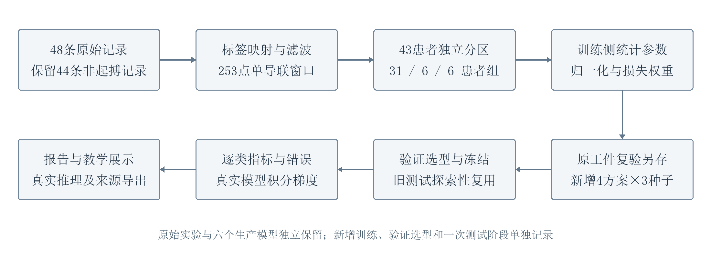

# 第2章 数据集与预处理

## 2.1 数据来源与记录选择

MIT-BIH Arrhythmia Database包含47名受试者的48段约半小时双通道动态心电记录，采样率为360 Hz，并提供经专家检查的心拍标注[1,3]。本文采用已有正式实验版本，排除102、104、107和217四条含起搏心拍记录。保留的44条记录对应43个受试者组；记录201与202来自同一受试者[3]，在代码中统一为同一分组键，不能当成两名独立患者。

原始标注、映射心拍和有效输入窗口对应不同的统计对象。模型结果表只统计满足窗口与信号有效性规则、实际进入数据集的心拍，数据构建表另列原始事件和映射阶段的数量。N/V任务保留96554拍，四分类任务保留100115拍。两项任务使用同一记录分区中的不同标签子集，并非两套独立采集队列。

## 2.2 心拍标签及任务边界

项目按大小写敏感的符号映射归并AAMI类别，具体规则参考已有研究[4]，见表2-1。N组包括正常心拍、左/右束支传导阻滞心拍和部分逸搏，因此N标签不表示受试者绝对健康。V组表示本任务中的室性异位心拍。N/V二分类只评价这两个标签的区分能力，不能代表全部心律失常或心脏疾病检测。四分类纳入N、S、V、F，Q组未进入正式分类任务，非心拍标注也不作为心拍类别。

表2-1 项目采用的AAMI类别映射

| 类别 | 原始符号 | 组别含义 |
|---|---|---|
| N | N、L、R、e、j | 正常 束支阻滞及部分逸搏心拍 |
| S | A、a、J、S | 室上性异位心拍 |
| V | V、E | 室性异位心拍 |
| F | F | 室性与正常心拍融合 |
| Q | /、f、Q | 起搏 相关融合或无法分类心拍 |

表2-2 数据构建的记录与心拍数量流程

| 构建阶段 | 记录范围 | 数量与单位 | 统计含义 |
|---|---|---|---|
| 原始记录与保留记录 | 全库→正式实验 | 48→44条；保留43受试者组 | 排除102、104、107、217；201/202同组 |
| 全部原始注释事件 | 48条 / 44条 | 112647 / 103724条 | 包含节律、质量等非心拍事件 |
| 显式AAMI映射覆盖心拍 | 48条 / 44条 | 109494 / 100733拍 | 仅N/S/V/F/Q映射符号，不等于注释事件总数 |
| N/V目标心拍 | 44条 | 97134拍 | 窗口技术排除前 |
| N/V有效窗口 | 44条 | 96554拍 | 排除540拍保护区与40拍边界不足 |
| N/S/V/F目标心拍 | 44条 | 100718拍 | 未纳入Q，窗口技术排除前 |
| N/S/V/F有效窗口 | 44条 | 100115拍 | 排除562拍保护区与41拍边界不足 |

表2-2分别统计注释事件、映射心拍和有效窗口，数量均与原始符号、逐拍元数据及校验文件交叉核对。每个有效心拍只对应一个253点窗口，窗口内的253个采样点不能计作253个独立训练样本。预处理程序对连续信号进行固定滤波，再围绕标注位置截窗。患者分区确定后，程序仅用训练窗口估计归一化参数和损失权重。固定滤波不使用标签拟合，训练统计参数也不从验证或测试数据估计。

## 2.3 信号预处理

数据构建程序优先选择MLII导联，缺少该导联时使用第一导联，并在元数据中记录。元数据核验表明，本实验全部有效输入均为MLII单导联。程序以mV读取原始信号，使用0.5—40 Hz Butterworth带通滤波。原型阶数为4，带通变换后单次滤波为8阶，程序采用二阶节前后向滤波获得零相位结果。这种处理使用未来信号，属于离线、非因果预处理。网页能够回放历史波形，并不意味着系统能够进行因果实时监护。图2-1比较滤波前后的真实信号，滤波削弱的频率成分不能直接视为病理信息。

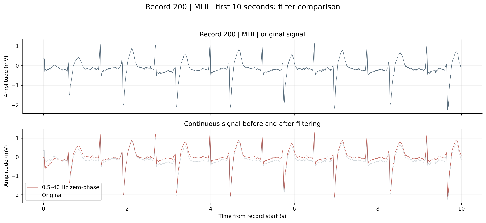

截窗程序以专家标注样本r为中心，保留前0.3 s和后0.4 s，分别对应108点与144点，加上中心点后，输入长度为108+1+144=253点，端点间隔为0.7 s。图2-2说明截取过程。每个连续有限信号段的两端设置5秒保护区。程序排除越界、落入保护区、含非有限值、平坦或目标位置重复等技术失败窗口，不根据模型预测修改专家标签，也不把质量提示转换为诊断标签。

$$ xᵢ[j] = s_f[rᵢ − 108 + j]，j = 0，…，252 （2-1）

其中s下标f表示滤波信号，rᵢ为第i个专家心拍标注的位置，j为窗口内索引。数据采用训练窗口全部数值拟合的全局标量z-score：

$$ zᵢ[j] = (xᵢ[j] − μ_train) / σ_train （2-2）

训练均值μ和标准差σ分别取训练窗口全部数值的均值与总体标准差。N/V版本的参数为0.010123 mV和0.342253 mV，验证、测试和部署均复用这组参数，四分类使用自身训练集估计的参数。程序不对每拍做单位幅值缩放，也不为测试患者重新估计归一化参数。逻辑回归另使用逐特征StandardScaler，该缩放器同样只在训练向量上拟合。

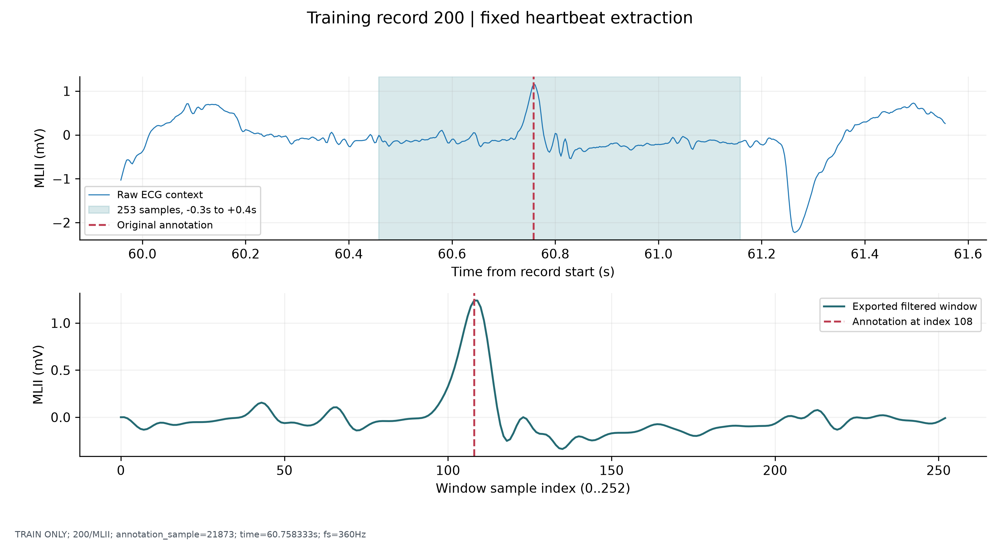

## 2.4 数据集划分

项目以受试者组划分数据，训练、验证和测试的目标比例约为70%/15%/15%，随机种子为20261027，实际得到31/6/6个受试者组。划分程序按V注释数是否达到100分层，并约束留出的V数量。记录100、200已用于前期探索，固定保留在训练区，未根据模型成绩反复选区。训练区含32条记录，验证和测试各含6条，原因是记录201与202属于同一名训练患者。表2-3列出实际心拍数，患者比例不能直接换算为各类心拍比例。两任务使用相同患者分区，训练、验证和测试的患者集合互不重合。归一化参数和类别权重均只由训练数据估计。

表2-3 两项任务的实际数据划分

| 任务 | 训练拍数 | 验证拍数 | 测试拍数 | 患者数 训练 验证 测试 |
|---|---|---|---|---|
| N/V | 70183 | 12923 | 13448 | 31 / 6 / 6 |
| N/S/V/F | 71941 | 14345 | 13829 | 31 / 6 / 6 |

## 2.5 数据探索

四分类中N、S、V、F分别有89577、2761、6977和800拍，N占89.47%，F仅占0.80%。图2-3同时列出心拍数和患者覆盖，说明心拍数量多并不意味着独立患者来源充分。本文从元数据重新汇总各类别的患者数，未沿用将整个分区患者数重复填写到各类的旧统计。典型波形用于观察信号形态，不能代表该类别的全部变化。

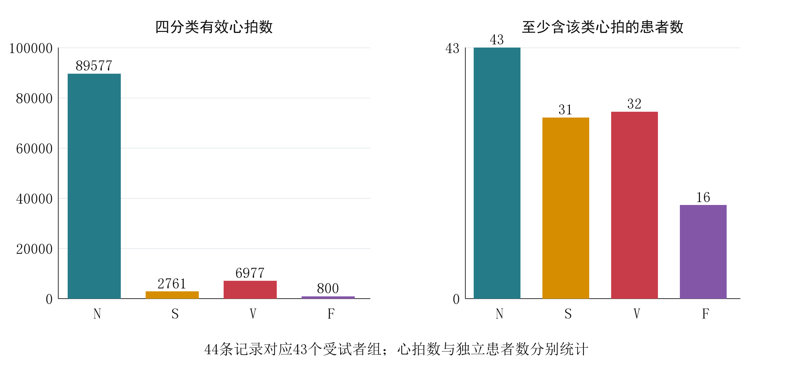

# 第3章 模型设计

本实验比较线性基线、非线性树集成和局部时序卷积三种建模方式。模型使用相同任务分区和253点输入，但学习方式、损失权重与训练机制不同。比较结果说明各方案在当前输入条件下的表现，不能将全部差异归因于某个网络组件。

## 3.1 逻辑回归

逻辑回归将253点标准化波形展平为向量，用线性得分产生分类输出，作为检验线性可分性的基线。多分类任务采用对应的多类概率模型。正式配置使用C=1.0、lbfgs求解器，最大迭代次数为1000，容差为0.001，类别权重为balanced。各时间位置的StandardScaler仅在训练向量上拟合。模型没有输入额外RR间期、手工QRS宽度或患者身份，其表现也受到现有波形表达的限制。

## 3.2 随机森林

随机森林集成多棵决策树，表示输入与类别之间的非线性关系[5]，输入同样为253维波形向量。正式配置包含100棵树，最大深度为18，每个叶节点至少含2个样本。分裂候选特征采用sqrt，每棵树的bootstrap抽样比例为0.8，类别权重为balanced_subsample。随机森林与逻辑回归共享任务分区，但训练机制和权重方式不同，两者属于相同数据条件下的模型对照，不能作为仅替换单个算子的严格结构消融。

## 3.3 一维卷积神经网络

项目采用紧凑的一维卷积结构，输入张量为B×1×253，其中B表示批大小。三个卷积层提取局部时序表示，ReLU提供非线性变换。前两层后接最大池化，末端的自适应平均池化聚合时间维，线性层再输出类别logits。网络未使用批归一化、Dropout、循环层或注意力层。图3-1和表3-1依据项目中的模型定义整理，与本实验实际结构对应。

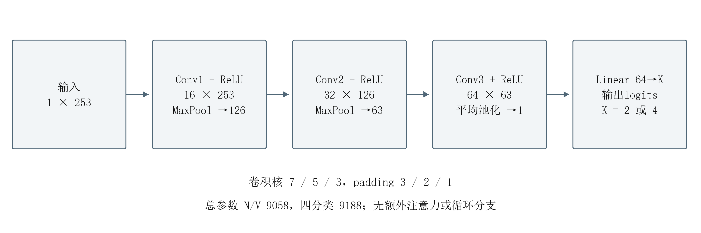

表3-1 一维卷积网络层结构

| 层或模块 | 输入尺寸 不含批维 | 输出尺寸 | 主要参数 |
|---|---|---|---|
| Conv1D 与 ReLU | 1×253 | 16×253 | 核7 padding3 |
| MaxPool1D | 16×253 | 16×126 | 核2 步长2 |
| Conv1D 与 ReLU | 16×126 | 32×126 | 核5 padding2 |
| MaxPool1D | 32×126 | 32×63 | 核2 步长2 |
| Conv1D 与 ReLU | 32×63 | 64×63 | 核3 padding1 |
| AdaptiveAvgPool1D | 64×63 | 64×1 | 输出长度1 |
| Linear | 64 | K | K为2或4 |

网络输出经softmax转换为类别分数，取最大分数对应类别。分数反映模型在给定标签集合下的相对输出，并未经过临床概率校准。训练使用加权交叉熵：

$$ L = −Σᵢ w_(yᵢ) log p_(i,yᵢ) / Σᵢ w_(yᵢ) （3-1）

其中yᵢ为真实类别，p_(i,yᵢ)为对应真实类别的预测概率，w_(yᵢ)为类别权重；求和在批内进行，分母对应加权均值。正式逆频率权重为w_c=n_train/(K n_c)，n_c为训练类c的拍数，K为类别数。该目标调整不同标签在损失中的相对贡献，不等于增加少数类患者。

## 3.4 训练与模型选择

CNN采用Adam优化器，学习率为0.001，weight decay为0.00001，批大小为256，最多训练25个epoch，早停耐心值为5。训练程序按验证集Macro-F1选择检查点，随机种子为20261027，运行设备记录为CPU。N/V和四分类的最佳epoch分别为12和11。验证集已用于早停和已有权重策略比较，不能再作为独立泛化证据。原实验检查点与预测单独保留，新增训练按3.5节方案执行，不用错误案例重新选择原模型。

表3-2 正式模型训练与选择条件

| 项目 | LR | RF | 1D-CNN |
|---|---|---|---|
| 主要规模参数 | C=1；最大迭代1000 | 100棵树；深度18 | 三层卷积；通道16/32/64 |
| 输入与缩放 | 253维；训练侧逐特征缩放 | 253维；全局标量标准化 | 单通道253点；全局标量标准化 |
| 类别处理 | balanced | balanced_subsample | 训练集逆频率交叉熵 |
| 优化设置 | lbfgs；容差0.001 | 叶节点最少2；抽样比例0.8 | Adam；lr=0.001；batch=256 |
| 选择与随机性 | 固定配置；seed=20261027 | 固定配置；同一seed | 最多25轮；patience=5；同一seed |
| CNN最佳轮次 | 不适用 | 不适用 | N/V第12轮；四分类第11轮 |

表3-2中的正式配置与权重探索实验分开记录。CNN输出logits直接送入交叉熵，推理时才转换为softmax分数；测试结果不参与检查点选择。两层最大池化分别缩短时间维，最后的自适应平均池化将每个通道聚合为一个数值，故线性分类器仅接收64维表示。

## 3.5 类别不平衡与RR上下文方案

受控实验保留原始CNN和六个生产工件，另设四个预声明方案。逆频率加权交叉熵对应ce_inverse，平方根平滑加权交叉熵对应ce_sqrt，平方根加权Focal Loss对应focal_sqrt，加入过去RR上下文分支的Focal方案对应focal_sqrt_rr。Focal Loss降低易分类样本的调制权重，改变它们对损失的贡献[12]。本实验取γ=2，将每拍负对数概率乘以类别权重α和调制项(1−p)的γ次幂，再除以批内α之和。γ=0时，该损失退化为相同α的加权交叉熵，对照中的损失均值口径一致。α取训练侧逆频率权重的平方根，全局乘以常数不会改变加权均值。各方案是否改善识别，需要根据完整逐类结果判断。

RR方案保留原三层波形编码器，新增4→16的ReLU分支处理四维时间特征。该分支的输出与64维波形表示拼接，再由80→4线性层分类，参数量比原结构增加144个。四维特征分别为上一RR间期、过去最多十个RR间期的均值、上一RR与该均值之比，以及上一RR与再前一RR之比。程序仅根据过去的专家心拍位置计算这些特征，不输入类别标签、下一RR、患者编号或记录编号。附加StandardScaler只用训练样本拟合，记录起始处缺少历史间隔时按协议使用0.8 s默认值。RR方案同时增加时间信息和可训练分支，本实验比较的是这一组合，不能将差异全部归因于单个特征。

四个方案沿用原患者分区、253点波形、标签和训练侧标量归一化。三个随机种子为20261027、20261116和20261117，训练上限为25轮，早停耐心值为5，学习率为0.001，批大小为256。训练程序按验证集四类Macro-F1选择每次运行的检查点，再根据三个种子的平均验证Macro-F1选定方案。若结果完全相同，程序按预声明配置顺序处理，不挑选最好种子。全部检查点和选型结果冻结后，实验才进入一次最终测试评估阶段。原测试集此前已经查看，因此这次评估属于旧测试集的探索性复用，不属于新的盲测或外部患者验证。

# 第4章 实验设计与评价指标

## 4.1 实验环境

原数据处理环境记录Python 3.12.10、NumPy 2.5.4、SciPy 1.18.1、WFDB 4.3.1、scikit-learn 1.9.1，依赖锁记录PyTorch 2.14.1。新增受控训练实际使用Python 3.12.10、NumPy 2.5.4与PyTorch 2.14.1+cpu，固定CPU线程数4。项目在Windows环境组织和运行；具体硬件型号未纳入已有实验记录，因此不补写。前后端依赖由各自配置维护，与训练环境分开记录。

## 4.2 评价指标

设混淆矩阵M的第a行、第b列表示真实为a、预测为b的心拍数。对类别c采用一对其余方式定义TP_c、FP_c、FN_c：

$$ Accuracy = Σ_c M_(c,c) / n （4-1）

$$ Precision_c = TP_c / (TP_c + FP_c)，Recall_c = TP_c / (TP_c + FN_c) （4-2）

$$ F1_c = 2 Precision_c Recall_c / (Precision_c + Recall_c) （4-3）

$$ Macro-F1 = (1/K) Σ_c F1_c （4-4）

n表示参与评价的心拍总数。分母为零时，评估程序将对应分数记为0，并报告真实支持数。Accuracy按心拍计数，容易受到多数类影响。Macro-F1对各类F1等权平均，能显示稀有类别的不足。Recall表示某类真实心拍被找回的比例，Precision表示该类预测中正确结果的比例，二者需要结合解释。按心拍汇总的分数与按患者平均的分数不同。

## 4.3 对照实验与证据范围

主实验在固定患者分区上比较N/V三模型，扩展实验使用同一记录分区的N/S/V/F标签。类别权重实验比较已有训练与验证结果，包含无权重、平方根平滑逆频率、截断逆频率和完整逆频率。平滑方案先对逆频率开平方，再按权重均值归一化。截断方案先将原始逆频率截到10，再按均值归一化。该比较只用于验证侧探索，不产生新的测试结论。

四分类五折StratifiedGroupKFold仅使用原训练与验证的86286拍，共37个患者组。每名患者在外层只进入一次折外评估。CNN在外层训练患者中生成四折分组候选，按类别覆盖和固定序号选定内层早停划分。选定epoch后，程序在全部外层训练数据上重新拟合。日志记录了这套流程、折内归一化和类别权重。模型设置形成于此前实验，因此交叉验证只用于探索性稳定性分析，不属于外部验证。正式测试集此前已被查看，本文复算保存预测、绘制错误图，也没有获得新的盲测数据。

表4-1 各实验的设置与证据范围

| 实验 | 分类任务 | 模型 | 数据范围 | 主要指标 | 目的 |
|---|---|---|---|---|---|
| 固定测试主实验 | N/V | LR RF CNN | 固定31/6/6患者分区 | Accuracy 逐类P/R/F1 Macro-F1 | 比较两组心拍识别 |
| 固定测试扩展 | N/S/V/F | LR RF CNN | 同一患者分区 | 同上及混淆方向 | 观察任务扩展的变化 |
| 类别权重探索 | N/S/V/F | CNN四策略；既有LR/RF对照 | train训练 val早停与比较 | Macro-F1 逐类P/R 预测份额 | 分析损失权重取舍 |
| 分组五折CV | N/S/V/F | LR RF CNN | 仅train+val的37患者组 | 折均值 样本标准差 OOF汇总 | 探索患者组成敏感性 |
| 部署一致性 | 两任务 | 三模型 | 每任务100样本×3，任务间有重合 | 类别相同次数 最大概率差 | 工程复现验证 |

表4-1最后一项比较同一模型的历史输出与部署输出，以两次输出是否一致为判据，不使用专家标签判断正确性，因此不是新增分类性能实验。原固定测试在训练后执行。新增重推和受控训练均说明了回顾性复用的范围，不能将已查看的测试集重新当作未接触的数据。

# 第5章 实验结果与分析

## 5.1 N/V二分类结果

本文用三份测试预测CSV重新计算表5-1，并与保存的JSON逐项核对。固定测试集含12287拍N和1161拍V。CNN的Accuracy为0.9957，Macro-F1为0.9865，两项指标均高于本实验的传统模型。图5-1并列展示二分类与四分类结果。CNN的优势随任务变化，二分类表现不能直接说明其多类识别能力。

表5-1 N/V固定测试集三模型总体指标

| 模型 | Accuracy | Macro-F1 | N类F1 | V类F1 |
|---|---|---|---|---|
| 逻辑回归 | 0.8369 | 0.6961 | 0.9030 | 0.4892 |
| 随机森林 | 0.9835 | 0.9494 | 0.9909 | 0.9079 |
| 一维CNN | 0.9957 | 0.9865 | 0.9976 | 0.9754 |

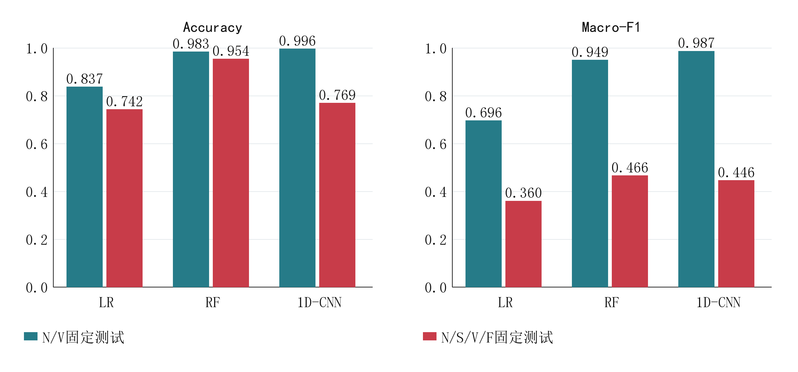

表5-2列出两类Precision和Recall。逻辑回归的V类Recall为0.9044，Precision仅为0.3352，说明模型找回较多V心拍的同时，也将较多N心拍误报为V。较高召回率不足以说明分类可靠。随机森林的V类Precision为0.8759，Recall为0.9423，相比逻辑回归减少了当前测试集的N→V误报，但仍有V→N漏分。CNN的V类Precision为0.9607，Recall为0.9905，在两项指标间表现较均衡。

表5-2 N/V测试集逐类Precision与Recall

| 模型 | N Precision | N Recall | V Precision | V Recall |
|---|---|---|---|---|
| 逻辑回归 | 0.9892 | 0.8306 | 0.3352 | 0.9044 |
| 随机森林 | 0.9945 | 0.9874 | 0.8759 | 0.9423 |
| 一维CNN | 0.9991 | 0.9962 | 0.9607 | 0.9905 |

图5-2显示，CNN正确识别12240拍N和1150拍V，将47拍N误报为V，将11拍V漏分为N，共出现58次错误。错误数量需要结合类别总数解释。N类基数较大，47拍误报对应的N类错误率仍较低，11拍V漏分则约占真实V心拍的0.95%。本文未根据这些错误调整阈值，也未给数据库标签设置临床处置优先级。

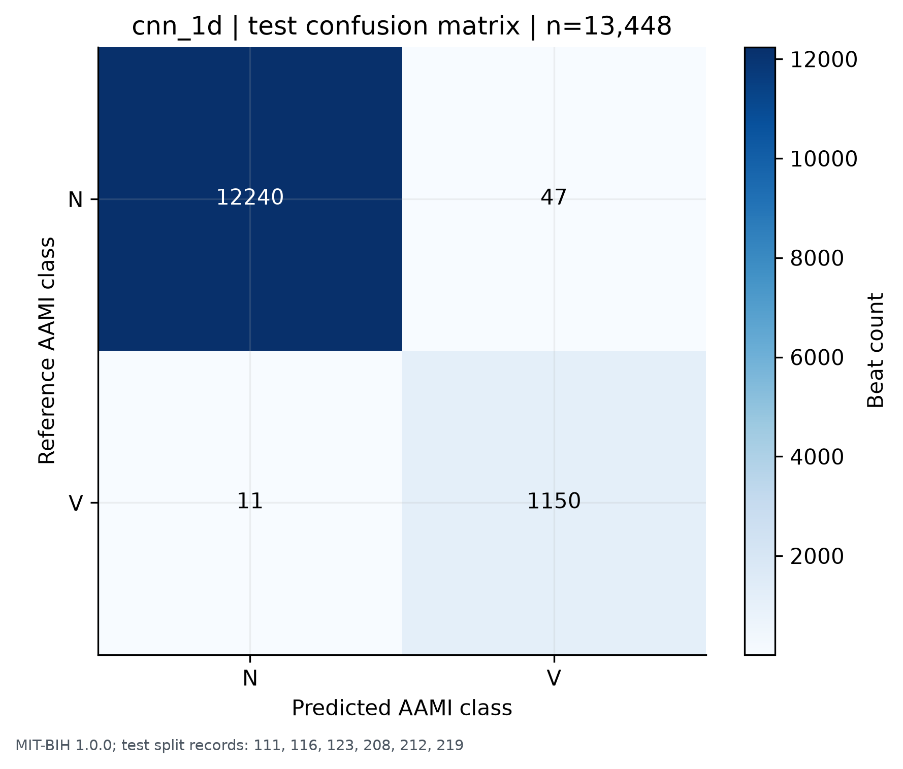

CNN相对随机森林的Accuracy提高约1.22个百分点，Macro-F1提高约0.0371。这个差异只表示当前固定分区的观察结果。同一患者的心拍相互关联，本文未将13448拍当作独立患者样本进行显著性检验，也未针对这项历史比较用多随机种子重训估计置信区间。结论因此限于本次保存实验。5.1.1节按患者来源分析验证与测试结果的差异。

### 5.1.1 验证集与测试集结果差异讨论

表5-3汇总验证与测试分区的逐类指标。N/V CNN的验证Macro-F1为0.6630，测试为0.9865，本文复查两份已有逐拍预测，并核对标签、模型和计算规则。两分区均采用N=0、V=1的类别顺序、相同AAMI映射和固定二类Macro-F1，预处理配置与训练集归一化参数也一致。训练记录及检查点均指向第12轮，当前最佳与最终最佳检查点的全部参数张量相同。生成程序对同一个最佳模型分别保存验证和测试预测。这些证据支持结果可比，但CSV未记录检查点哈希，仅靠现有文件仍不能完整重建历史运行过程。

验证集包含11854拍N和1069拍V，测试集分别为12287和1161拍，V占比分别约为8.27%和8.63%。类别频率接近，不能充分解释指标差距。验证V类Precision为0.2905，Recall为0.9616，F1为0.4462，测试对应为0.9607、0.9905和0.9754。主要差别出现在N→V误报，验证集有2511拍，测试集为47拍。验证与测试的V→N漏分分别为41和11拍。验证误报中有2477拍来自患者109，占98.65%，该患者2478拍N中仅1拍判对，其他验证患者没有同等规模的误报。较低验证分数主要表现为误报向个别患者集中，不能简单归因于V类召回不足。

验证与测试各有6个患者组，其中包含真实V心拍的患者分别为4和5个。验证V的77.17%来自患者233，测试V的84.84%来自患者208。同一患者的大量相关心拍会放大其对按拍指标的影响，仅有1拍或3拍V的患者也不足以提供稳定的逐患者召回估计。解释结果差异时需要考虑患者组成。现有统计仍不能确定患者109的错误由哪种形态、噪声或模型机制引起，也不能仅凭分数反差认定过拟合、数据泄漏或模型随时间退化。本分析未改变阈值、模型和分区，只对已有数据作回顾性诊断，模型稳定性仍需新的患者来源及独立验证检验。

表5-3 N/V CNN验证与测试逐类指标对比

| 分区 | 类别 | 支持拍数 | Precision | Recall | F1 |
|---|---|---|---|---|---|
| 验证 | N | 11854 | 0.9956 | 0.7882 | 0.8798 |
| 验证 | V | 1069 | 0.2905 | 0.9616 | 0.4462 |
| 测试 | N | 12287 | 0.9991 | 0.9962 | 0.9976 |
| 测试 | V | 1161 | 0.9607 | 0.9905 | 0.9754 |

图5-3将患者真实V支持与N→V误分率并列展示。患者109的误分率为2477/2478，而患者111只有1拍真实V，其V召回即使达到1/1也不能视为稳定估计。完整12名患者的P/R/F1、支持数及错误方向保留于本轮核验表；图中不把没有V的患者填成V召回为0。

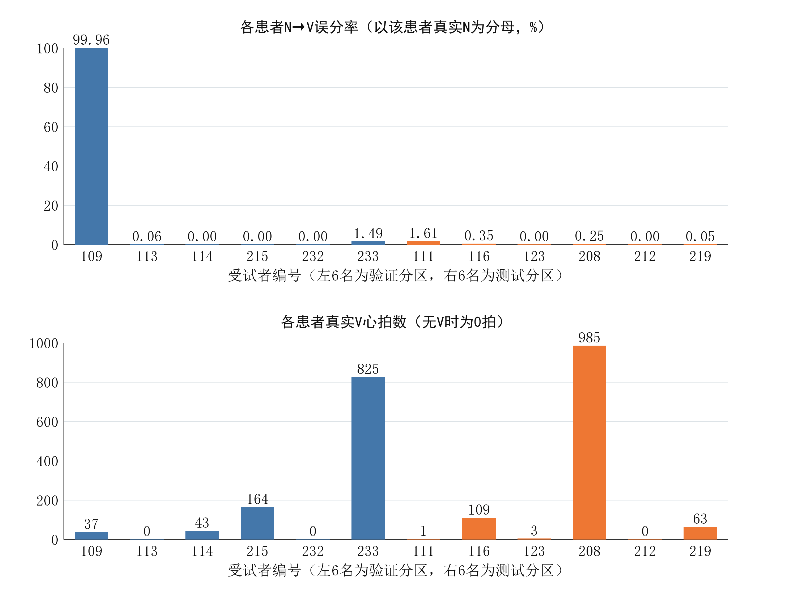

完整性复验核对了全部样本编号、原始符号、映射标签、采样位置、导联和数组行次。训练、验证与测试的患者、记录及样本编号集合互不重合，同记录跨分区重叠窗口数为0。滤波后mV窗口和归一化窗口的规范字节哈希也没有跨分区精确重复。检查没有穷举不同患者的近似形态，形态相似本身也不能直接作为同源泄漏证据。当前生产模型在eval模式下重新推理，原N/V验证与测试指标得到复现。本文未修改分区、标签或剔除患者109来消除差异。历史CSV缺少检查点哈希，原始模型的全部选择过程仍不能完整重建。

## 5.2 N/S/V/F四分类结果

表5-4显示，四分类随机森林的Accuracy为0.9536，高于CNN的0.7690，Macro-F1为0.4656，也高于CNN的0.4460。CNN在四分类任务中未保持全面优势。测试集只有10拍S和371拍F，N则有12287拍，总体Accuracy容易受N类表现影响，评价时还需要逐类查看结果。

表5-4 四分类固定测试集总体指标与逐类F1

| 模型 | Accuracy | Macro-F1 | N F1 | S F1 | V F1 | F F1 |
|---|---|---|---|---|---|---|
| 逻辑回归 | 0.7423 | 0.3599 | 0.8528 | 0.0083 | 0.4952 | 0.0833 |
| 随机森林 | 0.9536 | 0.4656 | 0.9800 | 0.0000 | 0.8825 | 0.0000 |
| 一维CNN | 0.7690 | 0.4460 | 0.8621 | 0.0000 | 0.9179 | 0.0039 |

随机森林的S、F类F1均为0，较高总体准确率与稀有类别识别不足同时存在。CNN的V类Recall为0.9914，S类Recall为0，F类仅判对1拍，Recall为0.0027。CNN将2626拍N错分为S，N类Recall降至0.7718。模型共预测2630拍S，却没有正确识别真实S心拍。这说明输出更多的少数类标签，并不等于改善少数类识别。

逻辑回归正确找回6/10拍S，Recall为0.6000，S类Precision仅为0.0042，大量其他心拍被误报为S。真实正例很少时，召回率尤其需要结合误报数量和患者来源解释。F类融合形态、短窗口缺少上下文等问题值得后续研究，但现有预测不能证明某种特定生理机制导致了这些错误。

## 5.3 类别不平衡与患者集中度

F类共有800拍，来自16名受试者，其中最大来源患者占46.25%，前三名合计占93.25%。训练分区只有411拍F，来自10名患者，患者213占88.08%。测试分区的371拍F中，370拍来自患者208，占99.73%。因此，数百拍F测试结果主要反映单个患者的心拍形态，不能作为稳定的跨患者F泛化估计。

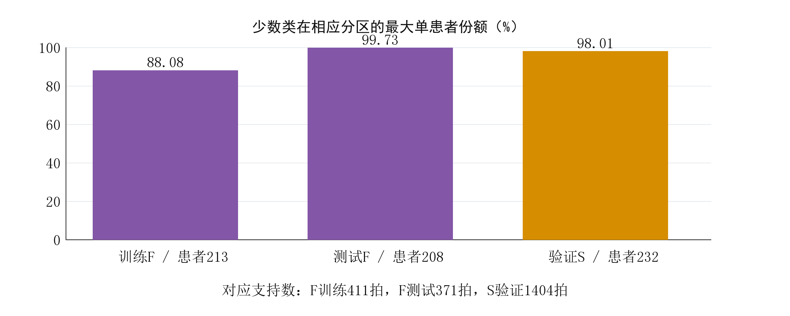

图5-4展示关键分区的患者集中情况。S类验证集有1404拍，其中98.01%来自患者232，测试集的10拍S则仅来自3名患者。验证选型可能受特定患者主导，测试召回率也会对个别心拍的判断变化较为敏感。按心拍调整权重没有增加形态来源的多样性，也不能保证各分区包含足够多的患者。

项目曾修正类别级subject_count与record_count的派生统计错误。本次核验以逐拍metadata重新聚合患者数，确认N/V训练V类实际覆盖23名患者、24条记录，而非整个训练分区的31名患者、32条记录。该修正改变的是描述统计，不改变原始样本、标签、模型和预测，不能被解释为模型性能提升。

## 5.4 类别权重消融

表5-5和图5-5列出已有CNN权重实验的验证结果。无权重时，验证Accuracy为0.8519，Macro-F1为0.3914，S/F预测占比均为0。采用完整逆频率权重后，S类Recall升至0.9309，Precision为0.4693，F类Recall为0.1111，Precision仅为0.0036。模型找回了更多少数类心拍，也产生了更多错误预测，权重调整没有使所有指标同时改善。

表5-5 CNN权重策略的验证集结果

| 权重方案 | Accuracy | Macro-F1 | S Recall | F Recall | N Recall |
|---|---|---|---|---|---|
| 无权重 | 0.8519 | 0.3914 | 0.0000 | 0.0000 | 0.9760 |
| 平方根平滑 | 0.8335 | 0.3962 | 0.0000 | 0.1111 | 0.9490 |
| 截断逆频率 | 0.6590 | 0.4138 | 0.6980 | 0.0000 | 0.6313 |
| 完整逆频率 | 0.7185 | 0.4735 | 0.9309 | 0.1111 | 0.6897 |

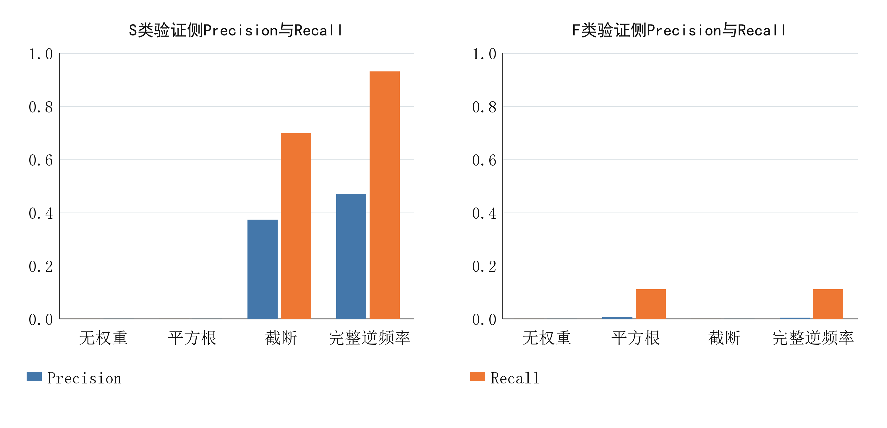

平方根平滑策略的验证Macro-F1约0.396，F类Precision约0.006，仍未解决S类预测缺失；截断策略的Macro-F1约0.414，也不优于完整逆频率的约0.473。完整逆频率在当前验证对照中的Macro-F1最高，但同一验证集参与早停，故该排序具有探索性。不能据此把它推广为其他患者、其他随机种子或其他数据集上的最优策略。

传统模型的已有加权和无权重对照呈现不同变化。随机森林的验证Macro-F1分别约为0.402和0.409，加权没有带来相同收益。逻辑回归加权后的Recall、Precision和总体表现也存在取舍，说明权重效果还受模型决策方式影响。现有结果可以说明权重改变了预测分布，但不能将四分类识别不足完全归因于单一权重设置。

## 5.5 患者级泛化与折间波动

表5-6汇总五折分析，标准差取五个折结果的样本标准差，不表示标准误或置信区间。随机森林的平均Macro-F1为0.4173，CNN为0.3564，逻辑回归为0.3047。图5-6显示CNN的折间变化较大，其Accuracy标准差约为0.187，随机森林约为0.033。该结果提示，在本次分组条件下，CNN对患者组成变化更敏感。

表5-6 四分类探索性受试者分组五折结果

| 模型 | Accuracy 均值±标准差 | Macro-F1 均值±标准差 | 合并折外Macro-F1 |
|---|---|---|---|
| 逻辑回归 | 0.6038±0.0908 | 0.3047±0.0377 | 0.2931 |
| 随机森林 | 0.9011±0.0332 | 0.4173±0.0424 | 0.4054 |
| 一维CNN | 0.6418±0.1870 | 0.3564±0.0624 | 0.3535 |

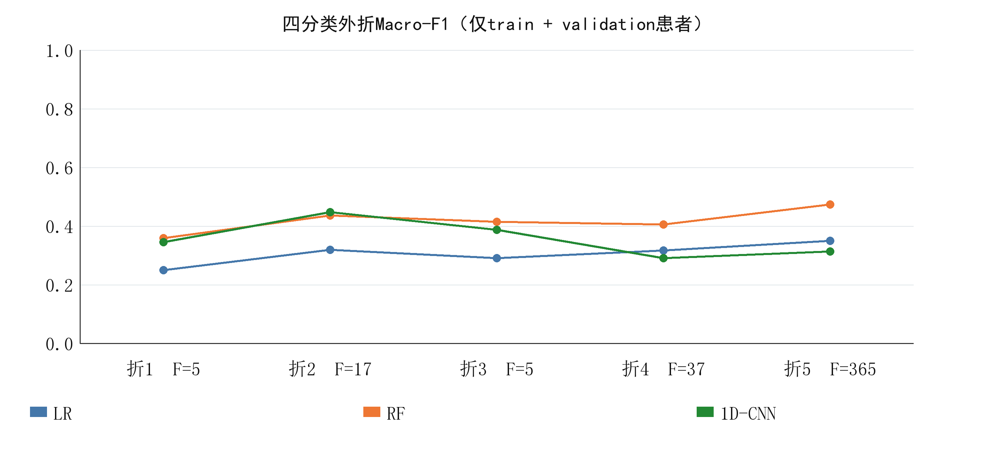

按拍汇总会赋予心拍较多的患者更大权重，逐患者平均则需要事先规定如何处理缺少某类心拍的患者，二者并不等价。本文对各折按拍计算Macro-F1，再取五折均值，不是对37名患者的F1直接平均。F1属于非线性汇总，各折的支持数和类别构成也不同，因此五折均值与合并全部折外预测后的Macro-F1并不相同。固定测试与这组CV使用不同患者集合，二者的分数差不能直接视为模型随时间退化。两种分析均显示，S/F的跨患者识别仍然不足。

CV的86286拍仅来自37个训练加验证患者组，其中F总计429拍。五个外折的F真实支持分别为5、17、5、37和365拍，折间指标同时受到患者构成与少数类支持变化影响。随机森林的F类平均Recall为0，CNN约0.0632。分组评估阻断了同一患者直接跨越训练和评估两侧，但无法补足稀有类别来源不足，也无法消除既有模型设定的选择历史。本文据此将结果用于稳定性诊断，而不宣称完成了临床外部验证。

## 5.6 错误样本分析

图5-7从保存的四分类测试预测中，分别选取N→S、F→N、F→V和V→N各一个案例。程序在每种错误方向内，选择预测类别置信度接近中位数的样本，没有随机抽样。曲线读取对应NPZ中的滤波后mV信号，横轴以专家标注为零点。图题列出记录和原始采样位置，元数据保存完整样本编号，便于追溯。

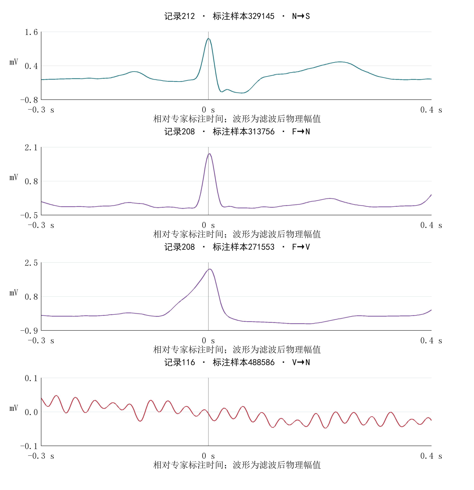

记录212在采样点329145处的心拍对应914.292 s，原始符号为R，映射后属于N，却被模型预测为S。N组包含束支阻滞等不同符号，因此N→S不能一律解释为健康心拍误报。记录208在采样点313756处对应871.544 s，错误方向为F→N，在采样点271553处对应754.314 s，错误方向为F→V。两例显示同一患者的F心拍可以被错分到不同类别。记录116在采样点488586处对应1357.183 s，错误方向为V→N，说明较高的V类总体召回率仍可能包含局部漏分。

这些案例可以复核错误类别和数据来源，但本文没有开展临床专家盲评、特征遮挡或因果归因，不能仅凭局部形态认定网络使用了特定P波或QRS规则。四分类中F→N和F→V分别有216和154拍，F测试心拍又几乎全部来自患者208，因此个案需要结合整体分布解释。二分类的47拍N→V和11拍V→N属于另一标签任务，四分类图例不能替代其错误分析。本文仅用案例作描述性复核，未据此调整阈值或重新选择原检查点。

## 5.7 实验结果综合讨论

三种模型学习输入关系的方式不同。逻辑回归在波形向量上建立线性边界，随机森林表示分段非线性关系，CNN则共享局部时序卷积参数。在当前固定划分下，CNN的N/V按拍汇总结果较好，任务扩展为四分类后未继续保持优势。标签边界、各类支持、患者来源和训练权重都发生作用，现有对照不能将差异归因于单一因素。总体Accuracy较多反映N类表现，Macro-F1则显示稀有类F1接近零，两项指标需要结合判断。

患者来源集中时，大量相关心拍不能等同于大量独立患者证据。验证N→V主要来自患者109，测试F几乎来自患者208，按拍指标因而可能受到少数患者主导，但这些结果并未证明模型记忆了患者身份。权重改变各类损失贡献及预测分布，没有增加新患者或节律上下文。探索性CV显示了折间波动，仍不能替代外部数据。本文结论因此限于既定数据库和协议下的模型比较与工程复现，进一步验证需要补充独立患者来源。

## 5.8 多种子受控改进实验

新增12组训练均遵守3.5节的预声明方案。Balanced Accuracy取四个固定类别Recall的等权均值，表中均值和样本标准差来自三个随机种子，不表示患者间标准差或置信区间。表5-1—表5-6保留历史实验口径，新增ce_inverse属于相同方法的多种子重训，不能与历史单次训练混写为同一结果。

表5-7 新训练四方案的三种子总体结果

| 方案 | 分区 | Accuracy | Macro-F1 | Balanced Accuracy |
|---|---|---|---|---|
| 逆频率CE | 验证 | 0.6441±0.0609 | 0.4806±0.0651 | 0.5947±0.0227 |
| 逆频率CE | 旧测试 | 0.7946±0.0607 | 0.4670±0.0210 | 0.4940±0.0455 |
| 平方根CE | 验证 | 0.8427±0.0085 | 0.3911±0.0042 | 0.4121±0.0154 |
| 平方根CE | 旧测试 | 0.9691±0.0008 | 0.4841±0.0011 | 0.4954±0.0010 |
| 平方根Focal | 验证 | 0.8399±0.0151 | 0.3937±0.0102 | 0.4084±0.0158 |
| 平方根Focal | 旧测试 | 0.9648±0.0043 | 0.4769±0.0048 | 0.4833±0.0108 |
| 平方根Focal＋RR分支 | 验证 | 0.9014±0.0101 | 0.6047±0.0060 | 0.5849±0.0146 |
| 平方根Focal＋RR分支 | 旧测试 | 0.9584±0.0046 | 0.5002±0.0036 | 0.6056±0.0169 |

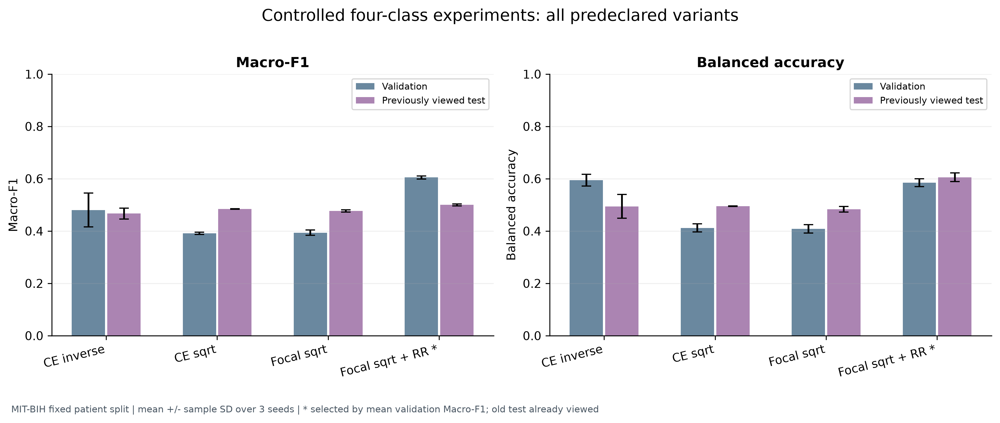

实验根据验证均值预先选定平方根Focal＋RR分支，配置名称为focal_sqrt_rr。该方案的验证Macro-F1为0.6047±0.0060，旧测试Macro-F1为0.5002±0.0036。相对本轮逆频率CE基线，旧测试Macro-F1均值变化为+0.0332，Accuracy变化为+0.1639。这些结果是验证选型后的观察，本文不根据测试分数重新排列优胜方案，也未用新方案替换生产模型注册表中的原工件。

表5-8 新训练方案的测试侧逐类结果

| 方案 | S Recall / F1 | F Recall / F1 | V Recall / F1 |
|---|---|---|---|
| 逆频率CE | 0.0667±0.1155 / 0.0006±0.0010 | 0.1276±0.1159 / 0.0637±0.0518 | 0.9842±0.0090 / 0.9253±0.0061 |
| 平方根CE | 0.0000±0.0000 / 0.0000±0.0000 | 0.0027±0.0047 / 0.0050±0.0086 | 0.9808±0.0081 / 0.9445±0.0140 |
| 平方根Focal | 0.0000±0.0000 / 0.0000±0.0000 | 0.0036±0.0062 / 0.0055±0.0095 | 0.9320±0.0450 / 0.9149±0.0233 |
| 平方根Focal＋RR分支 | 0.4333±0.0577 / 0.0457±0.0083 | 0.0108±0.0140 / 0.0207±0.0266 | 0.9940±0.0030 / 0.9538±0.0054 |

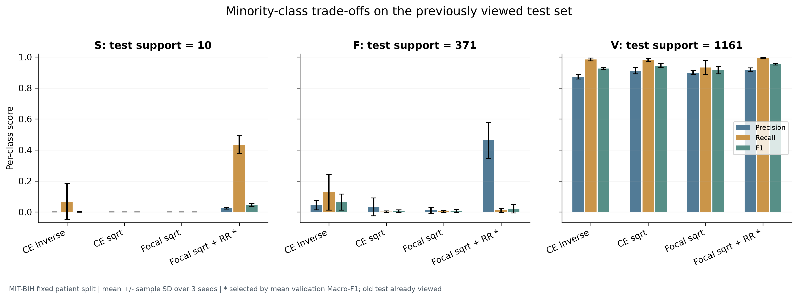

在旧测试分区，所选方案的S类Precision、Recall和F1均值分别为0.0242、0.4333和0.0457，F类分别为0.4630、0.0108和0.0207，V类Recall与F1分别为0.9940和0.9538。召回率上升也可能伴随误报增加，评价时需要结合总体Accuracy与逐类Precision。三个随机种子使用相同心拍和六个测试患者，不能当作三批独立患者证据。

与新训练逆频率CE相比，所选方案的S类F1从0.0006升至0.0457，F类Recall却从0.1276降至0.0108，F1从0.0637降至0.0207。本轮没有使S和F同时改善。F类Precision虽然较高，但模型仍漏分了大部分真实F心拍。新增策略改变了S、V及总体指标，尚不能说明融合心拍识别问题已经解决。相比仅改变Focal调制的方案，RR分支组合在当前分区的整体表现较好，这个结果仍需结合额外参数和患者来源解释。

相邻方案分别比较权重平滑、Focal调制和RR分支组合，图5-10保留相同种子的成对差值，包括负值。前两组保持波形网络结构不变，较接近损失因素对照，RR组则同时改变输入信息与参数量。本实验考察这些改动对少数类识别和误报的影响，没有依靠大量方案搜索最高测试分数。

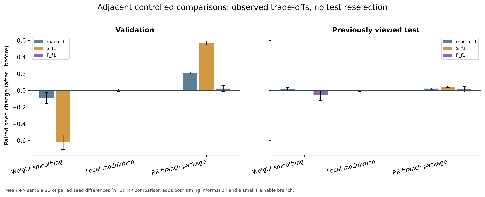

本轮保留困难患者和原S/F标签。验证S主要来自患者232，旧测试的10拍S只来自3个患者，371拍F中有370拍来自患者208。损失函数与RR上下文不能增加独立形态来源，因此即使某项均值上升，患者组成的限制仍然存在。新增对照只能比较当前固定条件下的训练策略，不能证明少数类的临床泛化问题已经解决。

## 5.9 真实模型的梯度归因分析

本文采用Integrated Gradients，对真实CNN预测类别的logit进行输入归因[13]。该方法沿参考输入到实际输入的路径累积梯度。本项目以归一化波形的零输入和标准化RR的零输入作为参考，它们对应各自训练均值，不代表生理正常心拍模板。解释模型来自验证选定的focal_sqrt_rr方案，种子取验证排序居中的20261117，再从验证集各真实类别中选取中间位置样本，共4例。样本不按测试表现筛选。图5-11的波形和波形/RR归因均来自真实前向及梯度计算，清单记录了样本来源、目标类别与检查点哈希。

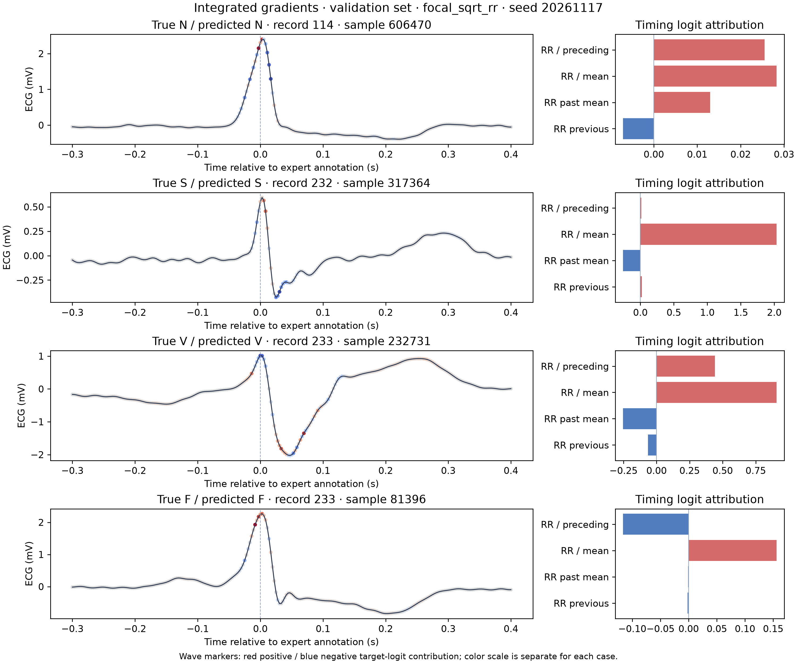

数值积分采用128步，并保存64步到128步的波形归因变化。四例完整性检查的最大绝对误差为0.003493，最大相对误差为0.001663，这两项误差用于检查近似积分的一致性，不是分类性能指标。归因值描述特定模型、参考输入和目标输出之间的局部数值关系，参考基线或目标类别改变后，归因结果也可能变化。某段信号贡献较大，不能证明模型掌握医学知识，也不能证明该区间具有因果诊断作用。RR方案还包含波形以外的输入，单看波形归因不能解释全部决策。本文用归因定位待复核区域，补充定量错误分析，未用归因图代替分类指标，也未声称模型经专家验证识别了P波或QRS机制。

# 第6章 ECG-AI系统设计与实现

## 6.1 系统总体架构

系统前端采用React与TypeScript，Umi组织页面路由，Ant Design提供交互组件，ECharts绘制信号和结果图，Motion负责界面动效。FastAPI接收浏览器请求，分别调用数据读取、模型推理、科研结果和互动教学模块。ECGStore从本地WFDB文件读取物理信号与专家标注，同时读取处理配置、受试者划分和训练集归一化参数。InferenceService组织选拍、输入构建和预测，Model Registry加载已有六个模型工件，核对输入维度及类别顺序，执行指定模型推理。接口将类别、逐类分数、工件哈希和数据来源返回前端。

科研结果展示和单次请求内的模型推理使用不同数据路径。实验中心、错误分析与图库由research模块读取已保存的指标表、逐拍预测和图像，历史预测CSV不代替单心拍推理。互动教学模块读取独立的真实关卡索引，由ECGStore取得历史信号，按专家标注结算，再用SQLite保存匿名会话。游戏分数不作为分类模型输入。模型推理与科研展示均不回写原始ECG、训练权重或正式实验结果。

图6-1区分请求调用、标准化输入和文件读取。InferenceService承担推理编排，ECGStore提供信号与窗口，模型注册模块只读装载工件；科研图表沿独立的历史结果路径提供。

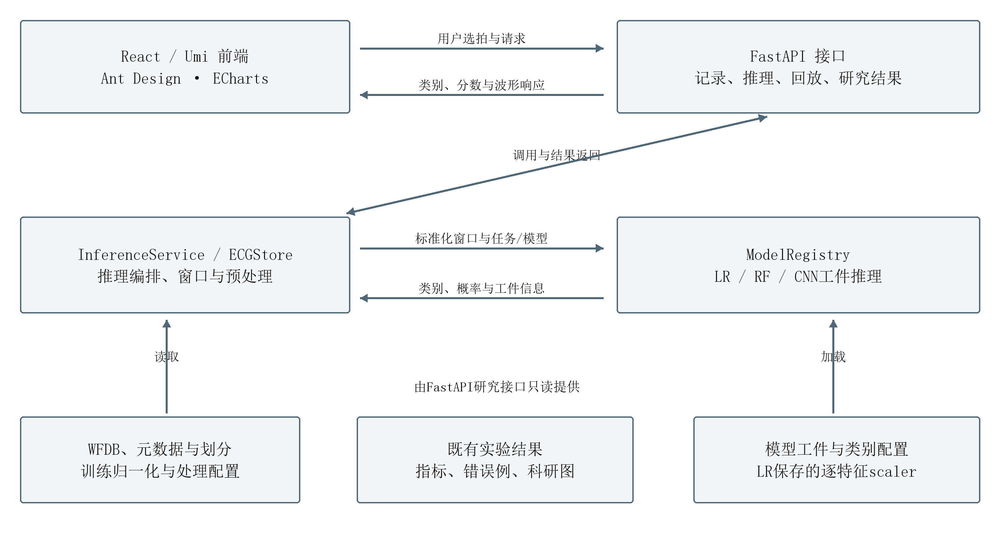

## 6.2 真实心拍推理流程与界面

用户选择记录、分类任务和专家标注位置后，GET /api/ecg/window读取选定时间窗，GET /api/ecg/annotations返回该范围的专家标注，GET /api/ecg/beat显示局部心拍。模型预测使用POST /api/inference/beat，请求包含记录编号、专家采样点、任务和模型标识。服务检查记录是否位于允许列表，推理还要求记录属于当前44记录实验且导联为MLII。任意文件路径或未标注采样点不能作为合法模型请求。

ECGStore复用已保存配置中的连续带通滤波。程序围绕专家采样点截取前108点、后144点和中心点组成的253点窗口，检查边界、有限值、平坦段及滤波保护区。任务对应的归一化参数仅由训练集拟合。LR使用保存的逐维StandardScaler，RF不增加训练时没有的缩放，CNN将输入组织为1×1×253张量，在CPU上推理。模型注册模块在应用启动或首次使用时加载工件，后续请求复用内存对象。专家类别只作回顾性对照，不进入波形特征。

预测响应包含predicted_class、class_probabilities、model_sha256、preprocessing_version及记录和采样点等字段。POST /api/inference/compare对同一标准化窗口依次执行三个模型；/api/inference/batch和/api/ecg/playback/segment用于有限批量和历史片段回放，最大处理128个标注位置。前端把返回结果与真实波形关联展示。该流程仍以专家标注中心为前提，离线双向滤波和历史回放也不等同于实时采集监护。

图6-2放大工作台中的实际波形和标注，图6-3集中展示同一心拍的三个真实模型输出。用户可以比较预测是否一致，专家标签仍是回顾性对照依据；单拍模型分数不代表总体性能。

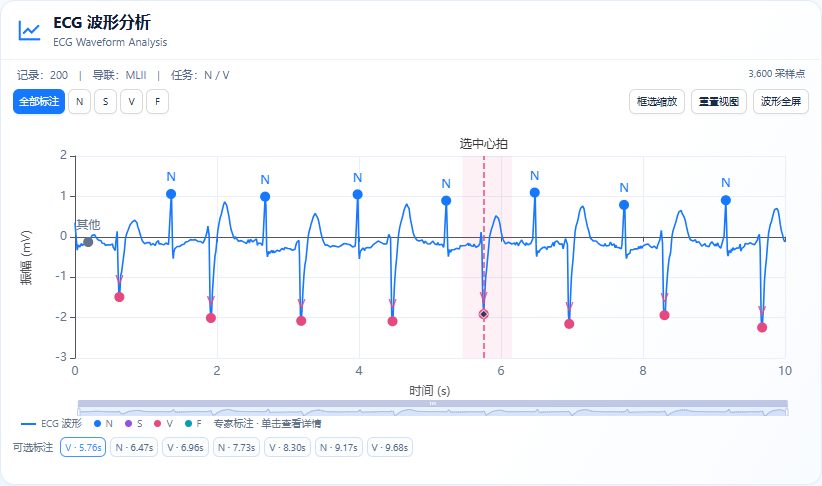

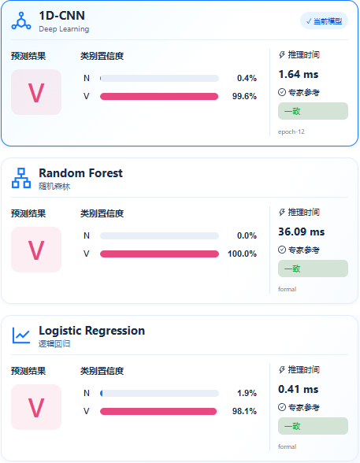

图6-2和图6-3取自2026年11月4日的真实浏览器页面。图6-3只重排结果卡片以便阅读，没有重绘波形或修改预测值。6.3节另列最终验收页面。

## 6.3 功能实现与验证

软件验证覆盖真实数据读取、模型预处理、推理、错误定位、报告导出和异常反馈。项目保留原58项Python测试，新增完整性、损失、RR时序、归因、报告及健康检查回归后，共73项通过。前端类型检查与生产构建也通过。Chrome对生产构建完成11项流程检查，包含真实游戏开局，未发现页面异常。导出接口重新运行原三模型，保存当前心拍、专家标注、逐类分数以及模型和输入来源哈希。六个模型未全部就绪时，健康接口返回503。公网直连的波形、真实推理和三模型比较已经验证，但公网仍运行既有版本，新增导出与健康修复尚未远程发布。这些检查说明软件按预期读取和展示数据，不代表已经验证医学泛化或教学效果。

表6-1 系统功能与最终实际验证

| 检查项目 | 实际结果 | 证据 |
|---|---|---|
| Python回归 | 73项通过，含原58项 | final_tests.log；数据、训练机制、接口、游戏和部署更新规则 |
| 前端检查 | 类型检查及生产构建通过 | typecheck.log；frontend_build.log |
| 真实浏览器流程 | 11项流程检查通过，页面异常0 | demo_20261117/acceptance.json；生产构建、隔离游戏数据库 |
| 报告导出 | 真实JSON下载及模型/专家/输入来源核对通过 | report_export_success.png与实际下载文件 |
| 异常与健康状态 | 导出失败可反馈重试；六模型未齐时503 | 受控故障注入；health_before.log与修复后73项回归 |
| 公网直连 | 网页、健康、真实推理及三模型比较通过 | public_probe.json；public_browser.json；配置网络出口502，直连200 |

软件测试核对了文件读取、接口行为和页面交互。模型对新患者是否有效，仍需独立的统计分析与医学评价。前端构建成功、接口返回正常，不能作为临床适用性的证据。

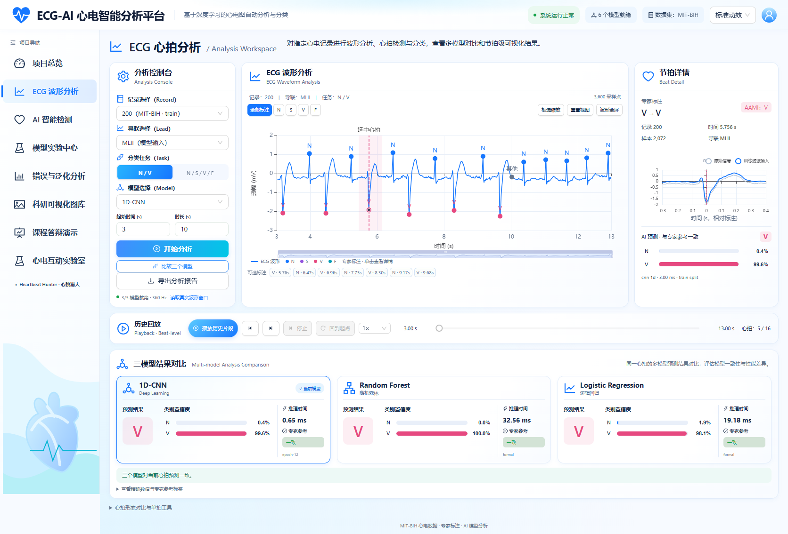

图中显示实际运行页面，模型输出与对应工件一致。

## 6.4 模型部署一致性

部署一致性对照来自phase3_validation保存记录，结果见表6-2。六组每组100次对照，预测类别均一致，输入最大绝对差均为0。

表6-2 部署与保存预测的一致性分组结果

| 任务 | 模型 | 验证心拍| 类别相同 | 最大概率绝对差 |
|---|---|---:|---:|---:|
| N/V | LR | 100 | 100/100 | 2.9802×10⁻⁷ |
| N/V | RF | 100 | 100/100 | 2.2204×10⁻¹⁶ |
| N/V | CNN | 100 | 100/100 | 1.6295×10⁻⁷ |
| N/S/V/F | LR | 100 | 100/100 | 4.7684×10⁻⁷ |
| N/S/V/F | RF | 100 | 100/100 | 2.2204×10⁻¹⁶ |
| N/S/V/F | CNN | 100 | 100/100 | 3.2846×10⁻⁷ |

两项任务各使用100条心拍，三模型复用各自任务的样本，合计200个任务内样本条目。跨任务去重后共有143个心拍位置，其中57个位置重合，因此这些对照不代表200个独立来源或600个不同心拍。N/V抽样为N=50、V=50，四分类为N=32、S=25、V=25、F=18。当前六模型工件的SHA-256与验证汇总一致。该对照只核验部署路径能否复现同一模型的历史预测，不能称为分类准确率100%，也不构成新的独立分类性能或临床验证。

## 6.5 互动教学模块

Heartbeat Hunter使用记录100、105、106、108、109、114的真实MIT-BIH MLII信号，采样率为360 Hz，关卡索引记录原始文件哈希和专家采样点。现有索引共有62个窗口，新手、标准和挑战分别为21、21、20关。片段仅保留N/V可判定内容，排除S/F/Q、未知心拍及不安全区。用户寻找V组心拍，服务端在±0.10 s容差内与专家位置一对一匹配，分别计算正确选择、误选和漏选的分数，再结合连击和限定条件下的时间奖励反馈当前操作。结算后，系统揭示专家答案，用户可查看局部波形，并跳转到同一心拍的真实模型推理。

欢迎引导和首次教程说明操作方法，阅读教程不会自动开始计时。欢迎页中的SVG已标为视觉示意，不作为真实ECG结果。界面允许减少动态效果。游戏分数只反映用户在当前规则下的选拍表现，项目尚未开展学习效果用户研究，不能据此声称提高了学习效果，也不能将游戏分数换算为医学诊断能力。关卡经过筛选，平台又允许查看历史标注，这些条件与未知患者的独立测验不同。

# 结论

本项目使用MIT-BIH单导联专家标注心拍，完成数据处理、模型对照、患者来源分析和ECG-AI教学系统整合。原患者独立N/V测试中，CNN的Accuracy为0.9957，Macro-F1为0.9865，验证Macro-F1仅为0.6630。重新推理后，差异仍然存在，验证误报主要集中在患者109。数据和模型工件复核支持结果一致，已检查范围内未发现跨分区同源窗口或精确波形重复，但这不能证明所有潜在泄漏与历史选择偏倚均已排除。四分类中，随机森林的总体指标较高，S/F识别却仍然不足，总体准确率不能替代逐类能力判断。

新增受控实验包含四个方案、三个种子，保留全部分区与标签，并在最终测试阶段前按验证结果锁定方案。选定的平方根Focal＋RR分支，其验证及旧测试Macro-F1分别为0.6047±0.0060和0.5002±0.0036。本文报告逐类变化、整体误报和种子波动，不用单个最好种子或召回率替代总体证据。过去RR分支和损失对照用于分析训练策略，真实梯度归因补充错误观察，二者都不能证明新的医学机制。系统将真实信号、专家标签、模型推理、错误反馈和教学互动连接起来，六个生产模型与探索性新模型分开保存。

本研究仅使用一个历史数据库，固定测试集只有六名患者，S/F心拍的患者来源也较集中。三个随机种子反映训练随机性，不能增加独立患者证据，旧测试集复用也不属于新的外部盲测。模型依赖专家定位和离线双向滤波，项目尚未评价自动定位误差、临床校准、前瞻性应用及教学效果。后续研究需要在新增患者数据上预先冻结评价方案，分别考察自动R峰定位和节律上下文的贡献，再评价模型部署与概率校准。现有成果适用于课程实验和教学展示，不能用于输出临床诊断结论。

# 参考文献

[1] MOODY G B, MARK R G. The impact of the MIT-BIH Arrhythmia Database[J]. IEEE Engineering in Medicine and Biology Magazine, 2001, 20(3): 45-50. DOI: 10.1109/51.932724.

[2] GOLDBERGER A L, AMARAL L A N, GLASS L, et al. PhysioBank, PhysioToolkit, and PhysioNet: components of a new research resource for complex physiologic signals[J]. Circulation, 2000, 101(23): e215-e220. DOI: 10.1161/01.CIR.101.23.e215.

[3] MOODY G, MARK R. MIT-BIH Arrhythmia Database version 1.0.0[DB/OL]. PhysioNet, 2005[2026-11-05]. https://physionet.org/content/mitdb/1.0.0/. DOI: 10.13026/C2F305.

[4] DE CHAZAL P, O'DWYER M, REILLY R B. Automatic classification of heartbeats using ECG morphology and heartbeat interval features[J]. IEEE Transactions on Biomedical Engineering, 2004, 51(7): 1196-1206. DOI: 10.1109/TBME.2004.827359.

[5] BREIMAN L. Random forests[J]. Machine Learning, 2001, 45(1): 5-32. DOI: 10.1023/A:1010933404324.

[6] KIRANYAZ S, INCE T, GABBOUJ M. Real-time patient-specific ECG classification by 1-D convolutional neural networks[J]. IEEE Transactions on Biomedical Engineering, 2016, 63(3): 664-675. DOI: 10.1109/TBME.2015.2468589.

[7] ACHARYA U R, OH S L, HAGIWARA Y, et al. A deep convolutional neural network model to classify heartbeats[J]. Computers in Biology and Medicine, 2017, 89: 389-396. DOI: 10.1016/j.compbiomed.2017.08.022.

[8] MONDÉJAR-GUERRA V, NOVO J, ROUCO J, et al. Heartbeat classification fusing temporal and morphological information of ECGs via ensemble of classifiers[J]. Biomedical Signal Processing and Control, 2019, 47: 41-48. DOI: 10.1016/j.bspc.2018.08.007.

[9] CHAWLA N V, BOWYER K W, HALL L O, et al. SMOTE: synthetic minority over-sampling technique[J]. Journal of Artificial Intelligence Research, 2002, 16: 321-357. DOI: 10.1613/jair.953.

[10] OLIVEIRA R F, MOREIRA G J P, FREITAS V L S, et al. Leveraging visibility graphs for enhanced arrhythmia classification with graph convolutional networks[EB/OL]. arXiv预印本, 2024[2026-11-16]. https://arxiv.org/abs/2404.15367v2.

[11] CHEN M, LI Y, SHI W, et al. Attention-enhanced convolutional neural network for inter-patient classification of premature ventricular contraction from ECG[C]//Computing in Cardiology. 2024, 51. https://cinc.org/archives/2024/pdf/CinC2024-463.pdf.

[12] LIN T Y, GOYAL P, GIRSHICK R, et al. Focal loss for dense object detection[EB/OL]. arXiv预印本, 2017[2026-11-16]. https://arxiv.org/abs/1708.02002.

[13] SUNDARARAJAN M, TALY A, YAN Q. Axiomatic attribution for deep networks[C]//Proceedings of the 34th International Conference on Machine Learning. PMLR, 2017, 70: 3319-3328. https://proceedings.mlr.press/v70/sundararajan17a.html.

# 附录1 数据与复现说明

数据来源为公开的MIT-BIH Arrhythmia Database及其专家标注。项目在公开数据范围内开展算法与软件实验，没有新增受试者招募或临床干预；不据此虚构伦理审批编号。原始记录、训练配置、模型工件和逐拍预测的来源与哈希由仓库结果文件记录。原实验与新受控实验分目录保存，复现步骤见项目README和对应实验报告。

课程成果署名作者为吴江彬。AI工具用于辅助代码开发、资料整理、实验检查和论文修订；指标来自实际运行或保存预测复算，AI生成文本不作为独立实验结果。作者负责核查提交成果的数据、实现与结论。项目材料未列示专项资助或商业合作信息，本稿不据此补写未经确认的经费或利益关系。

# 致谢

感谢公开数据库和开源软件的维护者为课程实验提供数据与工具基础。相关数据、方法和软件的贡献按照实际来源标注，不将其列为本文原创算法。
