# 基于一维卷积神经网络的心电图异常心拍识别与可视化系统设计

## 摘要

针对心电图心拍识别与课程实验展示需求，本文基于MIT-BIH心律失常数据库，对逻辑回归、随机森林与一维卷积神经网络开展模型比较，并实现ECG-AI可视化系统。实验排除4条含起搏心拍记录，采用44条记录、43个受试者的有效心拍，以受试者为单位划分训练、验证和测试集。信号经固定带通滤波后，围绕专家标注位置截取253点窗口，归一化参数仅由训练集估计。在N/V二分类固定测试集上，一维卷积神经网络的Accuracy和Macro-F1分别为0.9957和0.9865，V类Recall为0.9905。扩展为N/S/V/F四分类后，随机森林的Accuracy最高，为0.9536，但Macro-F1仅为0.4656；卷积网络Macro-F1为0.4460，S/F类识别仍存在明显不足。受试者分布、验证集权重消融和探索性分组交叉验证表明，少数类的患者覆盖与集中度是解释性能时必须考虑的因素。系统支持真实心拍查看、三模型推理、历史回放和实验分析；600次部署预测对照类别一致。本文完成模型实验与交互展示的贯通，同时明确其结论限于既有数据库和标注心拍，不构成临床诊断能力验证。

关键词：心电图；心拍分类；一维卷积神经网络；受试者独立评估；可视化系统

<!--TOC-->

# 第一章 绪论

## 1.1 研究背景

心电图通过体表电极记录心脏电活动，是观察心律和心拍形态的重要信号。长时间记录包含大量连续心拍，人工逐拍核对需要时间，且噪声、导联差异与个体差异会增加分析难度。自动心拍分类把连续信号中的局部片段映射到预定义标签，可用于辅助整理数据、定位值得复核的片段，以及开展信号处理和机器学习教学。MIT-BIH数据库提供可复查的信号与专家标注，为这类算法实验提供了共同基础[1-3]。

传统机器学习通常依赖特征表达与分类器的配合；一维卷积网络则能够在局部时间轴上进行多层特征变换[4-6]。但模型是否适用，不能仅由一个较高的总体准确率判断。多数类占比、同一患者心拍的相似性、少数类来源患者数量，以及训练与测试的划分方式，都会影响评价。对于课程实践，展示一段真实心拍、对应标签、预测分数和错误案例，有助于把抽象指标与实际数据联系起来，也便于识别实验的适用边界。

## 1.2 国内外相关研究

Moody与Mark总结了MIT-BIH数据库在心律失常检测研究中的作用[1]；PhysioNet为生理信号的开放获取和研究复现提供了平台[2]。de Chazal等将形态与心搏间期特征用于心拍分类，并将模型配置选择与最终性能评估置于不同记录集合[4]。结合数据库存在同人多记录的特点，后续实验还应区分记录数与患者数[3]，避免将同一患者相似片段分到两侧后高估泛化能力。

随机森林通过多棵树的集成构建非线性决策边界，适合作为波形向量分类的传统对照[5]。Kiranyaz等研究了一维卷积网络的患者特异心拍分类[6]，其患者适配设定与本文受试者独立划分不同，因此不能直接比较数值并宣称优劣。Acharya等探索了多层卷积网络的五类心拍分类[7]；Mondéjar-Guerra等将形态和RR间期用于分类器集成[8]。这些工作说明，网络结构之外，输入上下文与评估协议也需要明确描述。类别不平衡研究中的SMOTE提供了处理少数类的一种思路[9]，本文并未实施该采样方法，而是保留原始有效样本分布，分析既有类别权重实验。

## 1.3 研究目标

本文的目标是建立可追溯的心拍分类实验与展示流程：比较三种模型在相同N/V任务上的表现；观察四分类扩展后的类别差异；从患者分布、权重策略与折间波动分析局限；将训练工件整合到可交互系统。研究范围是标注心拍的分类，不包含任意原始ECG的自动事件发现，也不以提出新网络算法为目标。

## 1.4 主要工作

本文核对数据构建、标签映射、患者分组和预处理配置，从保存的逐拍预测重新计算六组测试指标；复核既有四分类诊断与五折结果，并整理真实错误波形；依据当前代码审计Web功能和部署一致性。图1给出了项目技术流程。模型比较、结果分析与系统集成构成主要课程成果，普通工程实现不作为算法创新主张。

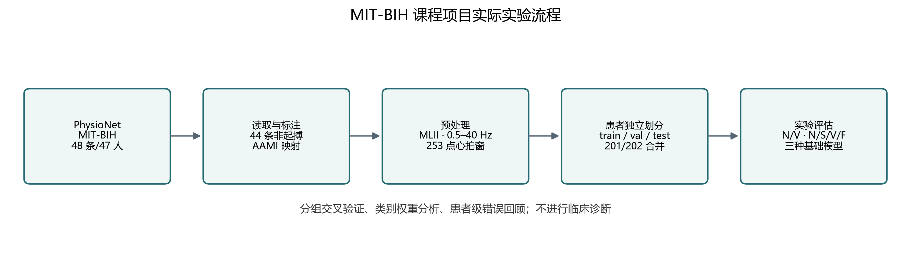

# 第二章 数据集与预处理

## 2.1 数据来源与记录选择

MIT-BIH Arrhythmia Database包含47名受试者的48段约半小时双通道动态心电记录，采样率为360 Hz，并提供经专家检查的心拍标注[1,3]。本文采用已有正式实验版本，排除102、104、107和217四条含起搏心拍记录。保留的44条记录对应43个受试者组；记录201与202来自同一受试者[3]，在代码中统一为同一分组键，不能当成两名独立患者。

原始标注总量、映射心拍数量与有效输入窗口数量具有不同含义。本文数据表仅统计通过窗口和信号有效性规则、实际进入模型数据集的心拍。N/V任务保留96554拍，四分类任务保留100115拍。两者并非两套独立采集队列，而是同一记录分区下的不同标签子集。

## 2.2 心拍标签及任务边界

项目根据显式、大小写敏感的符号映射归并AAMI类别，映射实践参考已有研究[4]。表1列出实际规则。N组包含正常心拍、左/右束支传导阻滞心拍及部分逸搏，因而N标签不能解释为受试者绝对健康；V组代表本任务中的室性异位心拍。N/V二分类只能评价这两个标签之间的区分，不能代表全部心律失常或心脏疾病检测。四分类纳入N、S、V、F，Q组仍未进入正式分类任务，非心拍标注也不被当作一个心拍类别。

表1 项目采用的AAMI类别映射

| 类别 | 原始符号 | 组别含义 |
|---|---|---|
| N | N L R e j | 正常 束支阻滞及部分逸搏心拍 |
| S | A a J S | 室上性异位心拍 |
| V | V E | 室性异位心拍 |
| F | F | 室性与正常心拍融合 |
| Q | / f Q | 起搏 相关融合或无法分类心拍 |

## 2.3 信号预处理

正式构建流程优先选择名称为MLII的导联；若不存在，则使用实际第一导联并在元数据中记录。核验元数据后，本实验全部有效输入实际均为MLII单导联。原始信号以mV读取，使用0.5—40 Hz Butterworth带通滤波。配置中的原型阶数为4，带通变换后单次滤波为8阶，并以二阶节前后向滤波实现零相位处理。该方法使用未来上下文，属于离线、非因果预处理；网页回放不意味着实现了因果实时监护。图2展示真实信号的滤波前后对比，滤波削弱的频率成分不应直接解释为病理信息。

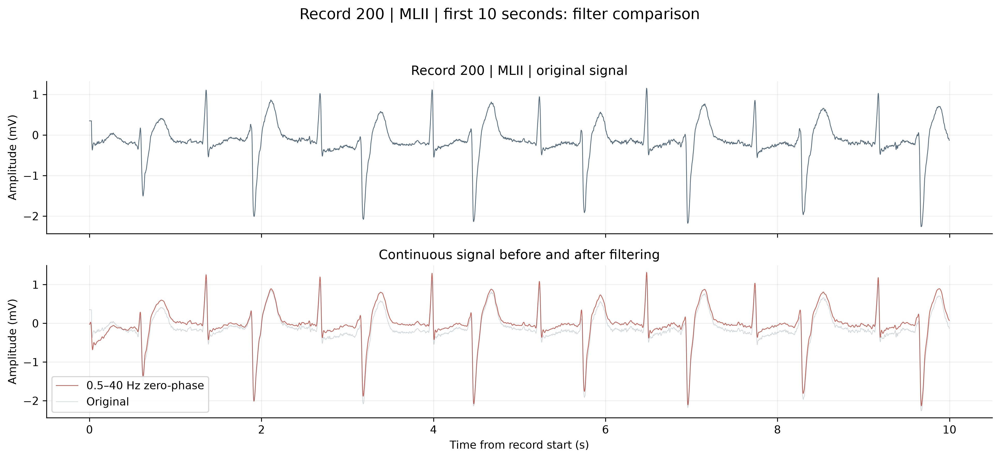

以专家标注样本r为中心，截取前0.3 s与后0.4 s，分别对应108点与144点，并包含中心点。因此输入长度为108+1+144=253点，覆盖端点间0.7 s。截取过程如图3。每个连续有限信号段两端设置5秒保护区；窗口越界、保护区内、非有限、平坦或重复目标位置等技术失败窗口排除；不根据模型预测修改专家标签，也不把质量提示直接转换为诊断标签。

$$ xᵢ[j] = s_f[rᵢ − 108 + j]，j = 0，…，252 （1）

其中s_f是滤波信号，rᵢ为第i个专家心拍标注的位置，j为窗口内索引。数据采用训练窗口全部数值拟合的全局标量z-score：

$$ zᵢ[j] = (xᵢ[j] − μ_train) / σ_train （2）

μ_train和σ_train分别为训练窗口的均值与总体标准差。N/V版本相应数值为0.010123 mV和0.342253 mV；验证、测试与部署复用既定参数。四分类使用其自身训练集参数。该过程不是逐拍单位幅值缩放，也没有为每个测试患者重新拟合归一化。逻辑回归在此基础上另用仅训练向量拟合的逐特征StandardScaler。

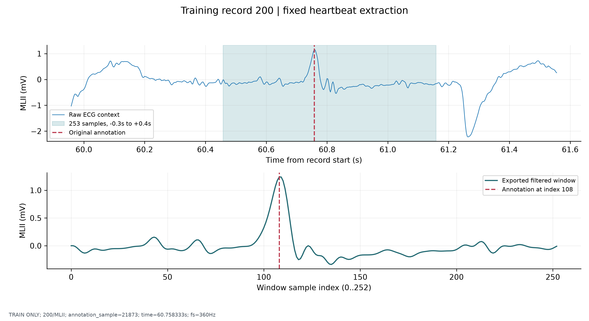

## 2.4 数据集划分

项目按受试者组以约70%/15%/15%的目标比例划分，随机种子为20261027；最终形成31/6/6个受试者的训练、验证和测试分区。划分还按V注释数是否达到100分层并约束留出V数量；已用于探索的记录100、200固定留在训练侧，未按模型成绩反复选择分区。训练区包含32条记录，其余各6条，原因是201与202同属训练患者。表2报告实际心拍数，不能由患者比例推算各类心拍比例。两任务患者分区相同，训练、验证和测试患者集合互斥，归一化与类别权重均只从训练侧估计。

表2 两项任务的实际数据划分

| 任务 | 训练拍数 | 验证拍数 | 测试拍数 | 患者数 训练 验证 测试 |
|---|---|---|---|---|
| N/V | 70183 | 12923 | 13448 | 31 / 6 / 6 |
| N/S/V/F | 71941 | 14345 | 13829 | 31 / 6 / 6 |

## 2.5 数据探索

四分类中N、S、V、F分别为89577、2761、6977和800拍，N占89.47%，F仅占0.80%。图4同时显示样本支持与患者覆盖，提示大量心拍并不自动带来同等充分的患者多样性。类别级患者数由元数据重新聚合，未采用曾把整个分区患者数重复填入各类的旧派生统计。典型波形用于观察数据形态，不被视为每个类别的唯一模板。

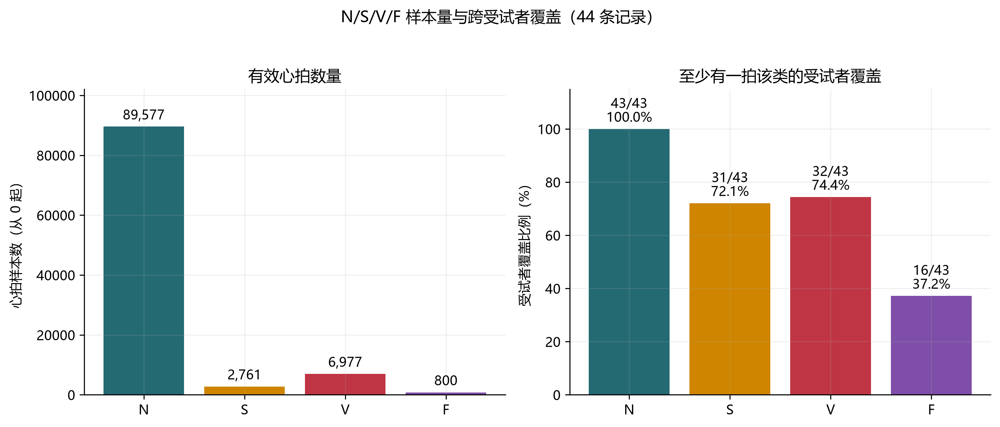

# 第三章 模型设计

## 3.1 逻辑回归

逻辑回归将253点标准化波形展平为向量，通过线性得分产生分类输出，作为检验线性可分性的基线。多分类时采用相应多类概率建模。正式配置使用C=1.0、lbfgs求解器、最大迭代1000、容差0.001和balanced类别权重。各时间位置的StandardScaler仅在训练向量上拟合。本文没有把额外的RR间期、手工QRS宽度或患者身份输入该模型，所以其不足也受到当前波形表达的限制。

## 3.2 随机森林

随机森林以多棵决策树的集成表示非线性关系[5]，输入同样为253维波形向量。正式配置为100棵树、最大深度18、叶节点最少2个样本，分裂候选特征采用sqrt，每棵树bootstrap抽样比例0.8，类别权重为balanced_subsample。随机森林与逻辑回归共享任务分区，但训练机制及权重方式不同。因此它们是相同数据条件下的模型对照，不是仅替换一个数学算子的严格结构消融。

## 3.3 一维卷积神经网络

项目采用紧凑一维卷积结构，输入张量形状为B×1×253，B表示批大小。三个卷积层依次提取局部时序表示，ReLU提供非线性，前两层后接最大池化，最后用自适应平均池化聚合时间维，再由线性层输出类别logits。实际网络没有批归一化、Dropout、循环层或注意力层。图5和表3均由现有模型定义整理，避免把文献中的其他网络结构误写入本项目。

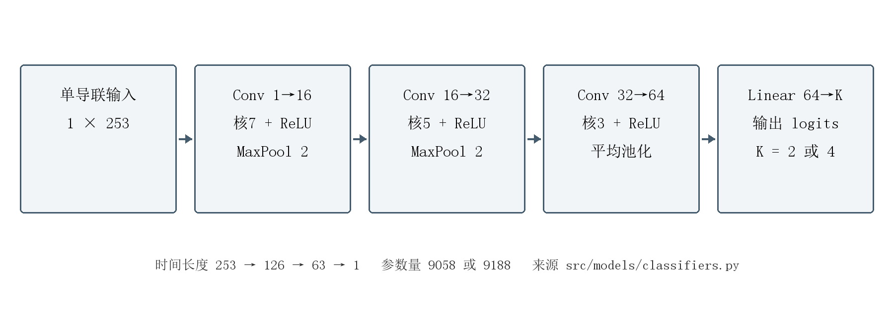

表3 一维卷积网络层结构

| 层或模块 | 输入尺寸 不含批维 | 输出尺寸 | 主要参数 |
|---|---|---|---|
| Conv1D 与 ReLU | 1×253 | 16×253 | 核7 padding3 |
| MaxPool1D | 16×253 | 16×126 | 核2 步长2 |
| Conv1D 与 ReLU | 16×126 | 32×126 | 核5 padding2 |
| MaxPool1D | 32×126 | 32×63 | 核2 步长2 |
| Conv1D 与 ReLU | 32×63 | 64×63 | 核3 padding1 |
| AdaptiveAvgPool1D | 64×63 | 64×1 | 输出长度1 |
| Linear | 64 | K | K为2或4 |

网络输出经softmax转换为类别分数，取最大分数对应类别。分数反映模型在给定标签集合下的相对输出，并未经过临床概率校准。训练使用加权交叉熵：

$$ L = −Σᵢ w_(yᵢ) log p_(i,yᵢ) / Σᵢ w_(yᵢ) （3）

其中yᵢ为真实类别，p_(i,yᵢ)为其预测概率，w_(yᵢ)为对应类别权重；求和在批内进行，分母对应加权均值。正式逆频率权重为w_c=n_train/(K n_c)，n_c为训练类c的拍数，K为类别数。该目标调整不同标签在损失中的相对贡献，不等于增加少数类患者。

## 3.4 训练与模型选择

CNN使用Adam，学习率0.001，weight decay为0.00001，批大小256，最多训练25个epoch，早停耐心值为5，以验证集Macro-F1选择检查点。随机种子为20261027，正式运行设备记录为CPU；N/V与四分类最佳epoch分别为12和11。验证集用于早停及已有权重策略比较，不能再当作独立泛化证据。本文读取既有工件与预测，未重新训练，也没有根据本次错误分析重新选择正式模型。

# 第四章 实验设计与评价指标

## 4.1 实验环境

正式数据处理环境记录Python 3.12.10、NumPy 2.5.4、SciPy 1.18.1、WFDB 4.3.1和scikit-learn 1.9.1，项目依赖锁记录PyTorch 2.14.1。上述版本来源于保存的环境与依赖文件，不表示论文生成时重新完成了该环境的全部复现。项目在Windows环境组织和运行，正式训练配置明确使用CPU；现存证据不足以填写具体CPU或显卡型号。Web前端和后端依赖分别由各自配置维护，不与训练环境混写。

## 4.2 评价指标

设混淆矩阵M的第a行、第b列表示真实为a、预测为b的心拍数。对类别c采用一对其余方式定义TP_c、FP_c、FN_c：

$$ Accuracy = Σ_c M_(c,c) / n （4）

$$ Precision_c = TP_c / (TP_c + FP_c)，Recall_c = TP_c / (TP_c + FN_c) （5）

$$ F1_c = 2 Precision_c Recall_c / (Precision_c + Recall_c) （6）

$$ Macro-F1 = (1/K) Σ_c F1_c （7）

n为被评价心拍总数。当分母为零时，项目评估实现把对应分数记为0，并同时报告真实支持数。Accuracy按心拍计数，容易受到多数类支配；Macro-F1等权汇总各类F1，便于暴露稀有类别的不足。Recall衡量实际该类心拍被找回的比例，Precision反映预测为该类的结果中正确比例，两者需要结合解读。按心拍计算的分数并非按患者平均的分数。

## 4.3 对照实验与证据范围

主实验在固定患者分区上比较N/V三模型；扩展实验使用同一记录分区的N/S/V/F标签。类别权重实验仅比较既有训练与验证结果，包括无权重、平方根平滑逆频率、截断逆频率和完整逆频率；平滑方案对逆频率开平方后按权重均值归一化，截断方案先将原始逆频率截到10再按均值归一化；该比较属于验证侧探索，未产生新的测试结论。

四分类五折StratifiedGroupKFold仅使用原训练加验证的86286拍、37个患者组。每位患者在外层仅进入一次折外评估；CNN在外层训练患者内部生成四折分组候选，按类别覆盖与固定序号选择一个内层早停划分，选定epoch后在整个外层训练侧重新拟合。该流程及折内归一化、类别权重已有日志记录。模型设置在此前实验中形成，故交叉验证定位为探索性稳定性分析，不称为外部验证。正式测试集此前已被查看，本文对保存预测的复算与错误图均为回顾性分析，未获得新的盲测数据。

# 第五章 实验结果与分析

## 5.1 N/V二分类结果

表4由三份测试预测CSV重新计算，并与保存JSON逐项核对。固定测试集包含12287拍N与1161拍V。CNN的Accuracy为0.9957，Macro-F1为0.9865，均高于本实验中的两种传统模型。图6并列展示二分类与四分类结果，说明优势具有任务条件，不能从二分类直接推断多类识别能力。

表4 N/V固定测试集三模型总体指标

| 模型 | Accuracy | Macro-F1 | N类F1 | V类F1 |
|---|---|---|---|---|
| 逻辑回归 | 0.8369 | 0.6961 | 0.9030 | 0.4892 |
| 随机森林 | 0.9835 | 0.9494 | 0.9909 | 0.9079 |
| 一维CNN | 0.9957 | 0.9865 | 0.9976 | 0.9754 |

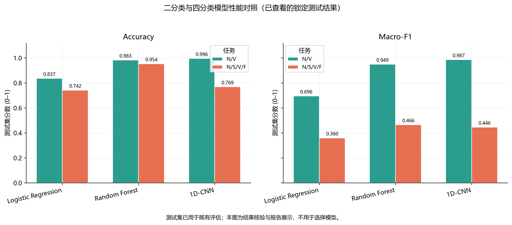

表5给出两类Precision和Recall。逻辑回归V类Recall达到0.9044，但Precision仅0.3352，意味着较多N心拍被报为V；因此不能只依据较高召回率认定其分类可靠。随机森林的V类Precision提高到0.8759，Recall为0.9423，在当前测试集上，随机森林相较逻辑回归减少了N→V误报，同时仍存在V→N漏分。CNN在两项指标间取得较好平衡，V类Precision为0.9607、Recall为0.9905。

表5 N/V测试集逐类Precision与Recall

| 模型 | N Precision | N Recall | V Precision | V Recall |
|---|---|---|---|---|
| 逻辑回归 | 0.9892 | 0.8306 | 0.3352 | 0.9044 |
| 随机森林 | 0.9945 | 0.9874 | 0.8759 | 0.9423 |
| 一维CNN | 0.9991 | 0.9962 | 0.9607 | 0.9905 |

图7中CNN正确识别12240拍N和1150拍V，N→V为47拍，V→N为11拍，共58次错误。两个方向的绝对数量与相对比例含义不同：N类基数更大，误报47拍仍对应较低的N类错误率；V类11拍漏分对应约0.95%的实际V心拍。本文没有根据这组错误调整阈值，也没有给这些数据库标签赋予临床处置优先级。

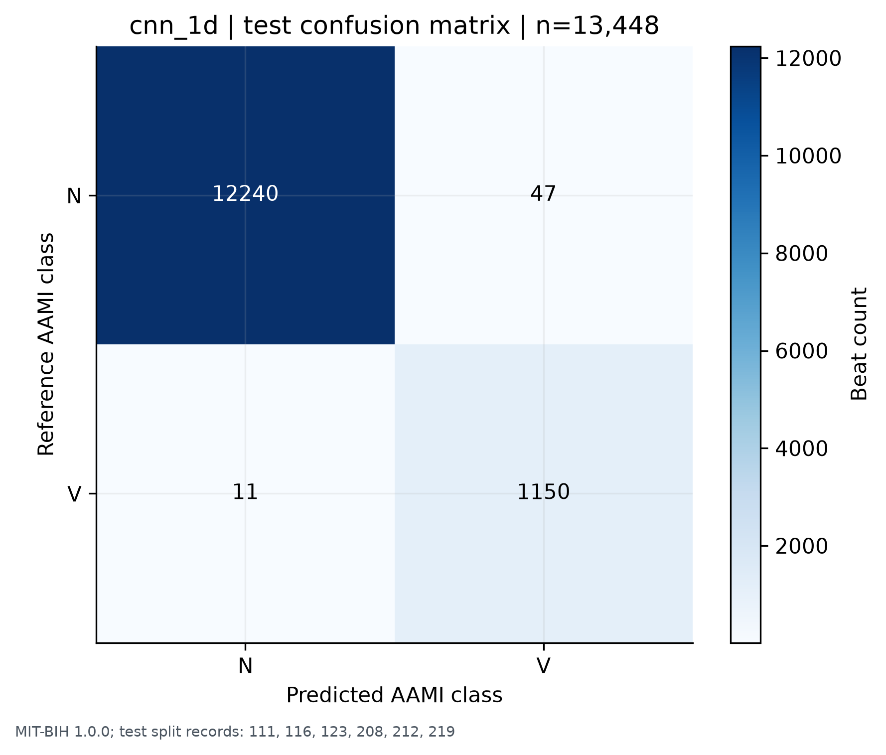

CNN相对随机森林的Accuracy提高约1.22个百分点，Macro-F1提高约0.0371。该差异仅是当前固定分区下的观测值；同一患者的心拍具有相关性，本文没有将13448拍视为独立患者样本进行显著性检验。也没有通过多随机种子重复训练给出置信区间，因此结论应限定为本次保存实验中的比较。另一个需要关注的事实是，该CNN最佳检查点在验证集上的Macro-F1仅0.6630，明显低于测试集0.9865。验证与测试患者及类别构成不同，分数高低不必同向；这种差异进一步表明，单个较高测试分数不足以证明对未知患者的稳定表现。

## 5.2 N/S/V/F四分类结果

表6显示，四分类随机森林以0.9536的Accuracy高于CNN的0.7690，Macro-F1也以0.4656高于CNN的0.4460。CNN没有在四分类上保持全面优势。测试集S仅10拍，F为371拍，而N仍为12287拍；总体Accuracy可主要由N类表现支撑，故需要同时查看每类结果。

表6 四分类固定测试集总体指标与逐类F1

| 模型 | Accuracy | Macro-F1 | N F1 | S F1 | V F1 | F F1 |
|---|---|---|---|---|---|---|
| 逻辑回归 | 0.7423 | 0.3599 | 0.8528 | 0.0083 | 0.4952 | 0.0833 |
| 随机森林 | 0.9536 | 0.4656 | 0.9800 | 0.0000 | 0.8825 | 0.0000 |
| 一维CNN | 0.7690 | 0.4460 | 0.8621 | 0.0000 | 0.9179 | 0.0039 |

随机森林的S、F类F1均为0，说明较高总体准确率与稀有类别识别不足可以同时出现。CNN的V类Recall为0.9914，但S类Recall为0，F类仅正确1拍，Recall为0.0027。其N类Recall降为0.7718，2626拍N被分到S。它预测S共2630拍却未正确识别真实S，并不能因输出了较多少数类标签，就认为少数类识别得到了改善。

逻辑回归正确找回6/10拍S，Recall为0.6000，但S类Precision仅0.0042，对应大量其他心拍被误报为S。因此极少数真实正例上的Recall尤其需要与误报规模及患者来源并读。F类融合形态及短窗上下文不足可以作为后续研究问题，但现有预测本身不能证明某种特定生理机制导致了这些错误。

## 5.3 类别不平衡与患者集中度

图8显示，F类800拍由16个受试者提供，其中最大来源患者贡献46.25%，前三名贡献93.25%。训练分区F仅411拍，由10名患者提供，其中患者213贡献88.08%；测试分区371拍F中370拍来自患者208，占99.73%。因此看似数百次的F类测试，实质上主要反映一个患者的心拍形态，不能代表稳定的跨患者F泛化估计。

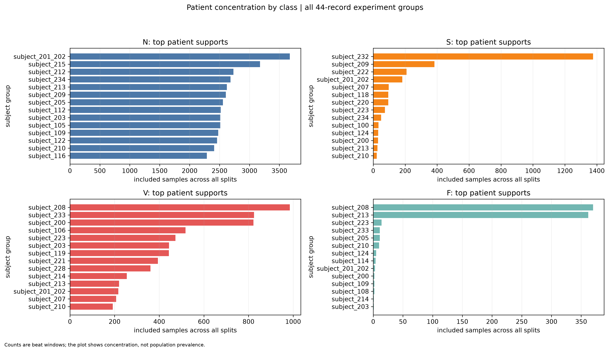

S类验证集虽有1404拍，却有98.01%来自患者232；测试S仅来自3名患者、共10拍。这种分布使验证侧选择可能受到特定患者支配，并使测试召回率对少数单拍变化敏感。既有按心拍权重调整并未增加形态来源的多样性，也未保证每个分区都有充分患者覆盖。

项目曾修正类别级subject_count与record_count的派生统计错误。本次核验以逐拍metadata重新聚合患者数，确认N/V训练V类实际覆盖23名患者、24条记录，而非整个训练分区的31名患者、32条记录。该修正改变的是描述统计，不改变原始样本、标签、模型和预测，不能被解释为模型性能提升。

## 5.4 类别权重消融

表7与图9仅使用既有CNN训练和验证结果。无权重时，验证Accuracy为0.8519，Macro-F1为0.3914，S/F预测占比均为0。完整逆频率权重使S类Recall提高至0.9309，但S类Precision为0.4693；F类Recall为0.1111，Precision仅0.0036。少数类被找回的比例提高，同时也带来更多错误预测，不能把权重作用概括为所有指标同步改善。

表7 CNN权重策略的验证集结果

| 权重方案 | Accuracy | Macro-F1 | S Recall | F Recall | N Recall |
|---|---|---|---|---|---|
| 无权重 | 0.8519 | 0.3914 | 0.0000 | 0.0000 | 0.9760 |
| 平方根平滑 | 0.8335 | 0.3962 | 0.0000 | 0.1111 | 0.9490 |
| 截断逆频率 | 0.6590 | 0.4138 | 0.6980 | 0.0000 | 0.6313 |
| 完整逆频率 | 0.7185 | 0.4735 | 0.9309 | 0.1111 | 0.6897 |

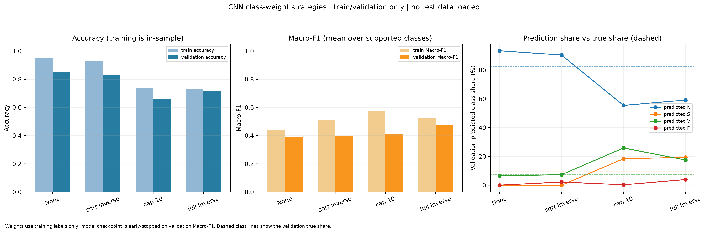

平方根平滑策略的验证Macro-F1约0.396，F类Precision约0.006，仍未解决S类预测缺失；截断策略的Macro-F1约0.414，也不优于完整逆频率的约0.473。完整逆频率在当前验证对照中的Macro-F1最高，但同一验证集参与早停，故该排序具有探索性。不能据此把它推广为其他患者、其他随机种子或其他数据集上的最优策略。

传统模型的既有加权与无权重比较呈现不同模式：随机森林验证Macro-F1分别约0.402与0.409，权重没有带来相同的收益；逻辑回归加权后Recall、Precision与总体表现也有不同取舍。这说明权重效果与模型决策方式共同作用。当前证据支持“权重改变了预测分布”的描述，尚不足以把四分类失效完全归因为单一权重设置。

## 5.5 患者级泛化与折间波动

五折分析汇总见表8，标准差使用五个折结果的样本标准差，不能解释为标准误或置信区间。随机森林平均Macro-F1为0.4173，CNN为0.3564，逻辑回归为0.3047；图10中CNN的折间变化较大。CNN的Accuracy标准差约0.187，而随机森林约0.033，提示前者对当前患者组成更敏感。

表8 四分类探索性受试者分组五折结果

| 模型 | Accuracy 均值±标准差 | Macro-F1 均值±标准差 | 合并折外Macro-F1 |
|---|---|---|---|
| 逻辑回归 | 0.6038±0.0908 | 0.3047±0.0377 | 0.2931 |
| 随机森林 | 0.9011±0.0332 | 0.4173±0.0424 | 0.4054 |
| 一维CNN | 0.6418±0.1870 | 0.3564±0.0624 | 0.3535 |

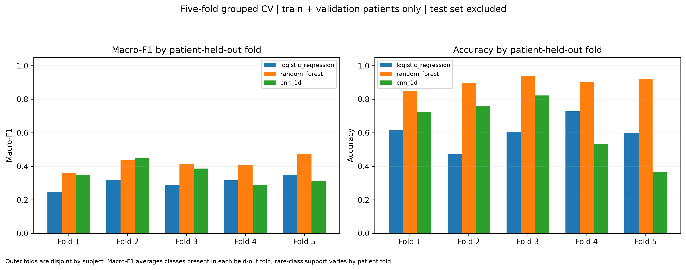

五折均值与合并全部折外预测后计算的Macro-F1并不相同，因为F1是非线性汇总，而且各折支持数与类别构成不同。正式固定测试集与这组CV使用的患者集合也不同，因此不宜把两者的差值直接当成时间上的性能退化。相同的是，两种分析都提示S/F的跨患者识别仍不足。

CV的86286拍仅来自37个训练加验证患者组，其中F总计429拍。五个外折的F真实支持分别为5、17、5、37和365拍，折间指标同时受到患者构成与少数类支持变化影响。随机森林的F类平均Recall为0，CNN约0.0632。分组评估阻断了同一患者直接跨越训练和评估两侧，但无法补足稀有类别来源不足，也无法消除既有模型设定的选择历史。本文据此将结果用于稳定性诊断，而不宣称完成了临床外部验证。

## 5.6 真实错误样本分析

图11从已有测试预测CSV与对应信号中选取实际错误，标出记录、标注位置及真值/预测标签。记录111标注索引62的心拍的原始符号为L，经映射属N，却被CNN预测为S，标注时刻53.175 s；记录208标注索引32的心拍在18.822 s处为F→N，标注索引19的心拍在11.381 s处为F→V。这些例子也说明N组内存在束支阻滞心拍，不能把所有N错误解释为健康人误报。

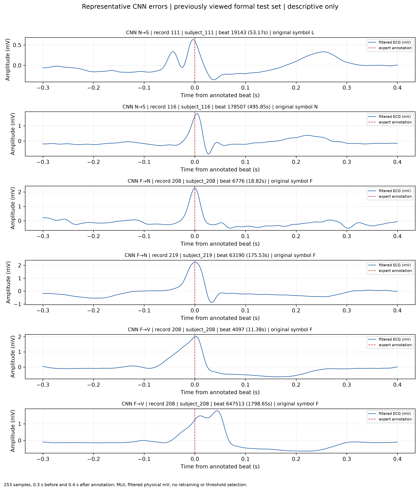

四分类F→N与F→V分别为216与154拍，合计解释了绝大多数F错误；测试F又几乎来自患者208，两条事实应共同讨论。N/V模型与四分类模型虽使用相近架构，却有不同训练标签、归一化工件及输出边界，其错误不能互相替代。二分类仍有47拍N→V和11拍V→N，表明高总体指标没有消除局部失误。

波形可为复核提供具体对象，但本文未做显著性归因、特征遮挡或临床专家盲评，因此不直接宣称网络学会了P波、QRS宽度等特定生理规则。患者形态差异、有限时间窗、标签内部异质性和类别来源集中均是后续可检验的解释。所选案例是已暴露测试集的定性回顾，不用于重新调参，也不能代表随机抽样的错误发生率。

# 第六章 ECG-AI系统设计与实现

## 6.1 系统目标与架构

系统面向课程实验展示，使用户能够从真实ECG波形进入心拍、预测和实验结果，追溯模型判断对应的数据。前端采用Umi Max、React、TypeScript、Ant Design组件生态与ECharts，后端采用FastAPI。当前依赖未单独声明Ant Design Pro产品包，因此按实际组件栈描述。数据层包括MIT-BIH信号和标注、预处理元数据、模型工件及既有实验结果；架构见图12。

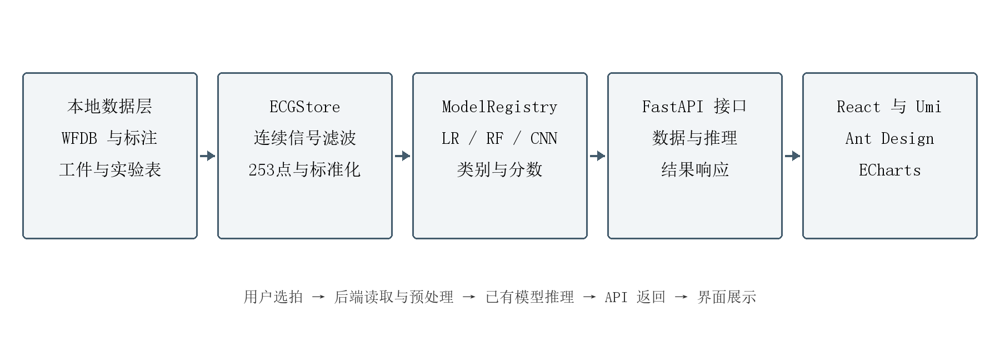

前后端通过接口交换记录信息、心拍片段和预测结果。模型注册层负责类别顺序、输入配置与工件加载，研究接口读取既有统计和图表。界面中的历史指标与用户触发的模型推理具有不同来源，系统分别提供相应展示，避免用一组历史分数代替当前选中心拍的预测。

## 6.2 波形查看与真实模型推理

ECG工作台支持记录与片段查看、专家标注定位、心拍选择和详情展示，图13来自实际运行页面。推理路径为：选择真实心拍，读取记录上下文，复用指定任务的滤波、截窗和归一化规则，加载已保存模型，生成类别及分数，再在前端与专家标签一起展示。系统使用上下文与滤波边界规则对齐训练预处理，而非只对253点短窗独立滤波。

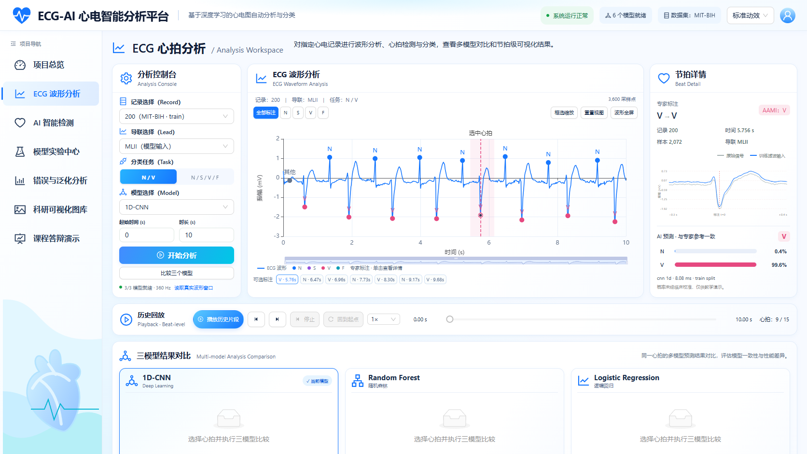

单心拍推理与三模型比较均调用真实模型工件，比较页如图14。用户可以观察同一输入上三种模型是否一致，但三者一致不能作为专家标签之外的真值。历史回放支持进度和播放控制，用于重现已有记录的观察过程；后端使用既有标注位置，不具备对任意未标注上传ECG自动定位全部心拍的能力。

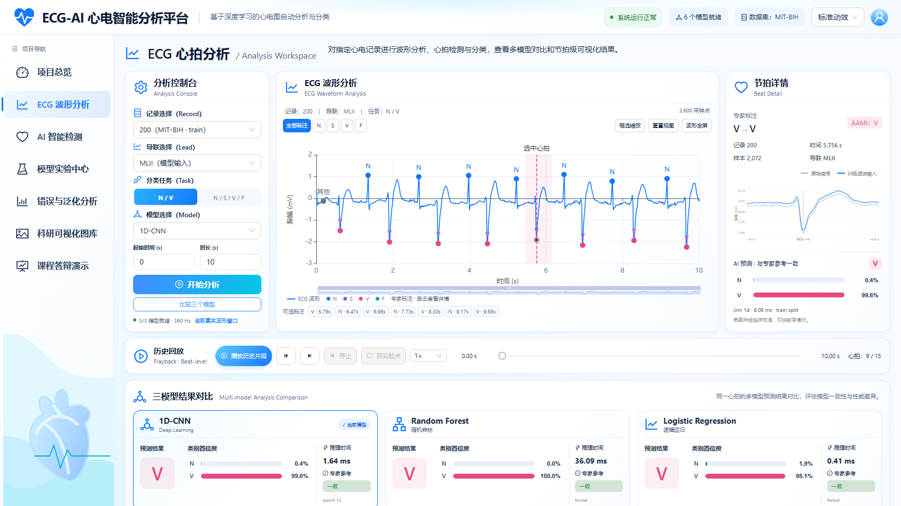

## 6.3 实验分析与互动教学

模型实验中心展示两项任务的指标、混淆矩阵及相关图表，图15提供实际页面证据。错误与泛化分析页将类别支持、患者集中度和真实错误样本联系起来，科研图片页索引已有实验图。动画、心电互动实验室、Heartbeat Hunter及首次访问欢迎引导已有实现和测试记录。游戏使用真实记录片段与标注组织练习，并可衔接模型分析，但练习得分不作为模型评估指标，也未通过教学研究证明学习效果。

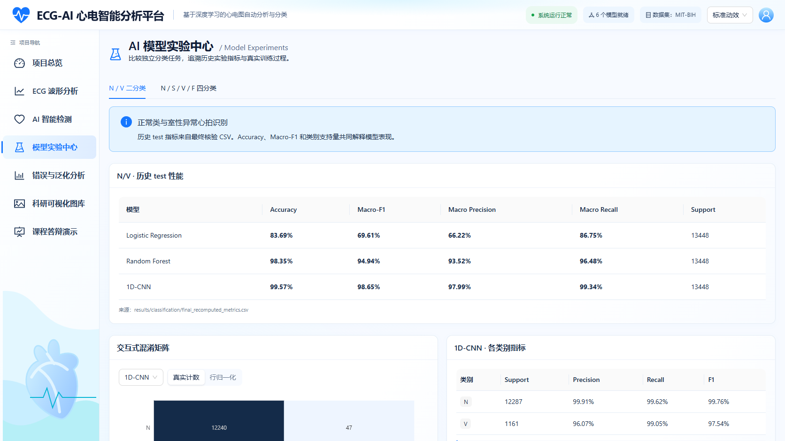

## 6.4 一致性验证与功能验证

保存的部署验证从N/V与四分类验证集各抽取100拍，每拍比较三模型，共600次对照，预测类别600/600一致。输入最大绝对差为0，概率最大绝对差为4.7684×10⁻⁷。这项结果证明被抽查工件、预处理和接口在数值上能够复现历史输出，分母为模型预测次数，不能写成600名患者或100%的疾病诊断准确率。

接口、模型加载和预测一致性具有对应的代码与原始测试日志。2026年11月3日后端阶段日志记录18项测试通过；11月4日全站浏览器交互回归记录16项通过；后续互动教学相关记录另包含后端测试和浏览器场景。前端存在构建及多视口页面验证记录，保存截图覆盖工作台、比较、实验与游戏流程。本次论文整合复核这些既有文件，未把历史通过记录写成本次重新执行全部测试。软件验证支持实现与运行一致性，不能消除第五章揭示的四分类模型局限。

# 第七章 总结与展望

## 7.1 工作总结

本文围绕已有ECG-AI项目完成单导联数据处理、三模型比较和交互系统整合。在固定受试者独立N/V测试中，一维CNN取得0.9957的Accuracy与0.9865的Macro-F1，显示其在当前数据条件下对两组心拍具有较好的区分能力。扩展到四分类后，随机森林总体指标更高，但三模型均存在少数类识别不足，深度模型优势不再普遍成立。患者分布核验、权重对照、交叉验证和真实错误案例使上述结论具有可追溯证据。

系统把原始波形、专家标注、真实工件推理和实验图表连接起来，并通过已有一致性与功能测试记录支持工程实现。课程成果主要体现为规范的比较实验、对不利结果的分析，以及可交互展示流程，不构成新的分类算法。

## 7.2 局限性

MIT-BIH规模有限，属于特定历史采集条件下的数据，不能代表现代设备与全部人群。患者独立划分虽降低同人泄漏，稀有类别患者数量和来源集中仍限制四分类估计。正式测试结果已有查看历史，当前回顾性诊断及探索性CV不能替代新的外部验证；单随机种子和较少测试患者也限制了不确定性判断。

模型依赖专家标注位置截窗，尚不能直接分析任意未标注ECG；离线前后向滤波不具备流式因果特性。输入缺少显式RR和更长节律上下文，模型分数未做临床校准，也没有临床终点、前瞻性研究或教学效果试验。因此系统适合本项目范围内的实验分析与教学展示，不能输出临床诊断结论。

## 7.3 未来工作

后续可引入并单独评价自动R峰检测，例如以经典QRS检测方法为起点[10]，将定位误差传播纳入分类评估；结合RR间期与长时上下文，检验其对S/F识别是否有帮助[4,8]。增加少数类患者来源、设置新的患者独立外部验证，并比较多导联与单导联方案，是扩大证据范围的方向。交互系统可继续完善教学任务和解释展示，但新增功能与模型改进均需经过独立验证后再写为已完成成果。

# 参考文献

[1] MOODY G B, MARK R G. The impact of the MIT-BIH Arrhythmia Database[J]. IEEE Engineering in Medicine and Biology Magazine, 2001, 20(3): 45-50. DOI: 10.1109/51.932724.

[2] GOLDBERGER A L, AMARAL L A N, GLASS L, et al. PhysioBank, PhysioToolkit, and PhysioNet: components of a new research resource for complex physiologic signals[J]. Circulation, 2000, 101(23): e215-e220. DOI: 10.1161/01.CIR.101.23.e215.

[3] MOODY G, MARK R. MIT-BIH Arrhythmia Database version 1.0.0[DB/OL]. PhysioNet, 2005[2026-11-05]. https://physionet.org/content/mitdb/1.0.0/. DOI: 10.13026/C2F305.

[4] DE CHAZAL P, O'DWYER M, REILLY R B. Automatic classification of heartbeats using ECG morphology and heartbeat interval features[J]. IEEE Transactions on Biomedical Engineering, 2004, 51(7): 1196-1206. DOI: 10.1109/TBME.2004.827359.

[5] BREIMAN L. Random forests[J]. Machine Learning, 2001, 45(1): 5-32. DOI: 10.1023/A:1010933404324.

[6] KIRANYAZ S, INCE T, GABBOUJ M. Real-time patient-specific ECG classification by 1-D convolutional neural networks[J]. IEEE Transactions on Biomedical Engineering, 2016, 63(3): 664-675. DOI: 10.1109/TBME.2015.2468589.

[7] ACHARYA U R, OH S L, HAGIWARA Y, et al. A deep convolutional neural network model to classify heartbeats[J]. Computers in Biology and Medicine, 2017, 89: 389-396. DOI: 10.1016/j.compbiomed.2017.08.022.

[8] MONDÉJAR-GUERRA V, NOVO J, ROUCO J, et al. Heartbeat classification fusing temporal and morphological information of ECGs via ensemble of classifiers[J]. Biomedical Signal Processing and Control, 2019, 47: 41-48. DOI: 10.1016/j.bspc.2018.08.007.

[9] CHAWLA N V, BOWYER K W, HALL L O, et al. SMOTE: synthetic minority over-sampling technique[J]. Journal of Artificial Intelligence Research, 2002, 16: 321-357. DOI: 10.1613/jair.953.

[10] PAN J, TOMPKINS W J. A real-time QRS detection algorithm[J]. IEEE Transactions on Biomedical Engineering, 1985, BME-32(3): 230-236. DOI: 10.1109/TBME.1985.325532.
