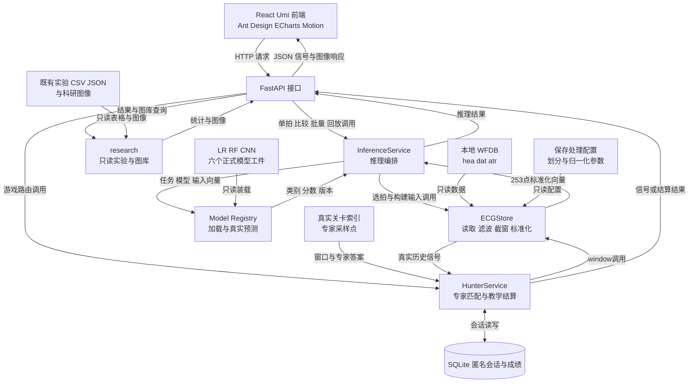

# 第六章 V2 系统实现补充稿

以下内容依据2026年11月6日的只读源码与历史产物复核整理，可并入第六章。软件测试的执行日期为项目原记录日期，本轮未重新运行服务或测试；CSV汇总是本轮对保存结果的复算。表号由全文排版时连续分配。

## 系统架构与数据方向

系统前端使用React与TypeScript，通过Umi组织路由，Ant Design提供交互组件，ECharts绘制信号与结果图，Motion负责界面动效。FastAPI接收浏览器请求，并按职责调用数据读取、模型推理、科研结果和互动教学模块。ECGStore从本地WFDB记录读取真实物理信号与专家标注，同时读取处理配置、受试者划分和训练集归一化参数。InferenceService负责组织选拍、输入构建及预测；Model Registry读取已有六个模型工件，核对输入维度与类别次序，再执行指定模型的推理。接口将类别、逐类分数、工件哈希及数据来源返回前端。

科研结果展示与请求内推理使用不同的数据路径。实验中心、错误分析及图库通过research模块读取保存的指标表、逐拍预测和图像；这些历史预测CSV不代替单心拍推理。互动教学模块读取独立的真实关卡索引，通过ECGStore取得历史信号，以专家标注进行结算，并用SQLite保存匿名会话。游戏分数不进入分类模型的输入。模型推理和科研展示不反向写入原始ECG、训练权重或正式实验结果。

架构图应表达以下实际调用与数据方向；图中“读取”表示文件流入服务，“调用/返回”表示服务之间的请求和结果：

## 真实心拍推理流程

用户首先选择记录、分类任务和专家标注位置。`GET /api/ecg/window`读取选定时间窗，`GET /api/ecg/annotations`返回该范围的专家标注；局部心拍由`GET /api/ecg/beat`展示。实际预测使用`POST /api/inference/beat`，参数为记录编号、专家采样点、任务与模型标识。服务先确认记录属于允许列表，推理时进一步要求记录纳入当前44记录实验且导联为MLII；不把任意文件路径或任意未标注采样点作为合法模型请求。

ECGStore复用保存配置中的连续带通滤波，对专家采样点前108点、后144点及中心点组成的253点窗口检查边界、有限值、平坦段与滤波保护区。任务对应归一化参数仅由训练集拟合。LR另应用保存的逐维StandardScaler，RF不增加训练时不存在的缩放，CNN将输入组织为1×1×253的张量，以CPU推理。模型注册模块在应用启动或首次使用时加载工件，后续复用内存对象。专家类别用于回顾性对照，不加入波形输入特征。

预测响应包含`predicted_class`、`class_probabilities`、`model_sha256`、`preprocessing_version`及记录和采样点等字段。`POST /api/inference/compare`对同一标准化窗口依次执行三个模型；`/api/inference/batch`和`/api/ecg/playback/segment`用于有限批量和历史片段回放，最大处理128个标注位置。前端把返回结果与真实波形关联展示。该流程仍以专家标注中心为前提，离线双向滤波和历史回放也不等同于实时采集监护。

## 功能实现与验证证据

表中软件测试结果均取自2026年11月3日至4日保留记录，本轮没有重新运行；不同阶段的通过项数不相加。16项全站回归为套件总数，不代表每个模块各有16项独立测试。

| 功能模块 | 实现内容 | 验证方式 | 实际记录结果 | 截图或日志证据 |
|---|---|---|---|---|
| ECG记录读取 | WFDB允许列表、真实mV与秒单位 | 后端真实记录/窗口检查及浏览器画图 | 历史核心后端18项通过；真实工作台场景通过 | `visual_fidelity/backend_final.log`；`e2e_final.log` |
| 单心拍定位 | 标注采样点定位、局部原始/滤波波形 | 真实标注点击并检查推理响应 | 历史全站回归16项包含选拍场景；欢迎后同拍推理有真实响应断言 | `tests/workspace.spec.ts`；`tests/welcome-onboarding.spec.ts`；工作台局部截图 |
| 模型切换 | LR、RF、CNN及两任务选择 | 等待真实API响应核对model_id | 欢迎交付记录的追加回归通过；当前passed标记无独立项数 | `welcome_onboarding.md`；`test-results-onboarding/.last-run.json` |
| 三模型比较 | 同一窗口执行三模型并展示概率 | 浏览器交互；保存验证预测比对 | 历史工作台场景通过；600条部署对照类别均一致 | `visual_fidelity/e2e_final.log`；`results/phase3_validation/` |
| 历史ECG回放 | 片段预载、暂停、倍速、定位 | 真实回放状态与浏览器场景 | 全站回归中回放场景通过；另有短时性能观测 | `visual_fidelity/e2e_final.log`；`phase5_playback_performance.json` |
| 模型实验结果 | 读取保存指标、混淆矩阵与训练日志 | 只读科研API与页面交互 | 历史后端18项及全站16项套件通过 | `visual_fidelity/backend_final.log`；`e2e_final.log`；实验中心局部截图 |
| 可视化图库 | 研究图片索引、缩略图与原图 | 真实图库及键盘操作场景 | 历史全站日志包含图库场景通过 | `visual_fidelity/e2e_final.log` |
| 互动实验室 | 三难度选拍、专家结算、复盘与模型入口 | 关卡校验、后端规则、浏览器流程 | 2026-11-04报告为37项后端、10项游戏E2E；当前历史marker为passed | `games/heartbeat_hunter_testing.md`；`test-results-hunter/.last-run.json` |
| 首次欢迎与教程 | 可跳过引导、主动开局、同拍模型跳转 | 真实交互及存储降级场景 | 交付文档记载分别运行22个场景；当前spec后增场景，不能沿用22作为最新套件数 | `welcome_onboarding.md`；`tests/welcome-onboarding.spec.ts` |

静态类型检查与生产构建另有`visual_fidelity/typecheck.log`、`build.log`；生产无外网场景为`production.log`所记1项通过。这些检查支持软件行为与构建复现，不验证医学分类效用。

## 部署预测一致性分组结果

本轮直接汇总`web/results/phase3_validation/validation_prediction_comparison.csv`，按任务和模型分别比较100条既有验证心拍。六组共600条，标准化输入的最大绝对差均为0。表中最大概率差是每组内所有样本、各类别输出与历史保存预测的最大绝对差。

| 任务 | 模型 | 验证心拍 | 类别相同 | 最大概率绝对差 |
|---|---|---:|---:|---:|
| N/V | LR | 100 | 100/100 | 2.9802×10⁻⁷ |
| N/V | RF | 100 | 100/100 | 2.2204×10⁻¹⁶ |
| N/V | CNN | 100 | 100/100 | 1.6295×10⁻⁷ |
| N/S/V/F | LR | 100 | 100/100 | 4.7684×10⁻⁷ |
| N/S/V/F | RF | 100 | 100/100 | 2.2204×10⁻¹⁶ |
| N/S/V/F | CNN | 100 | 100/100 | 3.2846×10⁻⁷ |

两任务各使用100个验证心拍条目，三模型复用同一任务样本，共形成200个任务—心拍条目和600次模型对照。按记录编号和专家采样点跨任务去重后，实际为143个不同心拍位置：两任务共享57个位置，其中N类32个、V类25个；所有条目共来自6个受试者组。因此不能将其视为200个独立心拍样本。N/V抽样为N=50、V=50；四分类为N=32、S=25、V=25、F=18。当前六模型工件的SHA-256仍与该验证汇总一致。此项对照验证部署路径复现了同一模型的历史预测，不能称作分类准确率100%，也不构成新的独立分类性能或临床验证。

## 互动教学模块的依据与范围

Heartbeat Hunter使用记录100、105、106、108、109、114的真实MIT-BIH MLII信号，360 Hz；关卡索引含原始文件哈希和专家采样点。现有索引共62个窗口，新手、标准、挑战分别为21、21、20关。片段只保留N/V可判定内容，排除S/F/Q、未知心拍及不安全区。用户寻找V组心拍，服务端按±0.10 s容差与专家位置作一对一匹配，正确选择、误选和漏选分别计分，并结合连击和限定条件下的时间奖励形成教学反馈。专家答案在结算后揭示，随后可查看局部波形并跳转至同一心拍的真实模型推理。

欢迎引导和首次教程用于说明操作，读取教程不会自动开始计时；欢迎中的SVG明确标为视觉示意，不能作为真实ECG结果。界面动效支持减少动态效果。游戏评分仅描述当前规则下的选拍表现，未开展学习效果用户研究，不能声称已显著提升学习效果，更不能将其换算为医学诊断能力。关卡筛选与历史平台可查阅标注的条件，也不同于未知患者的独立测验。

## 正文截图替换建议

采用保留的2026年11月4日真实浏览器截图局部，去除侧栏和重复页面装饰以放大核心信息；日期统一放在图注来源说明，无需写入每个图题。新副本已保存在`paper/figures/v2/`，原图与数字未变：

1. `system_workbench_crop.png`：展示真实波形、单位、标注和所选心拍，建议图题“ECG工作台的波形与心拍定位”。来源`iteration2/ecg_1672x941.png`，无损裁剪框为(left, top, right, bottom)=(512,132,1334,618)，原图1672×941，结果822×486。
2. `system_comparison_cards.png`：同一源图中的CNN、RF、LR三张卡片无损裁剪后纵向排列，建议图题“同一心拍的三模型推理结果”。来源`iteration2/comparison_1672x941_full.png`，原图1672×1116；三个框依次为(246,763,703,951)、(714,763,1171,951)、(1182,763,1639,951)。结果457×588，建议Word显示宽9—10 cm以控制图片高度；图注声明“三张结果卡片纵向重排，单拍概率不代表总体性能”。
3. `system_experiments_class_crop.png`：保留实验中心真实类别表和支持数说明，建议图题“模型实验中心的类别指标展示”。来源`iteration2/experiments_1672x941_full.png`，原图1672×1831；框(950,715,1653,984)，结果703×269。底部原始开发路径未纳入裁剪，来源另在索引登记。

三个框均使用左上含、右下不含坐标，仅裁剪和重排，未重绘信号、修改预测值或加入生成图像。本轮已逐张打开查看，内容无裁切；最终仍需在Word实际版面中验证字号。系统路由与相关数据路径相对V1已跟踪源码哈希未变，截图仍作为历史已实现界面的证据。本轮只读未检出既有服务监听，未启动服务，因此没有声称获取了2026年11月6日新运行截图。
