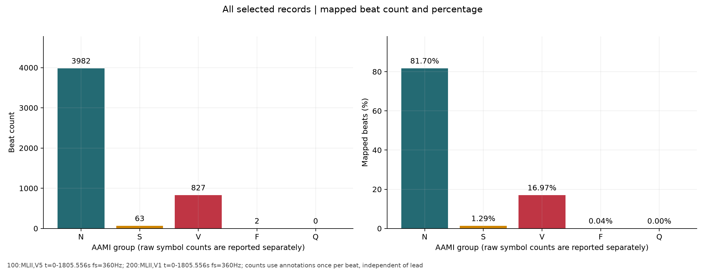
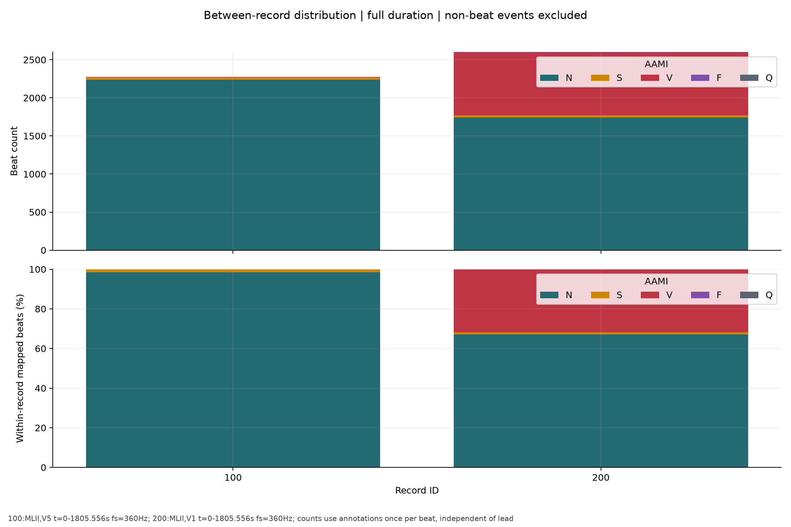

# MIT-BIH 第一阶段数据探索报告

## 数据集简介与本次范围

分析数据库版本固定为 **MIT-BIH Arrhythmia Database 1.0.0**。官方数据库含 48 条约半小时的双通道记录，来自 47 位受试者，采样率为每导联 360 Hz。部分记录为富集少见心律失常而选取，因此本次比例不能解释为人群患病率。[PhysioNet 官方说明](https://physionet.org/content/mitdb/1.0.0/)

本次实际读取记录：**100, 200**；共 2 条。下列统计均由本地原始文件计算；不是全库统计。未训练模型、未划分训练/测试集、未开发前端，未滤波、未重采样、未修改原始信号或专家标注。

| record | fs_hz | samples | duration_s | last_sample_time_s | leads | units | annotation_count |
| --- | --- | --- | --- | --- | --- | --- | --- |
| 100 | 360 | 650000 | 1805.56 | 1805.55 | MLII, V5 | mV, mV | 2274 |
| 200 | 360 | 650000 | 1805.56 | 1805.55 | MLII, V1 | mV, mV | 2792 |

## 数据读取流程与对应验证

1. 从 `https://physionet.org/files/mitdb/1.0.0/` 下载官方 `RECORDS`、`SHA256SUMS.txt` 和所选记录的 `.dat/.hea/.atr`。已有原始文件仅核验不覆盖；不匹配即报错。下载清单为 `results/download_manifest.csv`。官方哈希表本身通过 HTTPS 获取；这属于完整性核验，不是独立数字签名认证。
2. 使用 `wfdb.rdheader` 解析头文件；`wfdb.rdrecord` 分别读取物理幅值与数字采样；`wfdb.rdann(..., 'atr')` 读取专家标注。[WFDB Python 官方文档](https://wfdb.readthedocs.io/en/latest/io.html)
3. 时间采用记录起点相对时间 `time_s = sample / fs`，从 0 编号。有效末采样时间是 `(n-1)/fs`，记录区间为 `[0,n/fs)`。导联名称、物理单位、原始注释均来自头文件；完整元数据见 `results/record_metadata.csv`。
4. 核对信号形状、采样率、数字信号逐导联校验和、标注范围/顺序、重复时间及心拍位置有限值。图中标记直接放到原始 `sample`，不以检测峰替换。位置落在 QRS 附近的视觉对应只能支持读入一致，不能独立验证专家标签的医学正确性。

| record | annotations_in_range | annotations_monotonic | duplicate_annotation_times | duplicate_beat_times | all_signal_samples_finite | all_beat_positions_finite | digital_checksums_match |
| --- | --- | --- | --- | --- | --- | --- | --- |
| 100 | True | True | 0 | 0 | True | True | True |
| 200 | True | True | 0 | 0 | True | True | True |

## 原始标签、AAMI 归组及依据

WFDB 原始 `symbol` 是事实来源；中文仅是官方符号定义的翻译。映射严格使用任务指定的常用 AAMI 五组规则：`N←N,L,R,e,j`；`S←A,a,J,S`；`V←V,E`；`F←F`；`Q←/,f,Q`。参考 [de Chazal 等，2004，Table I，DOI](https://doi.org/10.1109/TBME.2004.827359)；原始符号含义及非心拍定义见 [PhysioNet Standard annotations](https://physionet.org/static/lightwave/doc/annotations.html)。本阶段是五类映射探索，不宣称已经完成完整 AAMI 评测协议。

**原始 N 与分组 N 不同**：分组 N 还包含束支阻滞及部分逸搏，不能统称健康/正常。原始 Q 与分组 Q 也不同：分组 Q 包含起搏和起搏融合。非心拍标注不放入五组；已知但不在指定映射中的心拍单列 `unmapped_beat`；陌生符号列为 `unknown`，不推测归组。

实际出现的所有原始符号如下（0 次符号只在完整映射 CSV 中列出）：

| symbol | meaning_zh | annotation_kind | aami_group | count |
| --- | --- | --- | --- | --- |
| N | 正常心拍 | mapped_beat | N | 3982 |
| V | 室性期前收缩 | mapped_beat | V | 827 |
| + | 节律改变（详见 aux_note） | non_beat |  | 149 |
| A | 房性期前收缩 | mapped_beat | S | 63 |
| ~ | 信号质量改变（保留 subtype） | non_beat |  | 43 |
| F | 室性与正常心拍融合 | mapped_beat | F | 2 |

完整规则、中文含义、分组、数量及来源：`results/label_mapping.csv`；分记录原始计数：`results/raw_symbol_counts_by_record.csv`；逐条非心拍：`results/non_beat_annotations.csv`。全部标注含 `record, annotation_index, sample, time_s, symbol, subtype, chan, num, aux_note`，并保留对应导联幅值。部分原始 aux_note 含 NUL 终止符，另以 `aux_note_json` 保留可安全往返的 JSON 字符串、`aux_note_text` 展示去尾部 NUL 的文本；`results/annotations.jsonl` 无损保留原始 aux_note 并做往返验证。

## 统计事实与各类别分布

总标注 **5066** 条 = 五组已映射心拍 **4874** + 非心拍 **192** + 未映射心拍 **0** + 未识别 **0**。同一心拍在两个导联上观察只计一次。

| aami_group | count | percentage_of_mapped_beats |
| --- | --- | --- |
| N | 3982 | 81.6988 |
| S | 63 | 1.29257 |
| V | 827 | 16.9676 |
| F | 2 | 0.0410341 |
| Q | 0 | 0 |

最多的非空组为 N（3982 拍），最少的非空组为 F（2 拍），两者数量比为 1991.00:1。 零样本组：Q。比例分母仅为已映射心拍（4874）；非心拍和未映射项不悄悄并入分母。非 N 组共 892 拍，不能直接解释为经诊断的“异常总数”。

| record | aami_group | count | percentage_within_record_mapped_beats |
| --- | --- | --- | --- |
| 100 | N | 2239 | 98.5042 |
| 100 | S | 33 | 1.45183 |
| 100 | V | 1 | 0.0439947 |
| 100 | F | 0 | 0 |
| 100 | Q | 0 | 0 |
| 200 | N | 1743 | 67.0127 |
| 200 | S | 30 | 1.1534 |
| 200 | V | 826 | 31.757 |
| 200 | F | 2 | 0.0768935 |
| 200 | Q | 0 | 0 |

## 典型波形与同类差异

绘图片段默认以原始专家标注为中心，前 0.25 s、后 0.45 s，采样端点包含中心及末点。仅对完整窗口作图：4874 个已识别心拍中，4871 个窗口有效，3 个越界跳过；统计计数仍保留全部心拍。有效窗口也可能含相邻心拍，不保证是严格孤立心拍。

第一组图展示每条记录双导联前 10 秒原始幅值，第二组在同一时间轴叠加原始符号。每记录的 `*_class_examples.png` 对每组取时间排序的中间有效心拍；`*_within_class.png` 等间距取最多 6 个有效心拍，左图原幅值，右图仅为展示减去各窗口中位数，未改写数据。缺失类别明确留空，不生成假波形。主比较导联优先 MLII，不存在则用头文件首导联；均标明实际导联。

**实际视觉观察及范围**：以下由开发助手查看本次生成的图像后记录，未经额外心电专家复核；所有类别均沿用 `.atr` 专家原标签，没有按外观重新归类。观察限于列出的示例窗口，不等于对整条记录逐秒人工审阅。

记录 100、MLII：在 [类间示例图](../figures/100_MLII_class_examples.png) 中，原始 N（891.867 s，sample=321072）和 A→S（1172.206 s，421994）均显示较尖的向上主波，局部形态相近；唯一 V（1518.867 s，546792）显示明显向下的主偏转，随后有较宽的向上偏转，与前两例外观不同。这里未测量专家 QRS 起止点，不能据图给出精确 QRS 时限。统计上，100 的 A 心拍前一 RR 中位数约 0.597 s，原始 N 为约 0.797 s；这支持保留节律上下文的必要性，不能以形态相似把 A 改为 N。

记录 200、MLII：在 [0–10 s 带标注图](../figures/200_first_10s_annotated.png) 中，可见尖锐向上主波的 N 与较大向下偏转的 V 交替出现；V 后的较宽向上偏转也很明显。与此同时 [类间示例图](../figures/200_MLII_class_examples.png) 所选 V（1040.511 s，sample=374584）有先向上、再向下的形态，与前 10 秒 V 不完全相同，表明一个时间段或一张示例不能代表该类全部形态。该描述仅是观察，不推断具体病理机制。

同类差异确实存在。[100 的 S 组叠图](../figures/100_MLII_S_within_class.png) 中 5.678–1747.697 s 的 6 个 A 心拍在幅值、基线及主波之前的波形上可见差异；减去窗口中位数后也未完全重合。[200 的 V 组叠图](../figures/200_MLII_V_within_class.png) 中 0.625–1799.239 s 的 6 个 V 心拍显示主偏转幅度、后续波峰幅值及形态差异。[200 的两个 F 心拍](../figures/200_MLII_F_within_class.png) 位于 608.003 s（218881）及 1071.908 s（385887），形态和幅值差异较大；仅 2 例不足以建立稳定的 F 类模板，也不构成推翻标签的依据。

**实际质量观察**：记录 200 的 [V1 高差分窗口 780–790 s](../figures/200_quality_top_diff_V1.png) 显示数 mV 级大幅偏移、突变和平台状波形，常规心拍细节明显受干扰；同期 MLII 的心拍轮廓更清楚。[首个非初始质量事件附近 218.192–228.192 s](../figures/200_quality_annotation.png)，V1 存在缓慢而较大的基线漂移，MLII 部分时间有较密的细碎起伏。0–10 s 的 V1 也比同期 MLII 更粗糙。完整统计显示 200/V1 幅值范围为 -4.890 至 4.940 mV，但 ADC 轨值触及数为 0，因此可观察到严重干扰而没有发生数字轨值饱和；不能仅靠触轨检测筛除所有问题。

记录 100 的 [1800–1805.556 s 尾窗](../figures/100_quality_top_diff_MLII.png) 大部分心拍结构仍清楚，窗口结束切在最后一拍附近。该窗口只有约 5.556 s，却被差分 RMS 排序选出，说明质量代理会受到心拍和窗口长度影响，不能把“排序最高”当作“噪声最严重”。所有干扰来源、生理变化与导联效应只作为可能解释，未作新的医学诊断或样本删除。

以下为全部有效窗口的峰峰值与相邻 RR 中位数。它们是描述量，**不是 QRS 宽度、纯目标心拍幅值或疾病指标**，会受到邻拍、基线和噪声影响；不能用这些量反推或改写标签。

| record | lead | aami_group | valid_window_count | unit | peak_to_peak_min | peak_to_peak_median | peak_to_peak_max | rr_previous_median_s | rr_next_median_s |
| --- | --- | --- | --- | --- | --- | --- | --- | --- | --- |
| 100 | MLII | N | 2237 | mV | 1.095 | 1.54 | 1.935 | 0.797222 | 0.797222 |
| 100 | MLII | S | 33 | mV | 1.405 | 1.58 | 1.845 | 0.597222 | 0.961111 |
| 100 | MLII | V | 1 | mV | 3.675 | 3.675 | 3.675 | 0.536111 | 1.13056 |
| 200 | MLII | F | 2 | mV | 0.455 | 1.2575 | 2.06 | 0.631944 | 0.654167 |
| 200 | MLII | N | 1742 | mV | 1.07 | 1.475 | 2.955 | 0.741667 | 0.613889 |
| 200 | MLII | S | 30 | mV | 1.21 | 1.4575 | 1.87 | 0.5875 | 0.763889 |
| 200 | MLII | V | 826 | mV | 1.04 | 2.77 | 3.99 | 0.544444 | 0.838889 |

## 数据质量问题

| record | lead | unit | minimum | maximum | nonfinite_samples | max_abs_sample_difference | adc_rail_samples | longest_exact_flat_run_s |
| --- | --- | --- | --- | --- | --- | --- | --- | --- |
| 100 | MLII | mV | -2.715 | 1.435 | 0 | 0.575 | 0 | 0.025 |
| 100 | V5 | mV | -2.465 | 1.225 | 0 | 0.47 | 0 | 0.0222222 |
| 200 | MLII | mV | -2.695 | 2.38 | 0 | 0.64 | 0 | 0.025 |
| 200 | V1 | mV | -4.89 | 4.94 | 0 | 0.64 | 0 | 0.025 |

每导联完整统计（均值、标准差、1%/99%分位数、数字值范围及 ADC 上下轨）见 `results/signal_quality.csv`。全记录共发现 0 个非有限采样、0 个到达/越过头文件 ADC 轨值的采样。没有缺失值或触轨不意味着没有噪声；原始幅值大小也不能直接判定信号质量或疾病。

每 10 秒窗口计算一阶差分 RMS 和峰峰值（含不足 10 秒的尾窗），见 `results/quality_windows.csv`；对每导联差分 RMS 最大的窗口绘出双导联检查图，另绘第一处非初始 `~` 附近窗口（存在时）。差分 RMS 同时受 QRS 形态、心率、陡变和高频噪声影响，**不是噪声检测器或经验证的质量评分**，不据此删除样本或计算“噪声比例”。`~` 是质量变化事件，`|` 是类 QRS 伪迹；保留其 subtype/chan/aux_note，不将事件次数当作噪声持续时长，也不误认作 Q 类心拍。

官方目录另指出记录 100 整体较干净，记录 200 的下导联存在较重噪声和伪迹，上导联偶有高频噪声；这是外部记录说明，不是本程序新作出的诊断或质量标注。[官方记录目录 100/200](https://physionet.org/files/mitdb/1.0.0/mitdbdir/records.htm)

## 针对七个问题的回答与后续 CNN 建议

1. **有哪些类型？** 上方原始符号表逐项列出当前记录的实际类型；五组计数与原始符号分别保留，不以全库类别冒充本次观察。
2. **最多/最少？** 最多的非空组为 N（3982 拍），最少的非空组为 F（2 拍），两者数量比为 1991.00:1。 零样本组为 Q；零样本与“最少非空类”分开说明。
3. **正常与其他组形态差异？** 以带记录、导联、时间的实际观察段为准。形态差异可以与既有专家标签相容，但不能单靠图像作新诊断；S 类与原始 N 常可能局部形态相近，需保留节律上下文。
4. **同类是否不同？** 见已核查的形态叠图与峰峰值范围；类内变化可能来自生理变化、导联方向、基线或噪声，本阶段不区分其因果贡献。
5. **噪声与异常幅值？** 见完整质量统计、专家质量/伪迹事件和高差分窗口。没有做全记录逐秒人工审阅，未给出无依据的异常幅值诊断。
6. **是否不平衡？** 最多的非空组为 N（3982 拍），最少的非空组为 F（2 拍），两者数量比为 1991.00:1。 当前子集的零样本类不能用来估计五类识别能力；记录间分布差异也需考虑。
7. **未来 CNN 需先处理什么？** 先扩展数据覆盖及稀有类别，定义起搏记录、Q、未映射心拍和非心拍的处理政策；根据任务决定导联与上下文窗口，检查高心率邻拍重叠、边界丢失及专家标注是否为预期的中心点。若采用滤波、去基线或重采样，保存参数并验证波形失真与坐标换算；原始数据继续只读保留。

未来必须先按**患者独立分组**设计训练/验证/测试，防止同患者邻拍和重叠窗口泄漏；**201 和 202 来自同一受试者，必须进入同一分区**。不能将传统记录列表直接当作保证患者独立的列表。当前不作随机心拍级划分。标准化参数只能在训练集拟合；类别权重/重采样/增强仅用于训练分区。评估需给出每类召回率、精确率、F1、混淆矩阵及宏平均，不能只看总体准确率；缺失类别、不同记录和导联差异、质量差异都应单独报告。

## 可复现性、输出与限制

环境：Python 3.12.10；wfdb 4.3.1, numpy 2.5.4, pandas 3.1.0, matplotlib 3.11.2。完整环境版本见 `results/environment.json` 与 `requirements-lock.txt`。运行配置见 `results/run_config.json`，输出校验见 `results/verification.json`。程序支持 `--records all` 扩展官方 48 记录列表（本次没有运行全库）。

共有 20 张本轮图片，精确范围见 `results/figure_manifest.csv`；示例心拍及原始样本边界见 `results/plotted_beats.csv`。所有 CSV 使用 UTF-8 BOM，便于 Windows Excel 打开；含原始字符串字段的 CSV 应以文本方式导入，尤其注意 `+`、`=` 等原始符号。相对时间不是患者绝对测量日期。

本报告只讨论当前子集；稀有类覆盖不足、质量代理非临床指标、专家标注未作独立复核，均是已知限制。开发助手的视觉观察保存在 `reports/visual_review.json`，仅在全部原始文件 SHA256 及窗口参数匹配时自动纳入，避免扩展记录后套用旧结论。未解决的目录权限或交付问题以最终执行说明为准。

## 本轮图片索引

- [100_first_10s_raw.png](../figures/100_first_10s_raw.png) — record=100; leads=MLII,V5; fs=360 Hz; samples=[0,3600); t=[0.000,10.000) s

- [100_first_10s_annotated.png](../figures/100_first_10s_annotated.png) — record=100; leads=MLII,V5; fs=360 Hz; samples=[0,3600); t=[0.000,10.000) s

- [100_MLII_class_examples.png](../figures/100_MLII_class_examples.png) — record=100; lead=MLII; fs=360Hz; exact original times/windows: results/plotted_beats.csv

- [100_MLII_N_within_class.png](../figures/100_MLII_N_within_class.png) — record=100; lead=MLII; fs=360Hz; legend=original annotation times; windows: results/plotted_beats.csv

- [100_MLII_S_within_class.png](../figures/100_MLII_S_within_class.png) — record=100; lead=MLII; fs=360Hz; legend=original annotation times; windows: results/plotted_beats.csv

- [100_MLII_V_within_class.png](../figures/100_MLII_V_within_class.png) — record=100; lead=MLII; fs=360Hz; legend=original annotation times; windows: results/plotted_beats.csv

- [100_quality_top_diff_MLII.png](../figures/100_quality_top_diff_MLII.png) — record=100; leads=MLII,V5; fs=360 Hz; samples=[648000,650000); t=[1800.000,1805.556) s

- [100_quality_top_diff_V5.png](../figures/100_quality_top_diff_V5.png) — record=100; leads=MLII,V5; fs=360 Hz; samples=[622800,626400); t=[1730.000,1740.000) s

- [200_first_10s_raw.png](../figures/200_first_10s_raw.png) — record=200; leads=MLII,V1; fs=360 Hz; samples=[0,3600); t=[0.000,10.000) s

- [200_first_10s_annotated.png](../figures/200_first_10s_annotated.png) — record=200; leads=MLII,V1; fs=360 Hz; samples=[0,3600); t=[0.000,10.000) s

- [200_MLII_class_examples.png](../figures/200_MLII_class_examples.png) — record=200; lead=MLII; fs=360Hz; exact original times/windows: results/plotted_beats.csv

- [200_MLII_F_within_class.png](../figures/200_MLII_F_within_class.png) — record=200; lead=MLII; fs=360Hz; legend=original annotation times; windows: results/plotted_beats.csv

- [200_MLII_N_within_class.png](../figures/200_MLII_N_within_class.png) — record=200; lead=MLII; fs=360Hz; legend=original annotation times; windows: results/plotted_beats.csv

- [200_MLII_S_within_class.png](../figures/200_MLII_S_within_class.png) — record=200; lead=MLII; fs=360Hz; legend=original annotation times; windows: results/plotted_beats.csv

- [200_MLII_V_within_class.png](../figures/200_MLII_V_within_class.png) — record=200; lead=MLII; fs=360Hz; legend=original annotation times; windows: results/plotted_beats.csv

- [200_quality_top_diff_MLII.png](../figures/200_quality_top_diff_MLII.png) — record=200; leads=MLII,V1; fs=360 Hz; samples=[219600,223200); t=[610.000,620.000) s

- [200_quality_top_diff_V1.png](../figures/200_quality_top_diff_V1.png) — record=200; leads=MLII,V1; fs=360 Hz; samples=[280800,284400); t=[780.000,790.000) s

- [200_quality_annotation.png](../figures/200_quality_annotation.png) — record=200; leads=MLII,V1; fs=360 Hz; samples=[78549,82149); t=[218.192,228.192) s

- [aami_class_distribution.png](../figures/aami_class_distribution.png) — 100:MLII,V5 t=0-1805.556s fs=360Hz; 200:MLII,V1 t=0-1805.556s fs=360Hz; counts use annotations once per beat, independent of lead

- [aami_distribution_by_record.png](../figures/aami_distribution_by_record.png) — 100:MLII,V5 t=0-1805.556s fs=360Hz; 200:MLII,V1 t=0-1805.556s fs=360Hz; counts use annotations once per beat, independent of lead
