# 图表索引

所有本轮新生成的定量图由 `src/evaluation/final_report.py` 基于项目 CSV/JSON/NPZ 重建，PNG 为 300 dpi；复用图来源于四分类失败诊断模块，亦为 300 dpi。测试集图仅作已查看结果的描述，不参与训练、调参或阈值选择。

## 图 01：01_task_model_performance.png

- 状态：本轮生成
- 分析作用：二分类/四分类三模型 Accuracy 与 Macro-F1 并列；说明高 Accuracy 与类别均衡表现的区别。
- 文件：`figures/12_final_report/01_task_model_performance.png`

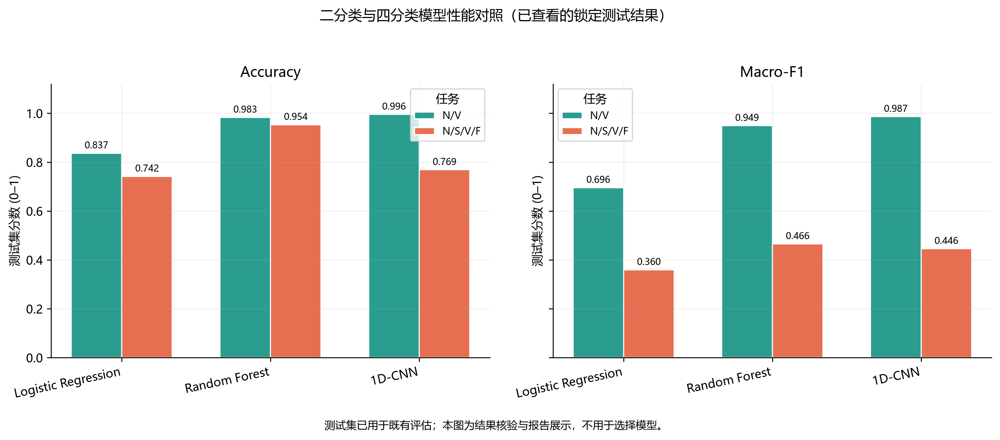

## 图 02：02_class_support_and_subject_coverage.png

- 状态：本轮生成
- 分析作用：四分类有效心拍数量和各类患者覆盖；并列说明按拍计数和按患者计数的差异。
- 文件：`figures/12_final_report/02_class_support_and_subject_coverage.png`

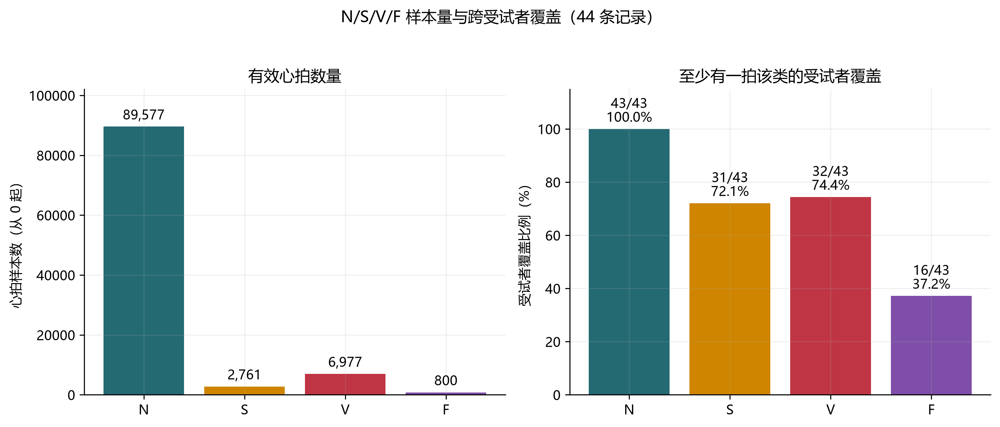

## 图 03：04_weight_strategy_precision_recall.png

- 状态：本轮生成
- 分析作用：验证集四种 CNN 权重策略的逐类 Precision–Recall；支持分析误报代价。
- 文件：`figures/12_final_report/04_weight_strategy_precision_recall.png`

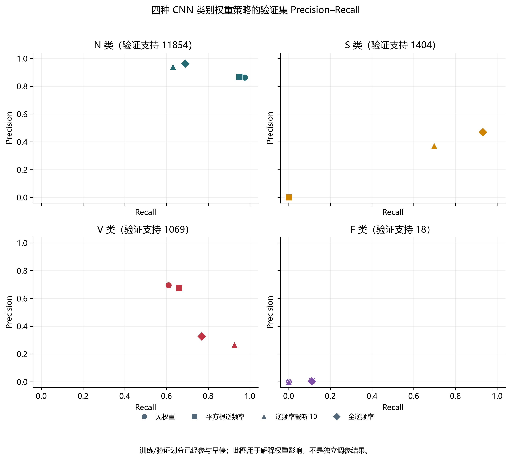

## 图 04：05_weight_strategy_prediction_shares.png

- 状态：本轮生成
- 分析作用：真实验证类别占比与各权重策略预测占比；直观显示偏向少数类的程度。
- 文件：`figures/12_final_report/05_weight_strategy_prediction_shares.png`

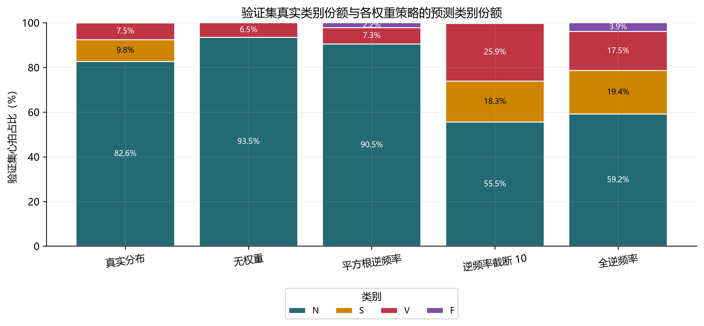

## 图 05：07_subject_level_model_heatmap_descriptive.png

- 状态：本轮生成
- 分析作用：按患者展示既有测试 Accuracy/Macro-F1；仅回顾性描述。
- 文件：`figures/12_final_report/07_subject_level_model_heatmap_descriptive.png`

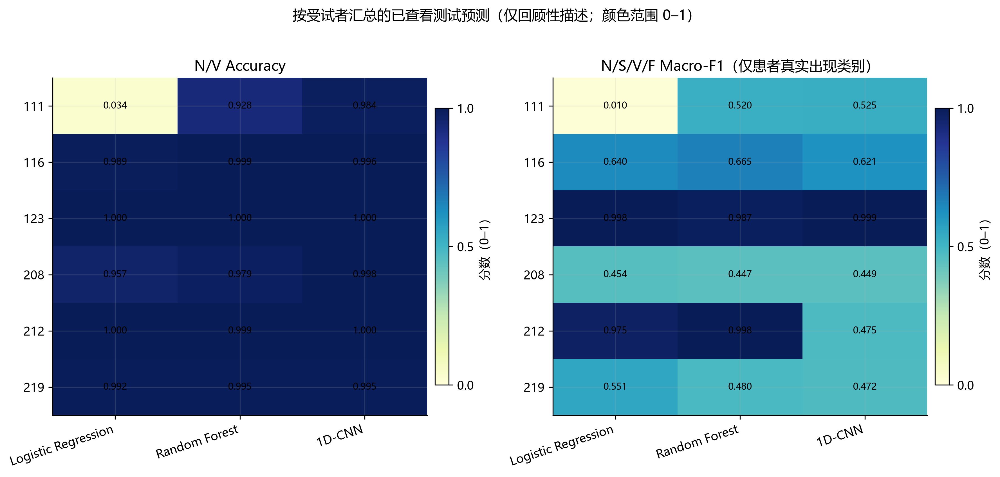

## 图 06：08_cnn_error_directions_descriptive.png

- 状态：本轮生成
- 分析作用：测试 CNN 四个主要混淆方向的数量与真实类内比例。
- 文件：`figures/12_final_report/08_cnn_error_directions_descriptive.png`

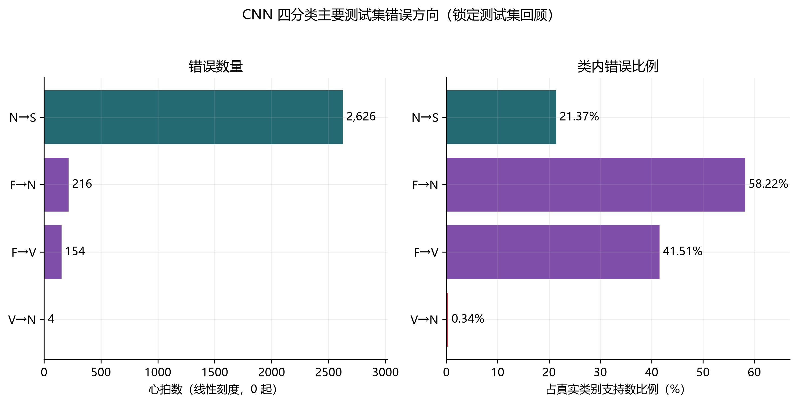

## 图 07：09_cnn_binary_vs_multiclass_per_class.png

- 状态：本轮生成
- 分析作用：对照 CNN 在 N/V 两类的二分类与四分类 Precision/Recall/F1。
- 文件：`figures/12_final_report/09_cnn_binary_vs_multiclass_per_class.png`

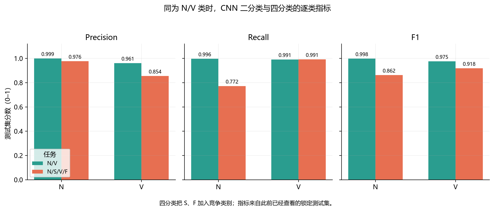

## 图 08：10_project_workflow.png

- 状态：本轮生成
- 分析作用：项目实际数据读取、预处理、患者划分与分类实验流程。
- 文件：`figures/12_final_report/10_project_workflow.png`

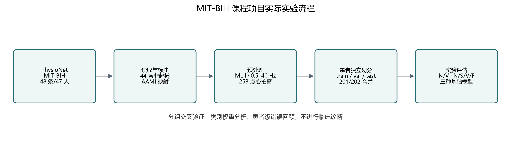

## 图 09：11_error_case_ecg_with_probabilities_descriptive.png

- 状态：本轮生成
- 分析作用：N→S、F→N、F→V、V→N 四种错误的 ECG 心拍、记录和预测概率。
- 文件：`figures/12_final_report/11_error_case_ecg_with_probabilities_descriptive.png`

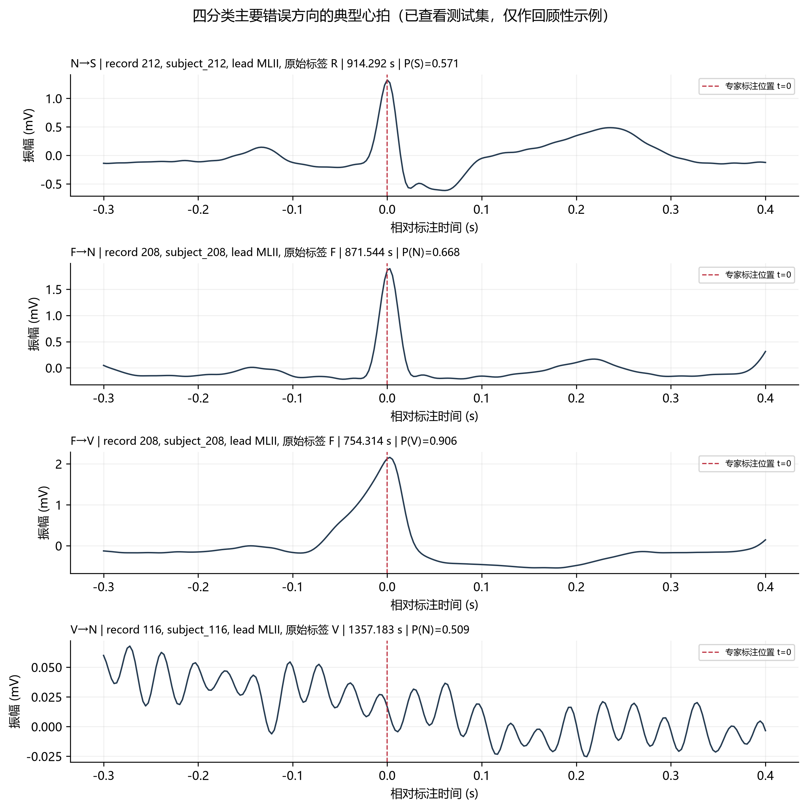

## 图 10：top_subject_class_concentration.png

- 状态：复用已有
- 分析作用：四类心拍的受试者集中度；复用已有失败诊断图。
- 文件：`figures/11_four_class_diagnosis/top_subject_class_concentration.png`

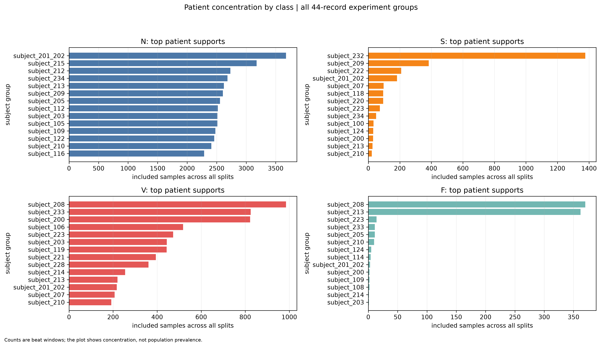

## 图 11：group_cv_fold_metrics.png

- 状态：复用已有
- 分析作用：五折受试者分组交叉验证指标；复用已有 CV 图。
- 文件：`figures/11_four_class_diagnosis/group_cv_fold_metrics.png`

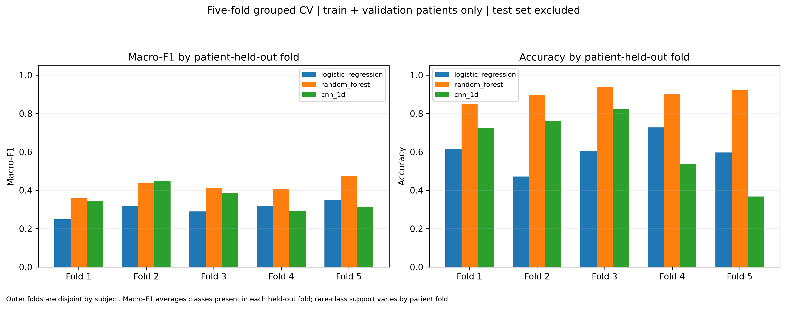

