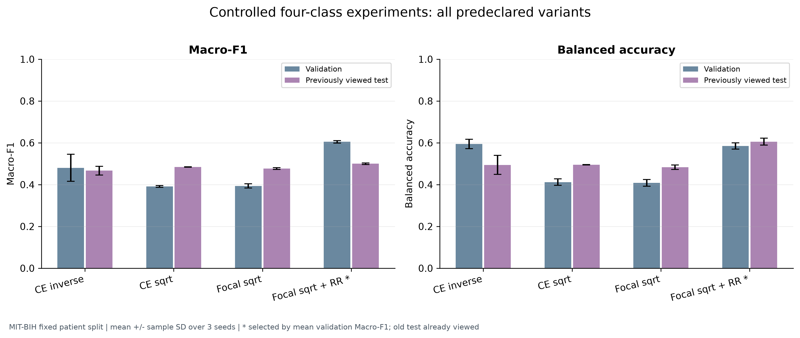
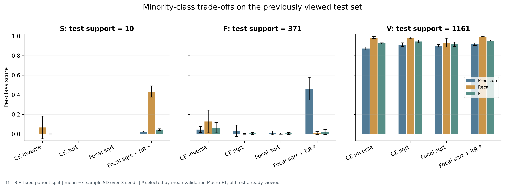
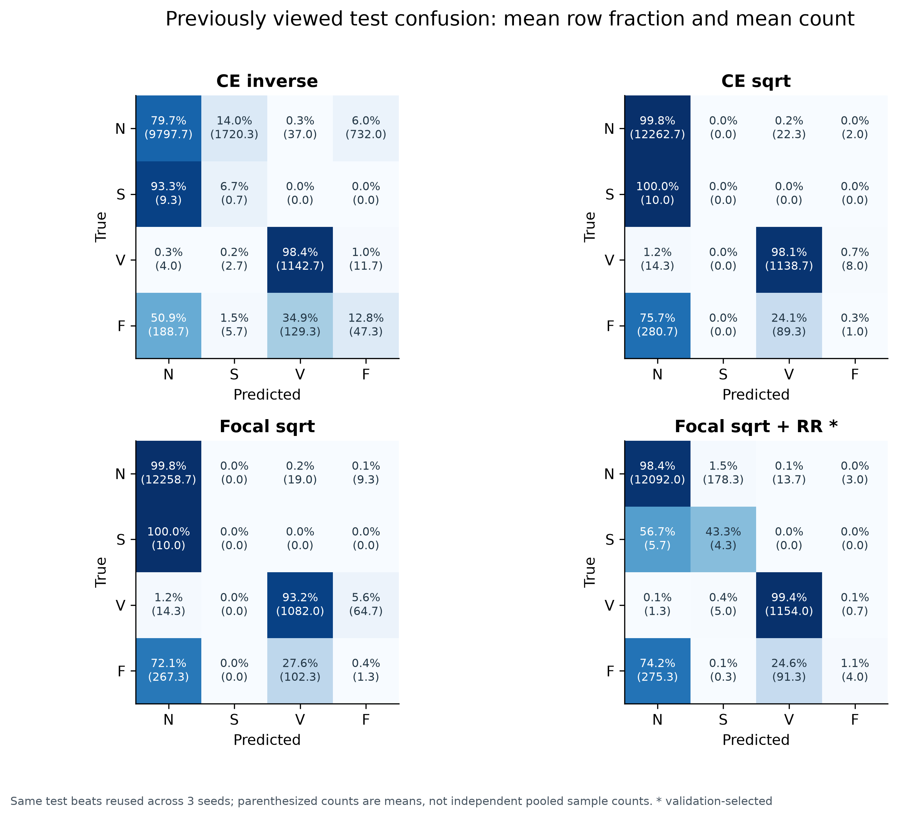
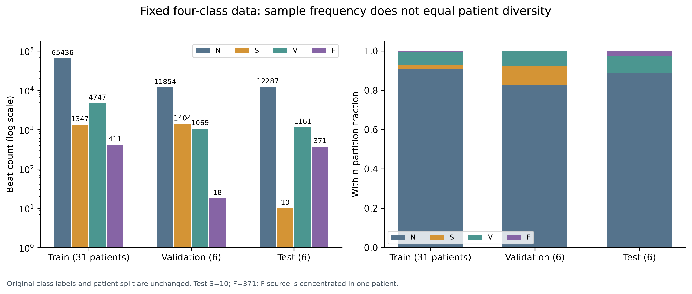
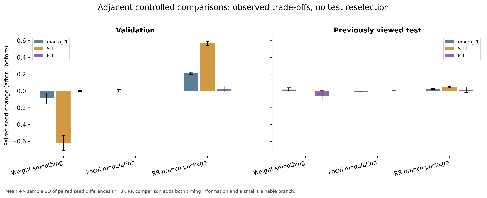

# 类别不平衡受控实验报告

报告实际生成时间：2026-11-16T18:47:00.017973+08:00。所有数值来自已完成的12组真实训练及冻结后的测试阶段。

## 协议与证据范围

保持44条非起搏记录、43患者组及原31/6/6患者分区，固定253点单导联窗口、原训练侧标量归一化和原标签；不删除困难患者、不改测试标签。训练开始前冻结协议、源码和数据SHA256，训练先经稳定性审计放行。

4方案×3随机种子（20261027、20261116、20261117）；每方案最多25轮、patience=5，以验证四类Macro-F1早停。所有3seed均保留，没有按测试结果挑seed。各方案以三seed平均验证Macro-F1选型，配置顺序处理完全同分；选型和全部checkpoint哈希在test前锁定。训练阶段不加载测试数组/标签参与选型，仅读取test.npz字节保存SHA256。

验证锁定方案：**focal_sqrt_rr**。测试阶段状态：completed，共12组。对所有预声明方案的评估处于同一个最终冻结阶段；测试后不再调参或重新选型。

原测试集此前已经查看，本轮只是既定测试集上的探索性复用，不能写作新盲测、外部验证或临床证据。三seed的±是样本标准差（ddof=1），反映训练随机性；不是患者层面的标准误、置信区间或显著性检验。

## 方案与研究问题

|方案|损失与权重|额外输入/结构|预定比较|
|---|---|---|---|
|ce_inverse|原逆频率加权交叉熵|原三层1D-CNN|保留原方法的三seed重新训练基线|
|ce_sqrt|逆频率权重开平方；加权均值CE|同一波形CNN|与ce_inverse比较权重平滑|
|focal_sqrt|sqrt逆频率alpha，gamma=2；按batch的alpha总和归一化|同一波形CNN|与ce_sqrt比较focal调制|
|focal_sqrt_rr|同一focal损失|波形编码器＋4维过去RR输入＋16维分支|与focal_sqrt比较RR分支方案|

CE的权重和focal的alpha采用相同加权均值口径；alpha全局归一化仅作共同尺度变换。过去RR由原始合法心拍标注位置计算，不用类别标签或未来RR；包括上一RR、过去最多10个RR均值及两个比值，StandardScaler仅在训练样本拟合。记录首拍无过去间隔时使用预设0.8 s，不过本实验有效窗口有5 s边缘保护。

RR方案同时增加上下文输入与可训练分支/参数，因此可评价整个方案，不能排除容量变化的贡献。全部方案仍依赖专家心拍定位，不是任意未标注ECG的独立检测器。

## 固定样本分布

|分区|N|S|V|F|
|---|---:|---:|---:|---:|
|train|65436|1347|4747|411|
|val|11854|1404|1069|18|
|test|12287|10|1161|371|

验证S高度集中于患者232，测试F几乎由患者208贡献；测试S只有10拍，1拍变化即可影响召回0.10。三seed不能增加独立患者数量。详见`results/stability_audit_20261116/nsvf_class_distribution.csv`及本轮患者错误来源汇总。

## 原始实验、当前工件复验与新训练

|证据阶段|模型|分区|Accuracy|Macro-F1|Balanced Accuracy|
|---|---|---|---:|---:|---:|
|原始保存实验（1seed）|logistic_regression|val|0.4860|0.2637|0.3746|
|原始保存实验（1seed）|logistic_regression|test|0.7423|0.3599|0.5624|
|原始保存实验（1seed）|random_forest|val|0.8547|0.4019|0.4127|
|原始保存实验（1seed）|random_forest|test|0.9536|0.4656|0.4748|
|原始保存实验（1seed）|cnn_1d|val|0.7185|0.4735|0.6252|
|原始保存实验（1seed）|cnn_1d|test|0.7690|0.4460|0.4415|
|原工件当前重推（无重新训练）|cnn_1d|val|0.7185|0.4735|0.6252|
|原工件当前重推（无重新训练）|cnn_1d|test|0.7690|0.4460|0.4415|

以上原始结果及重推不是本轮12组新训练之一；下表ce_inverse是同方法多seed重训，不能把三个seed称为三次独立患者验证。N/V任务的0.9865不参与四分类表的排名或直接差值计算。

相同seed=20261027的新ce_inverse验证Macro-F1为0.467390，历史CNN为0.473463。当前训练使用4个CPU线程，历史运行线程或数值执行环境可能不同；同一算法和seed不保证跨执行环境的训练轨迹逐位一致。未开展机制分解，不能把差别确定归因于线程或据此断言旧结果错误。原checkpoint本轮全量推理复验一致与新模型重新训练是两类证据。

## 12组新实验的三seed汇总

|方案|分区|Accuracy|Macro-F1|Balanced Accuracy|参数量|验证选定|
|---|---|---:|---:|---:|---:|---|
|ce_inverse|val|0.6441±0.0609|0.4806±0.0651|0.5947±0.0227|9188|否|
|ce_inverse|test|0.7946±0.0607|0.4670±0.0210|0.4940±0.0455|9188|否|
|ce_sqrt|val|0.8427±0.0085|0.3911±0.0042|0.4121±0.0154|9188|否|
|ce_sqrt|test|0.9691±0.0008|0.4841±0.0011|0.4954±0.0010|9188|否|
|focal_sqrt|val|0.8399±0.0151|0.3937±0.0102|0.4084±0.0158|9188|否|
|focal_sqrt|test|0.9648±0.0043|0.4769±0.0048|0.4833±0.0108|9188|否|
|focal_sqrt_rr|val|0.9014±0.0101|0.6047±0.0060|0.5849±0.0146|9332|是|
|focal_sqrt_rr|test|0.9584±0.0046|0.5002±0.0036|0.6056±0.0169|9332|是|

## 各类Precision、Recall与F1

|方案|分区|类别|每seed支持数|Precision|Recall|F1|
|---|---|---|---:|---:|---:|---:|
|ce_inverse|val|N|11854|0.9533±0.0154|0.6111±0.0696|0.7432±0.0516|
|ce_inverse|val|S|1404|0.5315±0.1982|0.8407±0.1428|0.6215±0.0878|
|ce_inverse|val|V|1069|0.4591±0.2375|0.7602±0.0292|0.5535±0.1803|
|ce_inverse|val|F|18|0.0021±0.0014|0.1667±0.0556|0.0042±0.0027|
|ce_inverse|test|N|12287|0.9797±0.0036|0.7974±0.0658|0.8783±0.0405|
|ce_inverse|test|S|10|0.0003±0.0005|0.0667±0.1155|0.0006±0.0010|
|ce_inverse|test|V|1161|0.8732±0.0151|0.9842±0.0090|0.9253±0.0061|
|ce_inverse|test|F|371|0.0448±0.0316|0.1276±0.1159|0.0637±0.0518|
|ce_sqrt|val|N|11854|0.8658±0.0009|0.9611±0.0112|0.9109±0.0046|
|ce_sqrt|val|S|1404|0.0000±0.0000|0.0000±0.0000|0.0000±0.0000|
|ce_sqrt|val|V|1069|0.6491±0.0221|0.6501±0.0110|0.6495±0.0149|
|ce_sqrt|val|F|18|0.0020±0.0035|0.0370±0.0642|0.0038±0.0066|
|ce_sqrt|test|N|12287|0.9757±0.0023|0.9980±0.0003|0.9868±0.0010|
|ce_sqrt|test|S|10|0.0000±0.0000|0.0000±0.0000|0.0000±0.0000|
|ce_sqrt|test|V|1161|0.9109±0.0195|0.9808±0.0081|0.9445±0.0140|
|ce_sqrt|test|F|371|0.0333±0.0577|0.0027±0.0047|0.0050±0.0086|
|focal_sqrt|val|N|11854|0.8652±0.0009|0.9589±0.0201|0.9096±0.0088|
|focal_sqrt|val|S|1404|0.0000±0.0000|0.0000±0.0000|0.0000±0.0000|
|focal_sqrt|val|V|1069|0.6937±0.0988|0.6377±0.0195|0.6617±0.0394|
|focal_sqrt|val|F|18|0.0018±0.0031|0.0370±0.0642|0.0034±0.0059|
|focal_sqrt|test|N|12287|0.9768±0.0014|0.9977±0.0009|0.9871±0.0005|
|focal_sqrt|test|S|10|0.0000±0.0000|0.0000±0.0000|0.0000±0.0000|
|focal_sqrt|test|V|1161|0.8992±0.0126|0.9320±0.0450|0.9149±0.0233|
|focal_sqrt|test|F|371|0.0114±0.0197|0.0036±0.0062|0.0055±0.0095|
|focal_sqrt_rr|val|N|11854|0.9238±0.0019|0.9633±0.0117|0.9432±0.0057|
|focal_sqrt_rr|val|S|1404|0.9249±0.0305|0.4091±0.0212|0.5671±0.0245|
|focal_sqrt_rr|val|V|1069|0.9012±0.1276|0.8746±0.0474|0.8825±0.0520|
|focal_sqrt_rr|val|F|18|0.0266±0.0389|0.0926±0.0642|0.0261±0.0316|
|focal_sqrt_rr|test|N|12287|0.9772±0.0016|0.9841±0.0058|0.9806±0.0024|
|focal_sqrt_rr|test|S|10|0.0242±0.0047|0.4333±0.0577|0.0457±0.0083|
|focal_sqrt_rr|test|V|1161|0.9167±0.0126|0.9940±0.0030|0.9538±0.0054|
|focal_sqrt_rr|test|F|371|0.4630±0.1156|0.0108±0.0140|0.0207±0.0266|

## 相邻因素比较

下表为同seed的after−before差值再求均值和样本标准差，不按测试分数重排方案。

|因素|分区|ΔMacro-F1|ΔS F1|ΔF F1|ΔV F1|ΔAccuracy|
|---|---|---:|---:|---:|---:|---:|
|weight_smoothing|val|-0.0895±0.0658|-0.6215±0.0878|-0.0003±0.0041|+0.0960±0.1872|+0.1986±0.0694|
|weight_smoothing|test|+0.0171±0.0203|-0.0006±0.0010|-0.0587±0.0604|+0.0192±0.0101|+0.1746±0.0602|
|focal_modulation|val|+0.0026±0.0136|+0.0000±0.0000|-0.0004±0.0007|+0.0121±0.0509|-0.0028±0.0066|
|focal_modulation|test|-0.0072±0.0049|+0.0000±0.0000|+0.0005±0.0008|-0.0295±0.0194|-0.0044±0.0038|
|rr_branch_package|val|+0.2111±0.0124|+0.5671±0.0245|+0.0227±0.0352|+0.2209±0.0412|+0.0615±0.0209|
|rr_branch_package|test|+0.0233±0.0081|+0.0457±0.0083|+0.0152±0.0324|+0.0388±0.0276|-0.0063±0.0044|

## 预定方案的观察与取舍

根据验证均值预先选定focal_sqrt_rr：验证Macro-F1=0.6047±0.0060，已查看测试Macro-F1=0.5002±0.0036。
相对本轮ce_inverse三seed基线，测试Macro-F1均值差为+0.0332，Accuracy均值差为+0.1639。这些是固定患者分区的描述性变化，不能解释为总体人群保证。
val侧所选方案S Precision/Recall/F1均值=0.9249/0.4091/0.5671；F为0.0266/0.0926/0.0261；V Recall/F1为0.8746/0.8825。
test侧所选方案S Precision/Recall/F1均值=0.0242/0.4333/0.0457；F为0.4630/0.0108/0.0207；V Recall/F1为0.9940/0.9538。

**不能认为S/F识别问题已经解决。** 所选方案测试S Precision仅0.0242，召回提高仍伴随大量误报。相对新ce_inverse，F F1从0.0637±0.0518下降到0.0207±0.0266，F Recall从0.1276下降至0.0108。该退步与总体Macro-F1提高同时存在；不能只报道整体分数或F Precision而省略F漏分。

Focal调制单独加入sqrt-CE后的测试Macro-F1均值变化为-0.0072，本轮没有显示其单独带来整体改进；RR分支的相邻比较也不能推出所有类别同步改善。

少数类召回、Precision、F1和总体误报必须共同评价；如果某项均值提高而另一项下降，应按上述完整表格保留，不以单个最好seed或单类召回替代总体结果。测试分数不用于重命名优胜方案，也不触发替换线上六模型。

## 错误与患者来源

下面列所选方案每个错误方向按三seed平均次数最多的患者。次数是相同样本的多模型输出均值，不能相加为新增独立患者证据。

|分区|错误方向|主要来源患者|平均错误拍数|该类患者支持数|
|---|---|---|---:|---:|
|val|N→S|subject_215|24.00|3176|
|val|N→V|subject_109|109.00|2478|
|val|N→F|subject_109|191.67|2478|
|val|S→N|subject_232|813.33|1376|
|val|S→V|subject_232|2.33|1376|
|val|V→N|subject_215|57.67|164|
|val|V→S|subject_215|15.00|164|
|val|V→F|subject_215|13.67|164|
|val|F→N|subject_233|8.00|11|
|val|F→S|subject_233|0.33|11|
|val|F→V|subject_114|1.33|4|
|test|N→S|subject_219|153.33|2070|
|test|N→V|subject_116|6.00|2288|
|test|N→F|subject_116|1.67|2288|
|test|S→N|subject_219|3.67|7|
|test|V→N|subject_208|1.00|985|
|test|V→S|subject_219|3.00|63|
|test|V→F|subject_116|0.67|109|
|test|F→N|subject_208|275.33|370|
|test|F→S|subject_219|0.33|1|
|test|F→V|subject_208|90.67|370|

患者来源表支持错误分布诊断，不证明模型依据某个特定P波、QRS机制或患者身份做判断。S/F稀有且患者覆盖不足，没有通过loss设置增加患者来源；引入RR后仍需外部患者、自动定位误差与概率校准验证。

## 验证侧积分梯度数值核验

所选方案的解释使用验证Macro-F1居中seed=20261117，每个真实类别固定取NPZ中间行；未按测试表现或归因外观挑样本。四例恰好均分类正确，不能代表全部错误或总体解释质量。归因目标为预测类logit，相对于零标准化波形与零标准化RR；它们对应训练统计参考，并不代表生理正常ECG。
采用128区间梯形积分，并保留64→128步波形归因变化。四例完整性绝对误差为0.000703—0.003493 logit，相对误差0.091%—0.166%；波形归因L1变化相对于128步L1总量约0.37%—0.58%。所有保存数组均有限，来源哈希、样本身份、波形与有符号归因和均复核一致。
数值误差小仅支持这四例的离散积分近似，不能证明参考选择合理、归因具有因果忠实性或模型掌握临床知识；不同案例使用独立波形色标，不能直接比较颜色强度。归因总和为负也不等于分类错误，只表示目标logit低于所选参考输入的该类logit。

## 图表与可复现工件

运行命令：`python -B -m src.evaluation.controlled_report`。脚本只在test_evaluation状态completed后读取真实结果、核验冻结哈希并生成本报告，不执行训练或测试。

主要CSV：`controlled_run_summary.csv`、`controlled_aggregate_summary.csv`、`controlled_class_run_summary.csv`、`controlled_class_summary.csv`、`controlled_ablation_summary.csv`、`controlled_error_summary.csv`、`controlled_confusion_summary.csv`、`controlled_historical_summary.csv`。均位于`results/controlled_imbalance_20261116/`。

正式原实验与线上6模型工件保持保留；本轮新的RR模型是探索性实验工件，需要独立部署适配与验证后才能考虑上线。
