# MIT-BIH 第二阶段：预处理与受试者独立数据集

## 本次结果

**第一版 N, V 训练数据已构建完成，自动验证通过。未训练任何分类器或深度学习模型，未开发前端。**

- 官方 48 条记录全部参与原始标注审计，共 112647 条标注，归并为 47 个受试者组。
- 目标类别的原始标注 97867 条；最终接受 97287 个窗口；因技术/边界原因排除 580 个目标窗口。
- 非目标/非心拍/未映射项 14780 条保留在原始数据与 metadata 中，不进入当前模型数组；没有删除原始数据。
- 输出目录：`data/processed/nv_v1`。`train.npz`、`val.npz`、`test.npz`、`metadata.csv`、`split_manifest.csv`、`split_plan.json`、`normalization.json`、`processing_config.json` 与 `verification.json` 均已生成。

## 项目复用、统计核查和完整性

复用既有 `src/download.py`、`src/io.py`、`src/analysis.py` 的导联选择及 `src/labels.py`，没有另写一套 WFDB 解码或标签推断。第一阶段与可视化阶段的历史统计分别按各自的 100/200 记录范围重新与 `.atr` 核对，结果如下；没有将旧的两记录统计误当成全库统计。

| source | records | total_annotations | raw_symbol_counts_match | aami_counts_match |
| --- | --- | --- | --- | --- |
| results | 100,200 | 5066 | True | True |
| results\visualization | 100,200 | 5066 | True | True |

正式构建使用官方 `RECORDS` 的全部 48 条记录，并核验每条 `.dat/.hea/.atr` 的官方 SHA256、WFDB 头信息与数字校验和。主站传输曾中断，已通过 PhysioNet 官方公开 S3 镜像补齐，仍使用主站的 SHA256 清单；没有替换已存在的原始文件。[官方数据库与下载入口](https://physionet.org/content/mitdb/1.0.0/)

全库原始标签统计如下。原始 `symbol` 与 AAMI 分组是两列，非心拍从不强行归入 Q。

| symbol | meaning_zh | annotation_kind | aami_group | count |
| --- | --- | --- | --- | --- |
| N | 正常心拍 | mapped_beat | N | 75052 |
| L | 左束支传导阻滞心拍 | mapped_beat | N | 8075 |
| R | 右束支传导阻滞心拍 | mapped_beat | N | 7259 |
| V | 室性期前收缩 | mapped_beat | V | 7130 |
| / | 起搏心拍 | mapped_beat | Q | 7028 |
| A | 房性期前收缩 | mapped_beat | S | 2546 |
| + | 节律改变（详见 aux_note） | non_beat |  | 1291 |
| f | 起搏与正常心拍融合 | mapped_beat | Q | 982 |
| F | 室性与正常心拍融合 | mapped_beat | F | 803 |
| ~ | 信号质量改变（保留 subtype） | non_beat |  | 616 |
| ! | 心室扑动波（非逐心拍标注） | non_beat |  | 472 |
| " | 注释文本 | non_beat |  | 437 |
| j | 交界性逸搏 | mapped_beat | N | 229 |
| x | 未下传 P 波（阻滞型房性期前收缩） | non_beat |  | 193 |
| a | 伴差异传导的房性期前收缩 | mapped_beat | S | 150 |
| \| | 孤立的类 QRS 伪迹 | non_beat |  | 132 |
| E | 室性逸搏 | mapped_beat | V | 106 |
| J | 交界性期前收缩 | mapped_beat | S | 83 |
| Q | 无法分类心拍 | mapped_beat | Q | 33 |
| e | 房性逸搏 | mapped_beat | N | 16 |
| [ | 心室扑动/颤动开始 | non_beat |  | 6 |
| ] | 心室扑动/颤动结束 | non_beat |  | 6 |
| S | 室上性期前或异位心拍 | mapped_beat | S | 2 |

| aami_group | count | percentage_of_mapped_beats |
| --- | --- | --- |
| N | 90631 | 82.7726 |
| S | 2781 | 2.53987 |
| V | 7236 | 6.60858 |
| F | 803 | 0.733374 |
| Q | 8043 | 7.34561 |

## 预处理方法、参数与形态影响

先对各记录的实际单导联**连续信号**滤波，再截取心拍，避免逐拍独立滤波产生大量短窗端点伪迹。首选名字为 MLII 的导联，否则使用该记录实际首导联。102、104 的首导联为 V5；114 的 MLII 在第二通道，代码按名称选择，未假定所有记录的第一通道都是 MLII。实际导联与通道逐样本保留。[官方导联配置](https://physionet.org/files/mitdb/1.0.0/mitdbdir/intro.htm)

滤波为 `scipy.signal.butter(N=4, Wn=[0.5,40], btype='bandpass', fs=360, output='sos')`，然后 `sosfiltfilt(..., padtype='odd', padlen=27)`。N=4 是原型阶数，对应单程 8 阶带通；前后双向处理的有效幅值响应为单程 `|H|²`。它避免常规单向相位延迟，但**不意味着波形形态或幅值无失真**，尤其会改变基线、低频段和尖锐波峰。[Butterworth/SOS 文档](https://docs.scipy.org/doc/scipy/reference/generated/scipy.signal.butter.html)、[双向滤波文档](https://docs.scipy.org/doc/scipy/reference/generated/scipy.signal.sosfiltfilt.html)

0.5–40 Hz 在读取任何正式留出波形前即固定为第一版方法；只在训练记录比较 0.5–40、0.5–45、1–40 Hz，不执行基于性能的搜索，也不让验证/测试记录决定滤波设置。全部系数和候选设置在 `processing_config.json` 中。

非有限数据不插值猜测，而是按连续有限片段分别滤波；过短片段保持无效。记录两端及每个非有限缺口两侧留出 **5.0 s** 的滤波保护区，只有整个心拍窗口位于安全区内才接受。这是保守工程规则，不能数学保证所有端点效应完全消失。

训练样本的默认滤波形态变化如下。相关系数计算时减去各窗均值；幅值比为滤波/原始窗口峰峰值；局部峰移仅在原始标注 ±80 ms 内比较减中位数后的主极值，**不用于重新定位标注**。

| mapped_label | n | correlation_median | correlation_q05 | ptp_ratio_median | peak_shift_abs_median_ms |
| --- | --- | --- | --- | --- | --- |
| N | 65913 | 0.996965 | 0.967495 | 0.975597 | 0 |
| V | 4318 | 0.998482 | 0.991971 | 0.984669 | 2.77778 |

相关系数低于 0.90、幅值比不在 [0.5,1.5] 或局部极值偏移绝对值超过 10 ms 只作复核标记，不自动删除或改标签。它们不能判定临床失真与疾病。本阶段承认滤波会改变信号，是否影响特定临床形态任务仍需专家和后续验证集实验检查。

## 心拍提取策略与类别映射

- 使用 `.atr` 专家原标注，不重新检测 R 峰。360 Hz 时，前 0.3 s 为 108 点，后 0.4 s 为 144 点，两端包含，合计 **253 点**；原标注位于数组索引 108。
- 切片是 `[annotation_sample-108, annotation_sample+145)`；第一点相对 -0.3 s、最后一点相对 +0.4 s。相邻采样点跨度为 0.7 s；253/fs 的存储区间长度与末首采样时差不同。
- `record_id, subject_id, annotation_sample, original_label, mapped_label, lead, lead_channel, time_s, window_start_sample, window_stop_sample_exclusive, sample_id` 全部保留。
- 固定窗可能含邻拍；在高心率、复杂心律或噪声片段中不能保证严格孤立心拍。边界、非有限值、滤波保护区、平直窗和重复目标心拍位置按预定技术规则处理。

第一版只接纳 N←N/L/R/e/j 和 V←V/E，目标编码为 {'N': 0, 'V': 1}。N 组包含束支阻滞和部分逸搏，**N/V 二分类不是健康与疾病的完整二分**。其余类别/非心拍保留在元数据与原始文件；可在新版本输出目录用 `--classes N S V F` 扩展，复用同一受试者分区。[原始标签依据](https://physionet.org/static/lightwave/doc/annotations.html)

各集合实际样本数：

| split | mapped_label | sample_count | subject_count_total | record_count_total |
| --- | --- | --- | --- | --- |
| train | N | 65913 | 33 | 34 |
| train | V | 4318 | 33 | 34 |
| val | N | 11612 | 7 | 7 |
| val | V | 1477 | 7 | 7 |
| test | N | 12558 | 7 | 7 |
| test | V | 1409 | 7 | 7 |

实际导联构成：

| split | lead | sample_count |
| --- | --- | --- |
| test | MLII | 13967 |
| train | MLII | 69963 |
| train | V5 | 268 |
| val | MLII | 13089 |

## 受试者划分与防泄漏

受试者 ID 是数据库层面的去标识分组键：通常由记录编号建立一组，**201 和 202 共享 `subject_201_202`**，不是推测临床身份。官方说明 48 条记录来自 47 位受试者，201/202 为同一受试者。[官方受试者说明](https://physionet.org/files/mitdb/1.0.0/mitdbdir/intro.htm)

固定种子 20261027，目标比例约 70/15/15，按受试者而非心拍分配：训练 33、验证 7、测试 7 位。由于 100、200 已在前两阶段被探索，二者预先固定为训练数据，避免把已经用于观察的记录重新称为盲留出数据。

在任何滤波比较之前，仅用专家标签计数定义 V≥100 的受试者层，每个留出集合预先保留至少两位该层受试者，预先规定每集合至少 200 个 V 样本。然后执行一次有种子的分层分配，写入并锁定 `split_plan.json`。这里是事先的标签分层设计，不是根据测试模型表现、波形质量或归一化结果挑选分区；没有遍历随机种子或反复重分来改善测试结果。

划分说明：No iterative adjustment or split search; V-presence constraints are specified before the one seeded allocation.。实际各集合 V 数量见上表，均通过预声明下限；本轮无需事后调整。若以后过滤导致既定留出类覆盖不足，程序直接失败，不能静默用测试结果重新选分区。更改数据/种子应新建版本目录，不覆盖既有锁定方案。

| split | subject_id | record_id |
| --- | --- | --- |
| test | subject_107 | 107 |
| test | subject_112 | 112 |
| test | subject_116 | 116 |
| test | subject_208 | 208 |
| test | subject_214 | 214 |
| test | subject_220 | 220 |
| test | subject_230 | 230 |
| train | subject_100 | 100 |
| train | subject_101 | 101 |
| train | subject_102 | 102 |
| train | subject_103 | 103 |
| train | subject_104 | 104 |
| train | subject_105 | 105 |
| train | subject_106 | 106 |
| train | subject_108 | 108 |
| train | subject_109 | 109 |
| train | subject_113 | 113 |
| train | subject_114 | 114 |
| train | subject_115 | 115 |
| train | subject_117 | 117 |
| train | subject_119 | 119 |
| train | subject_121 | 121 |
| train | subject_123 | 123 |
| train | subject_124 | 124 |
| train | subject_200 | 200 |
| train | subject_201_202 | 201,202 |
| train | subject_203 | 203 |
| train | subject_205 | 205 |
| train | subject_207 | 207 |
| train | subject_209 | 209 |
| train | subject_210 | 210 |
| train | subject_212 | 212 |
| train | subject_213 | 213 |
| train | subject_215 | 215 |
| train | subject_219 | 219 |
| train | subject_221 | 221 |
| train | subject_222 | 222 |
| train | subject_228 | 228 |
| train | subject_231 | 231 |
| train | subject_234 | 234 |
| val | subject_111 | 111 |
| val | subject_118 | 118 |
| val | subject_122 | 122 |
| val | subject_217 | 217 |
| val | subject_223 | 223 |
| val | subject_232 | 232 |
| val | subject_233 | 233 |

自动验证：受试者集合交集为 0；样本 ID 跨集重复为 0；201/202 同分区；100/200 训练专用；所有 NPZ 样本与 metadata 的行号、原标注和标签逐项一致。由于一个受试者的全部记录都在同一集合，邻拍重叠和同一记录的双向滤波上下文不会跨集合。

## 归一化与采样政策

仅在**接受后的训练集滤波窗口 float32 值**上拟合全局标量均值/标准差：mean=0.0119189389404 mV，std=0.345226580259 mV，ddof=0，共 70231 拍、17768443 个值。

训练、验证、测试均使用 `X=(X_filtered-mean)/std`，不分别拟合、不逐拍缩放、不按测试范围裁剪。拟合样本 ID 哈希、训练受试者与记录清单保存在 `normalization.json`；验证时重新从导出的训练数组独立计算参数并核对。验证/测试没有进入拟合。

**没有进行任何过采样、欠采样、SMOTE 或按测试表现挑选采样方案**。全部符合预设技术条件的目标心拍保留。`training_class_weights.json` 仅记录按训练标签计算的可选权重，未被应用；下一阶段是否使用权重应在训练/验证流程中决定，测试集保持锁定。

## 被排除样本及保留的异常标记

所有排除主原因互斥，总数 15360 = 非目标/非心拍等 14780 + 目标技术排除 580。原始数据未删除或覆盖，`metadata.csv` 对每个原始标注记录 `included`、`exclusion_reason` 和实际分区。

| exclusion_reason | count |
| --- | --- |
| not_target_group | 11627 |
| non_beat_annotation | 3153 |
| filter_edge_or_gap_guard | 540 |
| window_boundary | 40 |

接受样本中 2008 个至少含一个质量/形态复核标记；下表标记可重叠，不能直接相加当作排除数：

| flag | sample_count |
| --- | --- |
| morphology_correlation_lt_0.90 | 878 |
| near_quality_or_artifact_event | 620 |
| local_peak_shift_gt_10ms | 603 |
| amplitude_ratio_outside_0.5_1.5 | 32 |
| large_physical_amplitude | 8 |
| adc_rail_present | 7 |

ADC 触轨、大幅值、临近质量/伪迹事件、滤波形态改变以及大标准化 z 值都只是检查线索，**这些样本仍然保留**。特别是 `~` 是变化事件，不能根据事件数推算完整噪声持续时长。未来若决定剔除这类数据，应先在训练/验证侧确定可复现策略，不能看测试效果来选规则。

## 文件格式、运行与下一阶段建议

`X` 为归一化后的 float32，形状 `(n_samples, 1, 253)`，单通道在中间；`X_filtered` 为同形状的滤波后 mV 值，便于核查。`y` 为 int64；每个文件还含 sample_id、record_id、subject_id、annotation_sample、original_label、mapped_label、lead、class_names、relative_time_s、center_index、fs_hz，均可用 `allow_pickle=False` 安全读取。

`metadata.csv` 包含全部原始标注，`npz_row=-1` 表示未入数组；对接受行，`split` 与 `npz_row` 指向对应 NPZ 的位置。原始 aux_note 的 NUL 终止符在 CSV 中以 `aux_note_json` 无损 JSON 字符串保留，`aux_note_text` 供显示；原始 `.atr` 保持原样。`split_manifest.csv` 是全部记录的受试者及分区清单。

```powershell
.\.venv\Scripts\python.exe -m src.preprocess --offline
```

后续训练可以直接加载这三个 NPZ，但仍需处理：类别不平衡、MLII/V5 导联差异、含起搏记录中的 N/V 上下文、保留的质量标记、固定窗邻拍与原标注偏差，以及滤波对特定形态信息的影响。N/V 不覆盖 S/F/Q，不应把未覆盖类别当作已经验证的异常检测能力。建议先建立简单基线，训练/验证侧确定方案后才对锁定测试集做最终评价，并报告每类召回率、精确率、F1、混淆矩阵及受试者差异；不要只报告总体准确率。

## 本轮可视化与观察

以下波形图全部来自训练记录。分区/受试者数量和排除图是全库预设流程的聚合审计，不用来调参。默认处理方法保持预先固定，没有因为这些图而改变测试采样。额外视觉核查由开发助手查看实际图像后记录，未经独立心电专家复核。

### Training record 100 | raw, filtered and residual

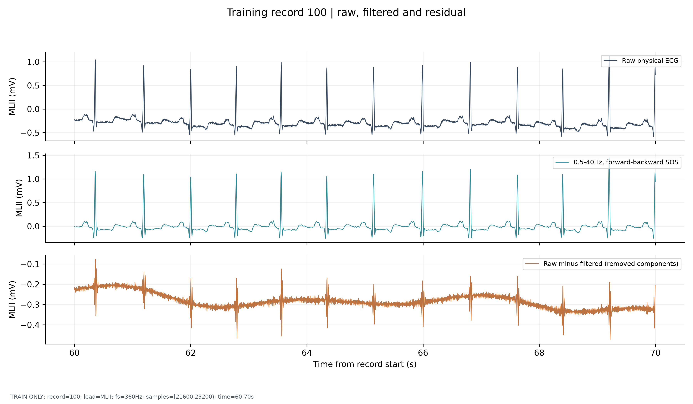

比较滤波前后基线与细碎起伏；残差不是纯噪声，也可能含真实波形分量，不能宣称形态完全无失真。

范围：`TRAIN ONLY; record=100; lead=MLII; fs=360Hz; samples=[21600,25200); time=60-70s`

### Training record 100 | N | different fixed passbands

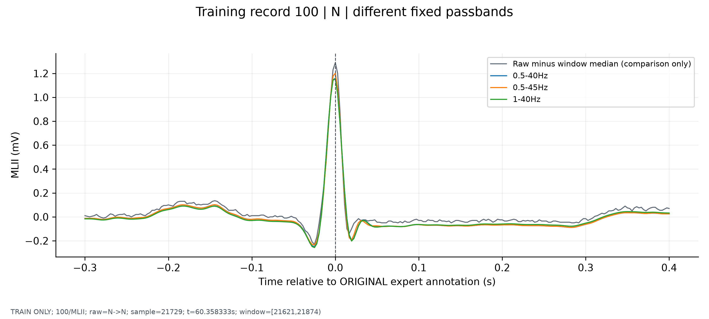

比较预先指定的 0.5–40、0.5–45、1–40 Hz；默认仍为预先声明的 0.5–40 Hz，不利用验证/测试波形选频段。

范围：`TRAIN ONLY; 100/MLII; raw=N->N; sample=21729; t=60.358333s; window=[21621,21874)`

### Training record 100 | V | different fixed passbands

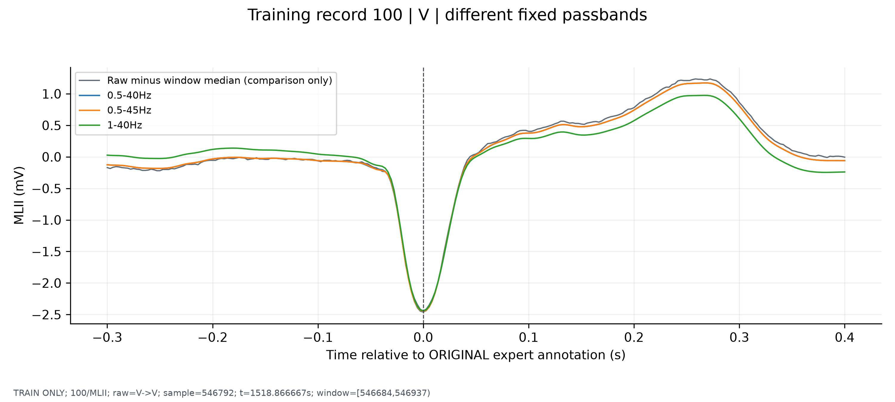

比较预先指定的 0.5–40、0.5–45、1–40 Hz；默认仍为预先声明的 0.5–40 Hz，不利用验证/测试波形选频段。

范围：`TRAIN ONLY; 100/MLII; raw=V->V; sample=546792; t=1518.866667s; window=[546684,546937)`

### Training record 100 | fixed heartbeat extraction

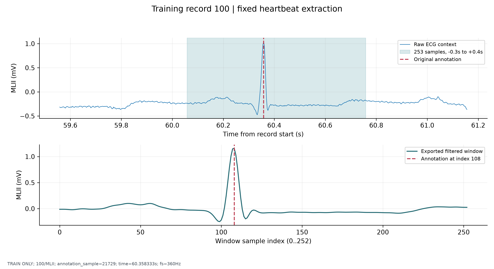

窗口含前 108 点、中心 1 点、后 144 点，共 253 点；不重新检测或移动专家标注，原始信号保持不变。

范围：`TRAIN ONLY; 100/MLII; annotation_sample=21729; time=60.358333s; fs=360Hz`

### Training record 200 | raw, filtered and residual

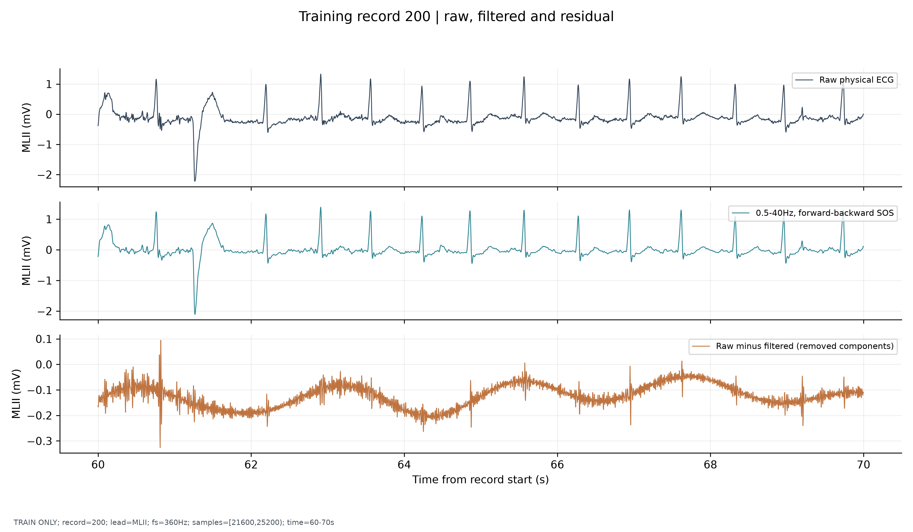

比较滤波前后基线与细碎起伏；残差不是纯噪声，也可能含真实波形分量，不能宣称形态完全无失真。

范围：`TRAIN ONLY; record=200; lead=MLII; fs=360Hz; samples=[21600,25200); time=60-70s`

### Training record 200 | N | different fixed passbands

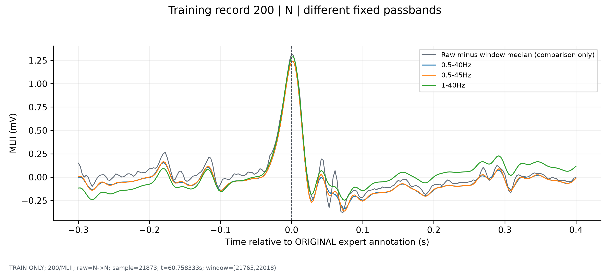

比较预先指定的 0.5–40、0.5–45、1–40 Hz；默认仍为预先声明的 0.5–40 Hz，不利用验证/测试波形选频段。

范围：`TRAIN ONLY; 200/MLII; raw=N->N; sample=21873; t=60.758333s; window=[21765,22018)`

### Training record 200 | V | different fixed passbands

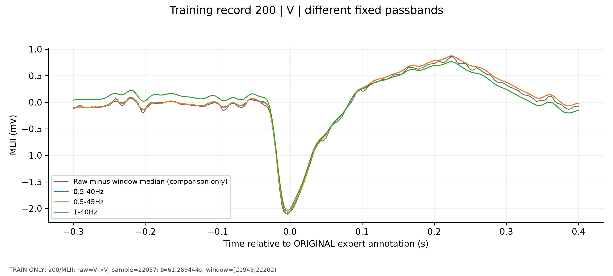

比较预先指定的 0.5–40、0.5–45、1–40 Hz；默认仍为预先声明的 0.5–40 Hz，不利用验证/测试波形选频段。

范围：`TRAIN ONLY; 200/MLII; raw=V->V; sample=22057; t=61.269444s; window=[21949,22202)`

### Training record 200 | fixed heartbeat extraction

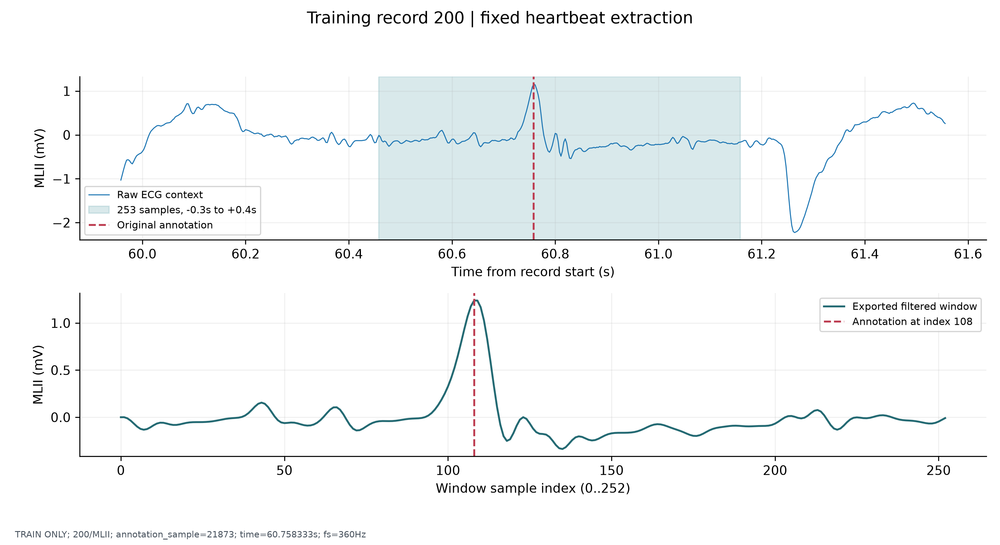

窗口含前 108 点、中心 1 点、后 144 点，共 253 点；不重新检测或移动专家标注，原始信号保持不变。

范围：`TRAIN ONLY; 200/MLII; annotation_sample=21873; time=60.758333s; fs=360Hz`

### Prespecified Butterworth SOS filters | effective two-pass response

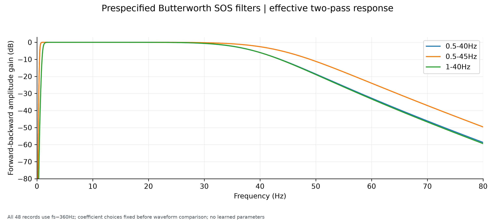

双向滤波的幅值响应为单程 |H|²，角频点衰减约 -6 dB；零相位并不等于零幅值失真。

范围：`All 48 records use fs=360Hz; coefficient choices fixed before waveform comparison; no learned parameters`

### Processed N/V examples | different training records

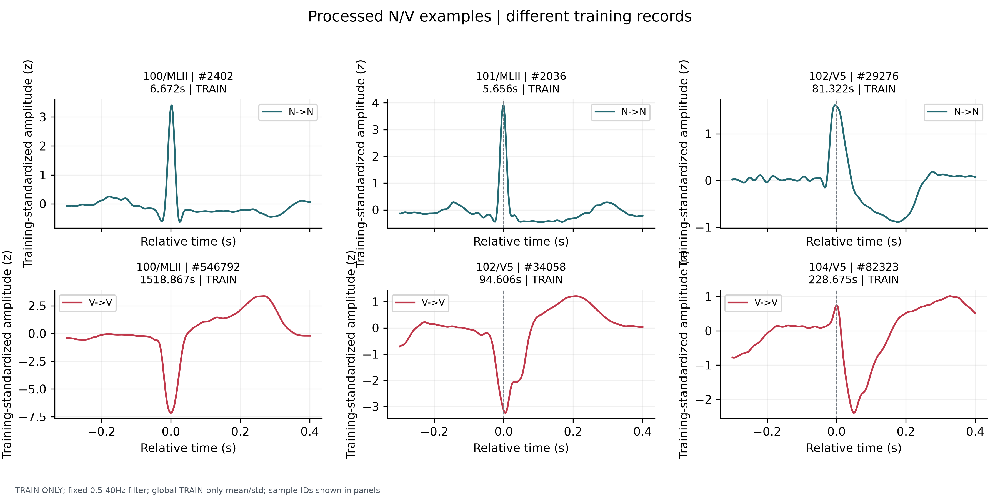

处理后的真实样本保持原始类别与位置；N 组含束支阻滞/部分逸搏，不能将所有 N 组样本称作正常。

范围：`TRAIN ONLY; fixed 0.5-40Hz filter; global TRAIN-only mean/std; sample IDs shown in panels`

### N/V normalization | TRAIN-derived mean and standard deviation

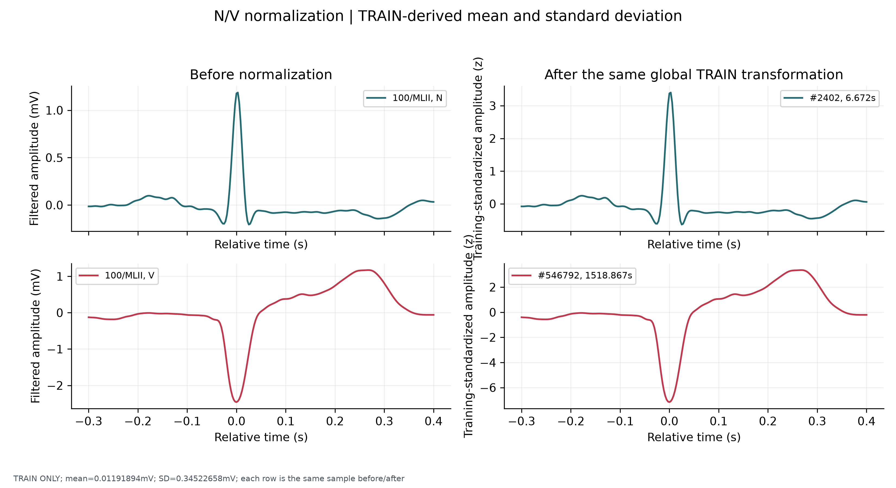

所有样本使用同一个训练集均值/标准差；没有为每个心拍缩放振幅，也没有用验证或测试集拟合。

范围：`TRAIN ONLY; mean=0.01191894mV; SD=0.34522658mV; each row is the same sample before/after`

### All 48 records | accepted classes after subject-independent splitting

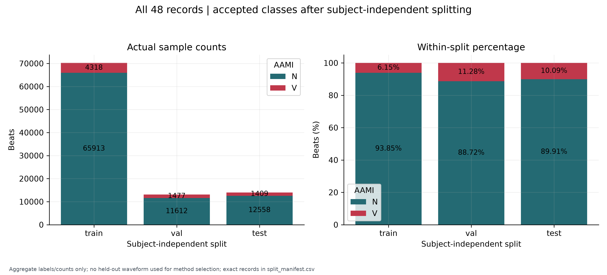

约 70/15/15 分配的是受试者数，心拍数量比例不一定相同；验证和测试保留自然类别分布，没有重采样。

范围：`Aggregate labels/counts only; no held-out waveform used for method selection; exact records in split_manifest.csv`

### Samples per independent subject | total and V counts

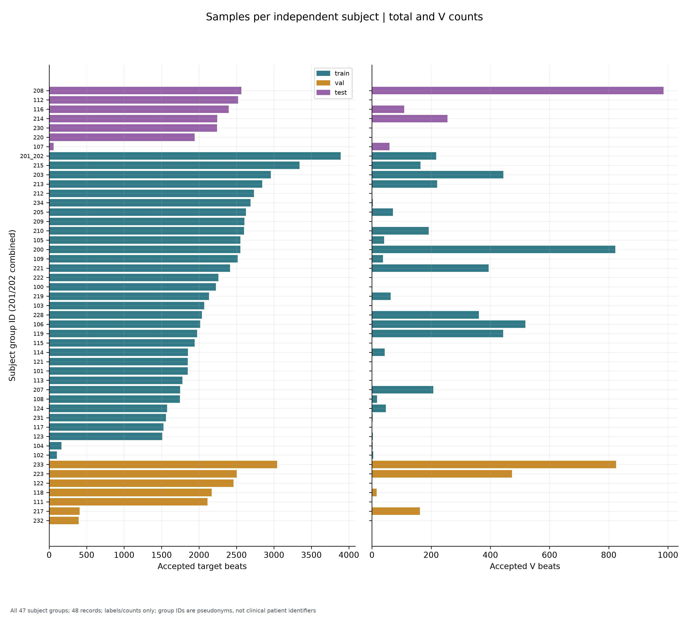

显示不同受试者贡献量及 V 类覆盖；201/202 合并，不可拆到不同集合；图中差异不用于改变测试采样。

范围：`All 47 subject groups; 48 records; labels/counts only; group IDs are pseudonyms, not clinical patient identifiers`

### Non-target labels, invalid windows and retained review flags

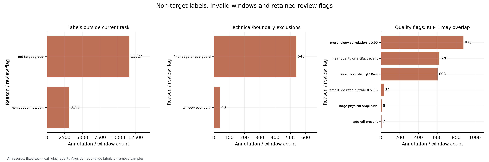

前两栏是互斥主排除原因；右栏是保留样本上的可重叠复核标记，不能相加当作排除总数。

范围：`All records; fixed technical rules; quality flags do not change labels or remove samples`

### TRAIN ONLY | morphology change under the fixed 0.5-40Hz filter

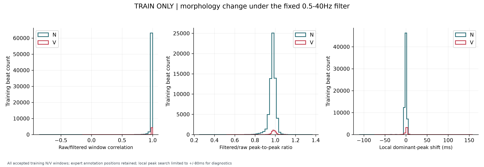

滤波相关性、幅值比与局部极值偏移只是工程形态变化指标，不能证明临床形态无失真；没有据此移动标签或自动删除样本。

范围：`All accepted training N/V windows; expert annotation positions retained; local peak search limited to +/-80ms for diagnostics`

