# MIT-BIH 心电图可视化图集与逐图分析

本轮仅做数据探索与可视化，**没有训练深度模型或分类器，也没有进行训练/验证/测试划分**。记录：**100, 200**；数据库版本 1.0.0；输出 67 张 300 dpi PNG，分为下列六类。所有数字来自本轮代码计算。

| 代码 | 图集类别 | 本轮张数 | 目录 |
| --- | --- | --- | --- |
| A | 数据分布 | 9 | `figures/A_distribution/` |
| B | 原始波形 | 14 | `figures/B_waveforms/` |
| C | 单心拍形态 | 19 | `figures/C_morphology/` |
| D | 节律分析 | 9 | `figures/D_rhythm/` |
| E | 数据质量 | 8 | `figures/E_quality/` |
| F | 降维探索 | 8 | `figures/F_embedding/` |

## 范围与主要统计事实

- 总标注 5066 条，其中已映射心拍 4874、非心拍 192；其余 0 条明确保留为未映射/未知项，不猜测类别。
- 已识别心拍 4874 个，其中 4871 个完整、有限且已映射的主导联窗口用于形态和降维；其余 3 个仍保留在原始统计与审计表中。
- 全部形态图按**相同导联名称**分组，优先 MLII，没有 MLII 的记录使用其实际首导联，并独立汇总，不将 MLII 与 V5 等直接混合。
- 本轮没有分析全部 48 条记录。`--records all` 可扩展，但需要另行运行；当前类频率不能当作全库或临床人群患病率。

| aami_group | count | percentage_of_mapped_beats |
| --- | --- | --- |
| N | 3982 | 81.6988 |
| S | 63 | 1.29257 |
| V | 827 | 16.9676 |
| F | 2 | 0.0410341 |
| Q | 0 | 0 |

完整原始符号表（含非心拍）如下。中文含义和五类映射均沿用既有显式规则；本轮未更改专家标签。

| symbol | meaning_zh | annotation_kind | aami_group | count |
| --- | --- | --- | --- | --- |
| N | 正常心拍 | mapped_beat | N | 3982 |
| V | 室性期前收缩 | mapped_beat | V | 827 |
| + | 节律改变（详见 aux_note） | non_beat |  | 149 |
| A | 房性期前收缩 | mapped_beat | S | 63 |
| ~ | 信号质量改变（保留 subtype） | non_beat |  | 43 |
| F | 室性与正常心拍融合 | mapped_beat | F | 2 |

## 可用于课程汇报的计算结果

- 非 N 组比例最高为记录 200（32.987%），最低为记录 100（1.496%），记录间构成差异不能被合并频率替代。
- 100: 平均 RR 0.7946 s，SD 0.0488 s；200: 平均 RR 0.6941 s，SD 0.1521 s。这是全部已识别心拍的 RR 描述量，不是正常 NN 的临床 HRV。
- MLII 的 N/S 类均值模板相关系数 r=0.9917；相关值只描述类均值，不能替代逐拍区分能力。
- 整条信号标准差最高的是 200/V1（0.4947 mV）；这只提供复核线索，不是噪声率。


## 计算方法与读图约定

1. **数据与标签**：使用 PhysioNet 官方 `.dat/.hea/.atr`，逐文件校验 SHA256、逐导联核对数字校验和并检查标注范围。原始 `symbol` 与 `aami_group` 分开保存。N←N,L,R,e,j；S←A,a,J,S；V←V,E；F←F；Q←/,f,Q。节律、质量与伪迹符号不计作心拍。[数据库说明](https://physionet.org/content/mitdb/1.0.0/)、[原始符号定义](https://physionet.org/static/lightwave/doc/annotations.html)、[AAMI 映射文献](https://doi.org/10.1109/TBME.2004.827359)。
2. **“异常比例”的操作性定义**：排序图计算 `(S+V+F+Q)/(N+S+V+F+Q)`，图中明确标为“非 N 组比例”。N 组包含束支阻滞和部分逸搏，Q 包含起搏/无法分类；这个比值不能当作严格的医学异常率。
3. **窗口**：原始专家标注前 0.25 s、后 0.45 s；包含中心和末采样点，stop 列为右开端点。360 Hz、默认参数时为 253 点。越界只影响片段，不删原始心拍计数；没有重新定位 R 峰，也没有滤波或改写原始数据。窗口可能包含相邻心拍。
4. **随机与代表性示例**：随机种子 20261027，每类最多 20 拍、不放回；不足时全部展示，零样本只显示缺失说明。网格首先取减中位数后最接近类均值的真实片段，再取不同峰峰值排序位置的真实片段；每格标注记录、导联、原始样本和秒数。抽样与网格的精确标识均见 `plotted_heartbeat_windows.csv`。
5. **形态与能量**：左侧原始幅值保持物理单位；减窗口中位数的版本仅用于控制常量基线。峰峰值、最大/最小值描述整个窗口，不是专家分割的 QRS 指标。窗口能量定义为 `sum(x**2)/fs`，单位 mV²·s，另报告减中位数后的能量。箱线图须为 1.5 IQR；均值波形阴影为逐点 ±1 标准差，不是置信区间。
6. **RR**：仅从同一记录连续专家心拍标注计算，不跨记录，不将非心拍事件当作 RR 邻居。RR 分析使用全部已识别心拍，与形态窗口是否越界无关；散点按当前拍类别着色。包含异位心拍的 RR 不等于正常 NN 间期，不进行临床 HRV 诊断。
7. **质量**：振幅/标准差是描述量；1 s 块中位数在 10 s 内的变化是漂移候选代理，≥0.5 mV 只作示例选择规则，也可能由宽心拍、突变伪迹等造成。专家 `~` 是质量改变事件，不是确定的噪声持续时长。未触及 ADC 轨值也不说明没有严重干扰。
8. **PCA/t-SNE**：所有有效同导联窗口先减各窗中位数；第二版本另除以各窗 RMS，去掉幅值尺度（常量窗口不除以零）。PCA 使用全部有效窗口且不按采样点做方差标准化。t-SNE 先按记录×类别各限 500 拍，再等额分配至总上限 3000，均为固定种子不放回；保留小样本层，不复制稀有类。对入选矩阵先 PCA 到最多 50 维，再运行 t-SNE，perplexity=[15.0, 40.0]、init=pca、learning_rate=auto、最多 1000 轮。每个投影同时按类别和记录着色，以检查记录效应。t-SNE 抽样图不代表原始类频率，坐标和簇间距离不能直接比较；其 KL 也不是分类准确率。[PCA 官方文档](https://scikit-learn.org/stable/modules/generated/sklearn.decomposition.PCA.html)、[t-SNE 官方文档](https://scikit-learn.org/stable/modules/generated/sklearn.manifold.TSNE.html)。

## 后续建模分析应注意

当前 F 可能极少、Q 可能缺失，因此不能据这两条记录评价完整五分类能力。类均值可能掩盖多形态或受大记录支配；二维聚集不等于真实可分性，也不是模型验证。未来划分须按受试者独立，**201 和 202 来自同一受试者，必须在同一分区**；不要随机心拍级划分或让重叠窗口跨分区。未来标准化与降维若用于预测管线，只能在训练分区拟合，验证/测试单独变换；本轮所有数据上的探索性投影不可当作测试性能。

## 可复现入口与明细

```powershell
.\.venv\Scripts\python.exe -m src.visualize --records 100 200 --offline
```

主入口 `src/visualize.py`；加载复用 `src/io.py`、下载复用 `src/download.py`、映射复用 `src/labels.py`；心拍截取与描述量位于 `src/heartbeat.py`；六类绘图模块位于 `src/visuals/`；本报告由 `src/visualization_report.py` 生成。

本轮清单与统计位于 `results/visualization/`：`figure_catalog.csv` 是全部图的解释索引；`all_beat_metadata.csv` 记录边界和 RR；`heartbeat_features.csv` 记录有效片段描述量；`embedding_coordinates.csv` 保存每个降维点的记录、原始标注位置和类别；`embedding_parameters.csv` 保存 t-SNE 参数；`template_correlations.csv` 保留缺失模板为 NA。每次运行以本轮清单为准，不自动删除其他运行留下的图片。

环境、配置和原始文件哈希见 `environment.json`、`run_config.json`、`download_manifest.csv`，完整性验证见 `verification.json`。各图下方的“计算结果”来自代码；额外“视觉核查”只来自开发助手对实际图像的查看，绑定本轮原始数据哈希及配置，未经额外心电专家复核，不能替代专家诊断。

## 逐图解释


### A. 数据分布

#### A01 · Records 100, 200 | original annotation frequency

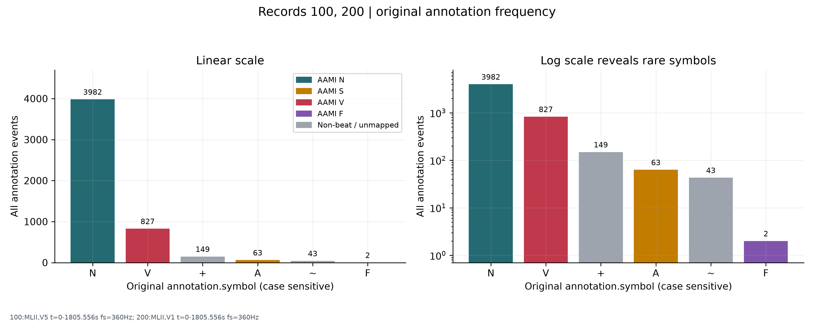

**读图目的**：比较全部原始符号，区分心拍与节律/质量等非心拍事件。

**计算结果**：原始 N=3982；原始 V=827；原始 +=149；原始 A=63；原始 ~=43；原始 F=2。其中非心拍事件 192 条。

**解释边界**：非心拍符号不能计入 AAMI 心拍分布；柱的颜色仅提示已有分组，灰色为非五组项。

**数据范围**：`100:MLII,V5 t=0-1805.556s fs=360Hz; 200:MLII,V1 t=0-1805.556s fs=360Hz`

#### A02 · Records 100 | original annotation frequency

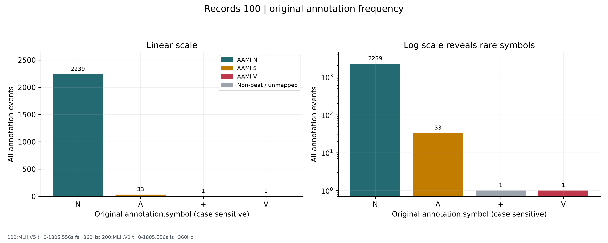

**读图目的**：比较全部原始符号，区分心拍与节律/质量等非心拍事件。

**计算结果**：原始 N=2239；原始 A=33；原始 +=1；原始 V=1。其中非心拍事件 1 条。

**解释边界**：非心拍符号不能计入 AAMI 心拍分布；柱的颜色仅提示已有分组，灰色为非五组项。

**数据范围**：`100:MLII,V5 t=0-1805.556s fs=360Hz; 200:MLII,V1 t=0-1805.556s fs=360Hz`

#### A03 · Records 200 | original annotation frequency

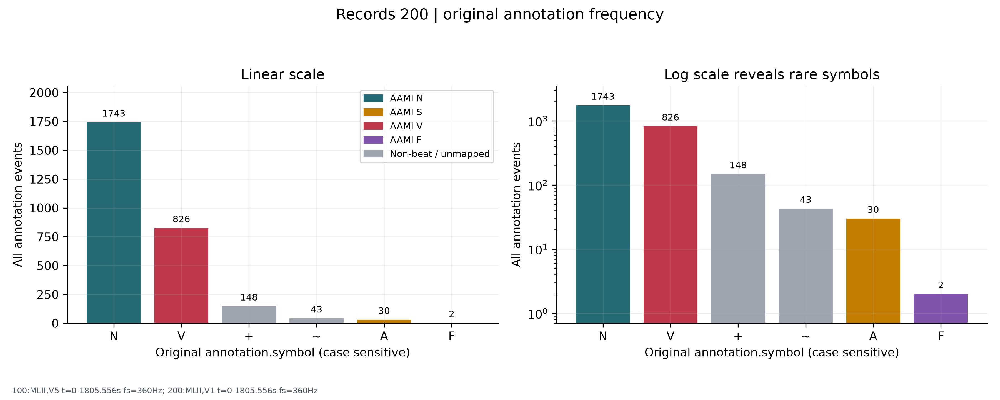

**读图目的**：比较全部原始符号，区分心拍与节律/质量等非心拍事件。

**计算结果**：原始 N=1743；原始 V=826；原始 +=148；原始 ~=43；原始 A=30；原始 F=2。其中非心拍事件 191 条。

**解释边界**：非心拍符号不能计入 AAMI 心拍分布；柱的颜色仅提示已有分组，灰色为非五组项。

**数据范围**：`100:MLII,V5 t=0-1805.556s fs=360Hz; 200:MLII,V1 t=0-1805.556s fs=360Hz`

#### A04 · All selected records | AAMI five-group counts

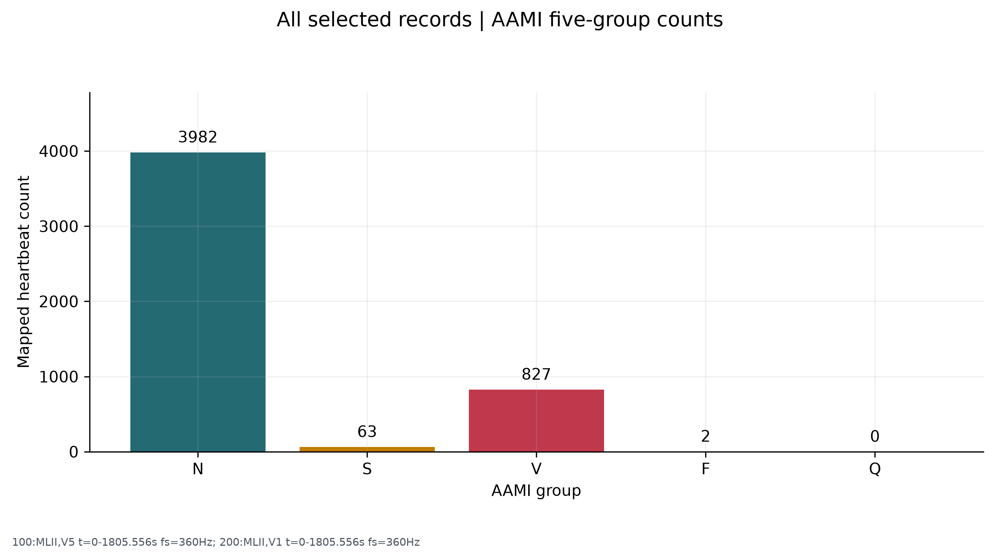

**读图目的**：识别多数类、稀有类与零样本类。

**计算结果**：N=3982 拍；S=63 拍；V=827 拍；F=2 拍；Q=0 拍

**解释边界**：分母只包含已映射心拍；N 组不等同于全部医学正常。

**数据范围**：`100:MLII,V5 t=0-1805.556s fs=360Hz; 200:MLII,V1 t=0-1805.556s fs=360Hz`

#### A05 · All selected records | AAMI proportions

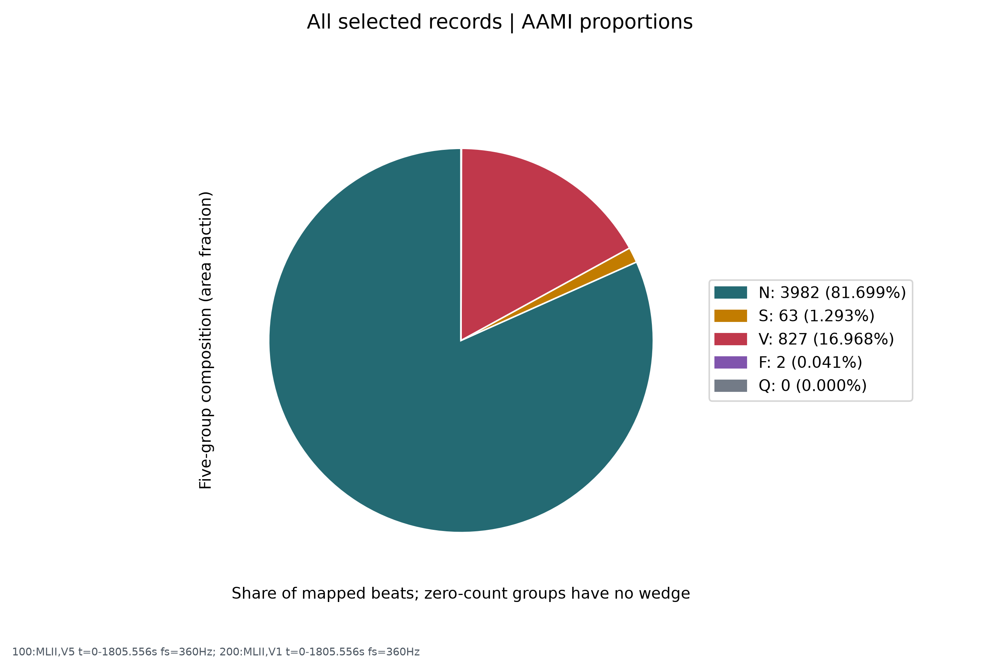

**读图目的**：用整体占比展示类别不平衡，同时在图例保留稀有类精确比例。

**计算结果**：N=81.6988%；S=1.2926%；V=16.9676%；F=0.0410%；Q=0.0000%

**解释边界**：小扇区不容易目视比较，数量请结合柱图；零样本组：Q

**数据范围**：`100:MLII,V5 t=0-1805.556s fs=360Hz; 200:MLII,V1 t=0-1805.556s fs=360Hz`

#### A06 · Record comparison | Mapped beat count

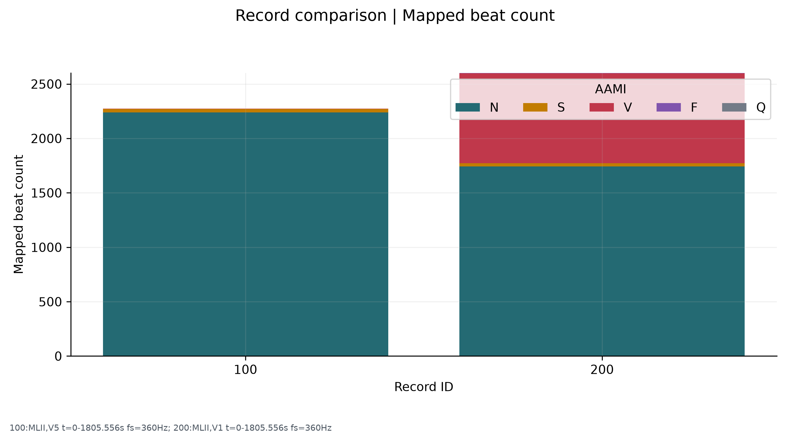

**读图目的**：比较记录之间的样本量和类别构成，观察记录效应。

**计算结果**：记录 100: N=2239, S=33, V=1, F=0, Q=0；记录 200: N=1743, S=30, V=826, F=2, Q=0

**解释边界**：记录长短或心率会影响计数；百分比不能代表人群患病率。

**数据范围**：`100:MLII,V5 t=0-1805.556s fs=360Hz; 200:MLII,V1 t=0-1805.556s fs=360Hz`

#### A07 · Record comparison | Within-record mapped beats (%)

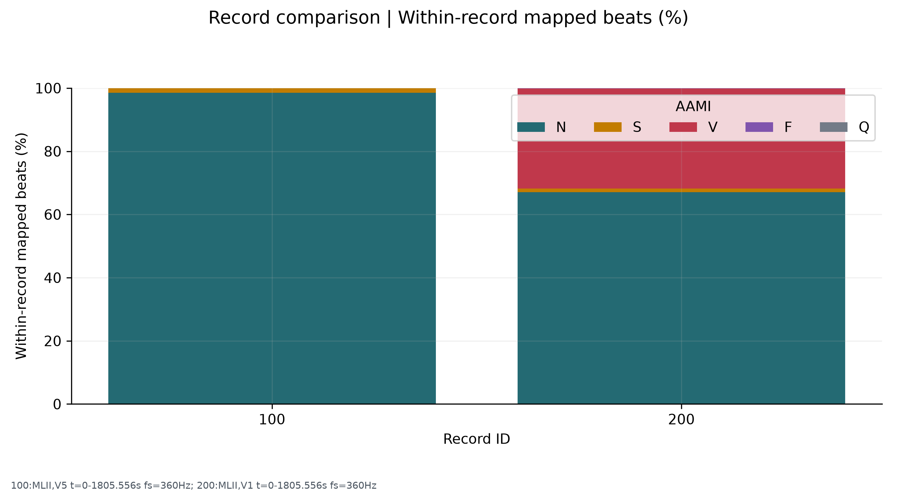

**读图目的**：比较记录之间的样本量和类别构成，观察记录效应。

**计算结果**：记录 100: N=2239, S=33, V=1, F=0, Q=0；记录 200: N=1743, S=30, V=826, F=2, Q=0

**解释边界**：记录长短或心率会影响计数；百分比不能代表人群患病率。

**数据范围**：`100:MLII,V5 t=0-1805.556s fs=360Hz; 200:MLII,V1 t=0-1805.556s fs=360Hz`

#### A08 · Record x class | count and within-record percentage

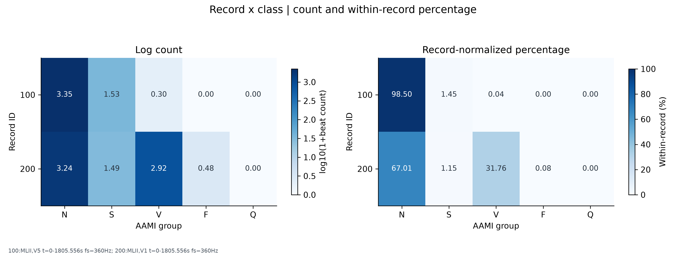

**读图目的**：同时观察绝对频数和记录内构成，减少大类遮蔽稀有类的问题。

**计算结果**：矩阵为 2 条记录 × 5 类；零计数单元格 3 个。

**实际视觉核查**：记录 100 的构成几乎都集中在 N 组；记录 200 的 V 组色块与百分比明显更大。两条记录合并后的类别比例掩盖了这种记录间差异。

**解释边界**：左图数值为 log10(1+count)，不是原始次数；右图各行合计 100%。

**数据范围**：`100:MLII,V5 t=0-1805.556s fs=360Hz; 200:MLII,V1 t=0-1805.556s fs=360Hz`

#### A09 · Records ranked by non-N beat proportion

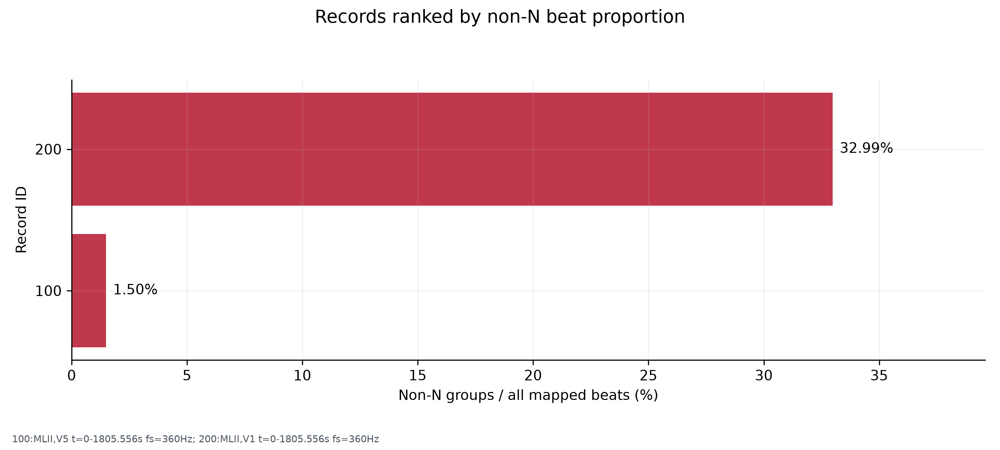

**读图目的**：按操作性定义比较各记录的非 N 组比例。

**计算结果**：200: 32.987%；100: 1.496%

**解释边界**：这是 S/V/F/Q 占已映射心拍比例；N 组含部分非正常心拍，Q 含起搏/不确定心拍，因此不能视作临床异常患病率。

**数据范围**：`100:MLII,V5 t=0-1805.556s fs=360Hz; 200:MLII,V1 t=0-1805.556s fs=360Hz`


### B. 原始波形

#### B01 · Record 100 | raw | 0.000-10.000s

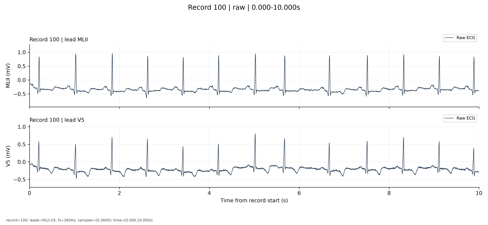

**读图目的**：前 10 秒观察；对照原始波形、专家位置与类别。

**计算结果**：区间 [0.000, 10.000) s，13 个心拍；N=12, S=1, V=0, F=0, Q=0

**解释边界**：标注位置直接来自 .atr，不保证是每个导联上的精确 R 峰；同一标注重复显示在各导联，但心拍只统计一次。

**数据范围**：`record=100; leads=MLII,V5; fs=360Hz; samples=[0,3600); time=[0.000,10.000)s`

#### B02 · Record 100 | position | 0.000-10.000s

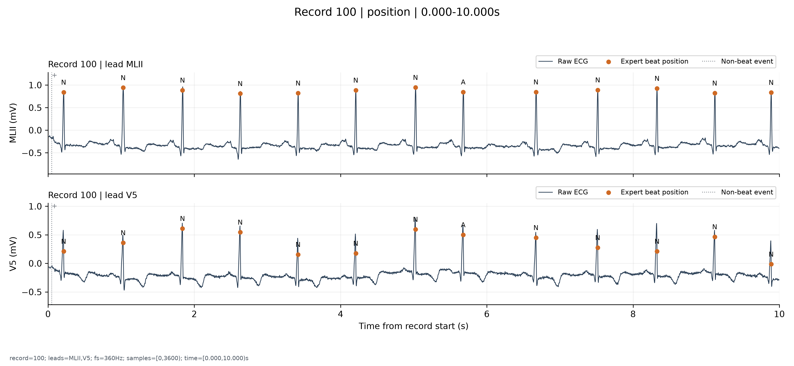

**读图目的**：前 10 秒观察；对照原始波形、专家位置与类别。

**计算结果**：区间 [0.000, 10.000) s，13 个心拍；N=12, S=1, V=0, F=0, Q=0

**解释边界**：标注位置直接来自 .atr，不保证是每个导联上的精确 R 峰；同一标注重复显示在各导联，但心拍只统计一次。

**数据范围**：`record=100; leads=MLII,V5; fs=360Hz; samples=[0,3600); time=[0.000,10.000)s`

#### B03 · Record 100 | class | 0.000-10.000s

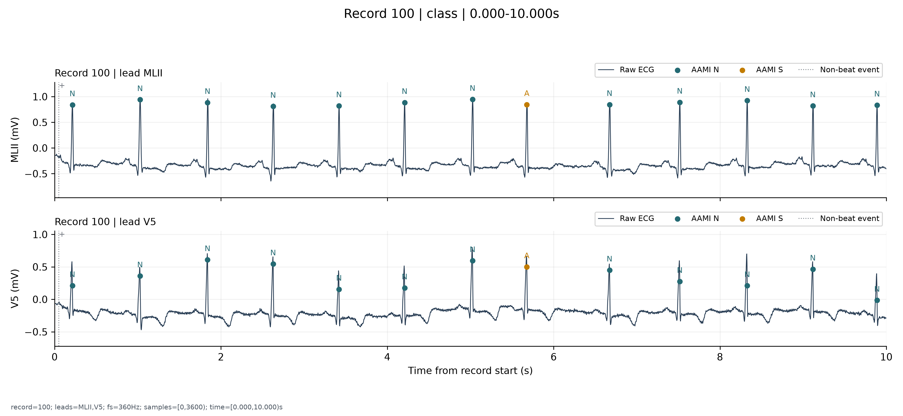

**读图目的**：前 10 秒观察；对照原始波形、专家位置与类别。

**计算结果**：区间 [0.000, 10.000) s，13 个心拍；N=12, S=1, V=0, F=0, Q=0

**解释边界**：标注位置直接来自 .atr，不保证是每个导联上的精确 R 峰；同一标注重复显示在各导联，但心拍只统计一次。

**数据范围**：`record=100; leads=MLII,V5; fs=360Hz; samples=[0,3600); time=[0.000,10.000)s`

#### B04 · Record 100 | class | 888.867-894.867s

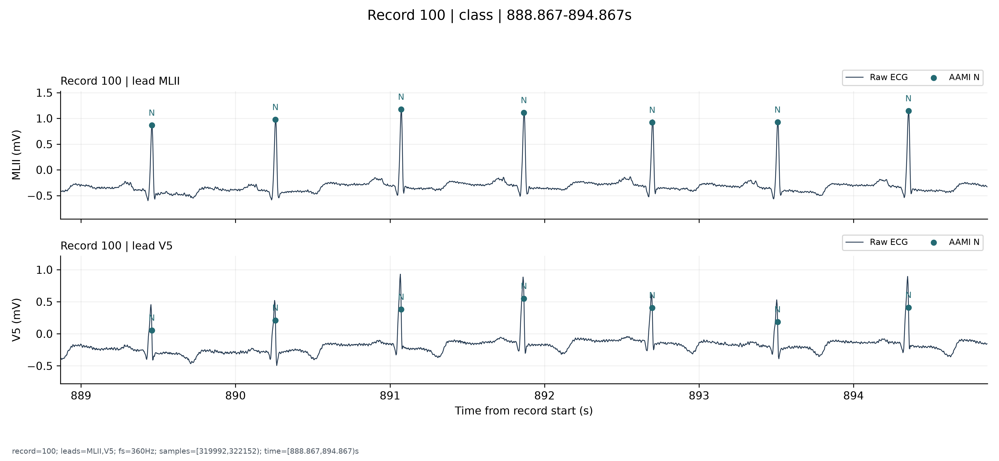

**读图目的**：以 N 类时间排序的中间有效心拍为中心观察约 6 秒节律上下文；对照原始波形、专家位置与类别。

**计算结果**：区间 [888.867, 894.867) s，7 个心拍；N=7, S=0, V=0, F=0, Q=0

**解释边界**：标注位置直接来自 .atr，不保证是每个导联上的精确 R 峰；同一标注重复显示在各导联，但心拍只统计一次。

**数据范围**：`record=100; leads=MLII,V5; fs=360Hz; samples=[319992,322152); time=[888.867,894.867)s`

#### B05 · Record 100 | class | 1169.206-1175.206s

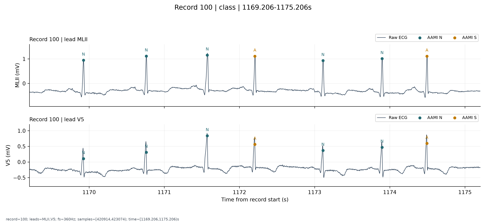

**读图目的**：以 S 类时间排序的中间有效心拍为中心观察约 6 秒节律上下文；对照原始波形、专家位置与类别。

**计算结果**：区间 [1169.206, 1175.206) s，7 个心拍；N=5, S=2, V=0, F=0, Q=0

**解释边界**：标注位置直接来自 .atr，不保证是每个导联上的精确 R 峰；同一标注重复显示在各导联，但心拍只统计一次。

**数据范围**：`record=100; leads=MLII,V5; fs=360Hz; samples=[420914,423074); time=[1169.206,1175.206)s`

#### B06 · Record 100 | class | 1515.867-1521.867s

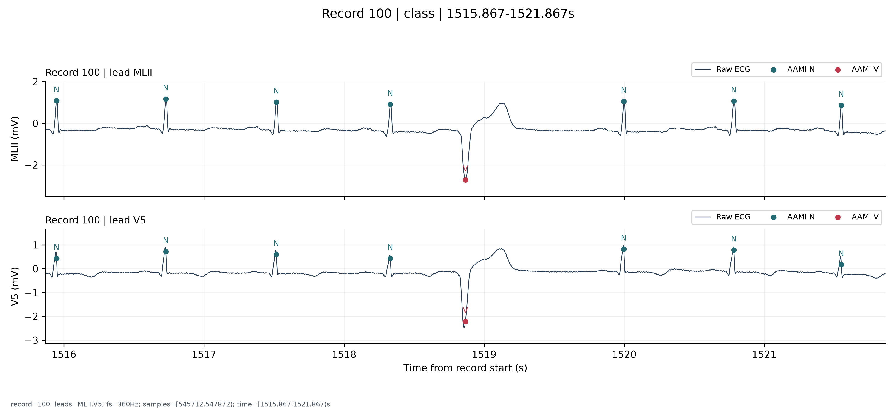

**读图目的**：以 V 类时间排序的中间有效心拍为中心观察约 6 秒节律上下文；对照原始波形、专家位置与类别。

**计算结果**：区间 [1515.867, 1521.867) s，8 个心拍；N=7, S=0, V=1, F=0, Q=0

**解释边界**：标注位置直接来自 .atr，不保证是每个导联上的精确 R 峰；同一标注重复显示在各导联，但心拍只统计一次。

**数据范围**：`record=100; leads=MLII,V5; fs=360Hz; samples=[545712,547872); time=[1515.867,1521.867)s`

#### B07 · Record 200 | raw | 0.000-10.000s

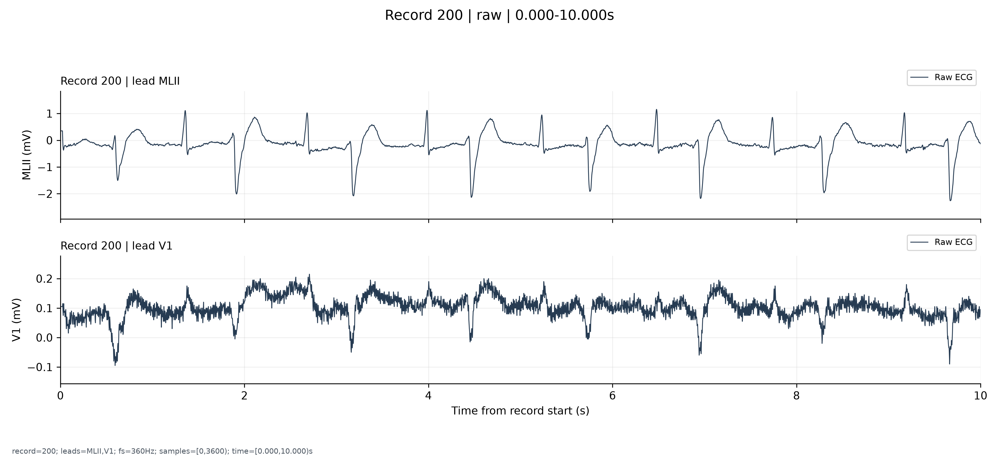

**读图目的**：前 10 秒观察；对照原始波形、专家位置与类别。

**计算结果**：区间 [0.000, 10.000) s，15 个心拍；N=7, S=0, V=8, F=0, Q=0

**解释边界**：标注位置直接来自 .atr，不保证是每个导联上的精确 R 峰；同一标注重复显示在各导联，但心拍只统计一次。

**数据范围**：`record=200; leads=MLII,V1; fs=360Hz; samples=[0,3600); time=[0.000,10.000)s`

#### B08 · Record 200 | position | 0.000-10.000s

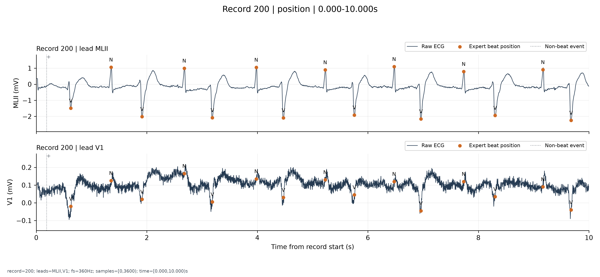

**读图目的**：前 10 秒观察；对照原始波形、专家位置与类别。

**计算结果**：区间 [0.000, 10.000) s，15 个心拍；N=7, S=0, V=8, F=0, Q=0

**解释边界**：标注位置直接来自 .atr，不保证是每个导联上的精确 R 峰；同一标注重复显示在各导联，但心拍只统计一次。

**数据范围**：`record=200; leads=MLII,V1; fs=360Hz; samples=[0,3600); time=[0.000,10.000)s`

#### B09 · Record 200 | class | 0.000-10.000s

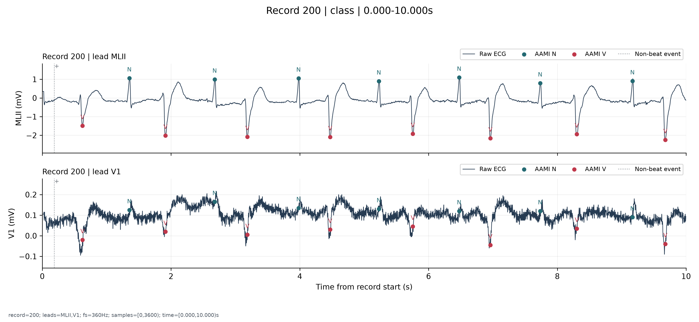

**读图目的**：前 10 秒观察；对照原始波形、专家位置与类别。

**计算结果**：区间 [0.000, 10.000) s，15 个心拍；N=7, S=0, V=8, F=0, Q=0

**解释边界**：标注位置直接来自 .atr，不保证是每个导联上的精确 R 峰；同一标注重复显示在各导联，但心拍只统计一次。

**数据范围**：`record=200; leads=MLII,V1; fs=360Hz; samples=[0,3600); time=[0.000,10.000)s`

#### B10 · Record 200 | class | 832.433-838.433s

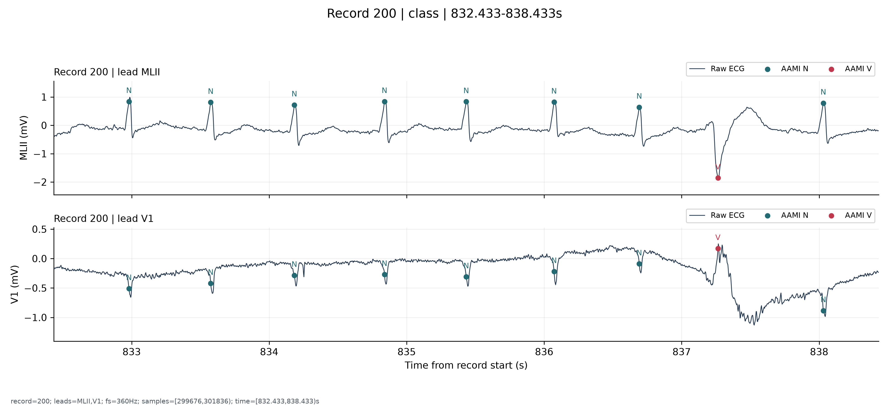

**读图目的**：以 N 类时间排序的中间有效心拍为中心观察约 6 秒节律上下文；对照原始波形、专家位置与类别。

**计算结果**：区间 [832.433, 838.433) s，9 个心拍；N=8, S=0, V=1, F=0, Q=0

**解释边界**：标注位置直接来自 .atr，不保证是每个导联上的精确 R 峰；同一标注重复显示在各导联，但心拍只统计一次。

**数据范围**：`record=200; leads=MLII,V1; fs=360Hz; samples=[299676,301836); time=[832.433,838.433)s`

#### B11 · Record 200 | class | 1354.167-1360.167s

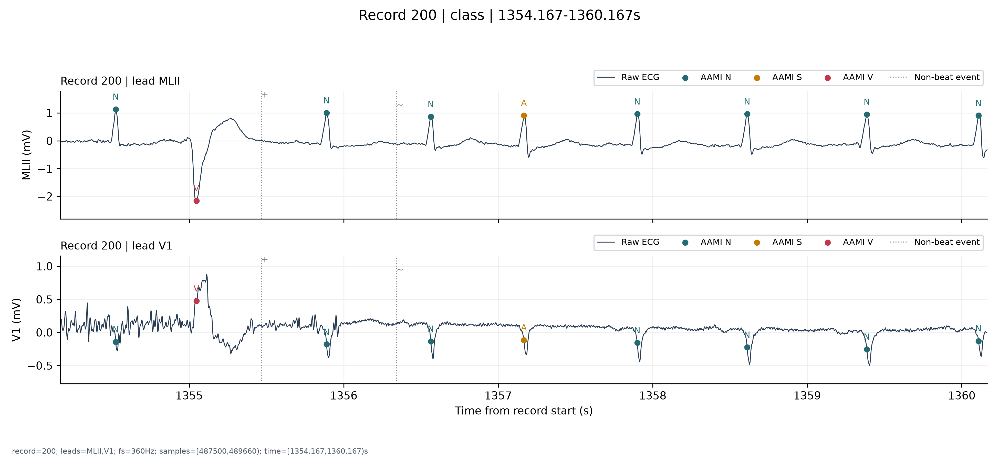

**读图目的**：以 S 类时间排序的中间有效心拍为中心观察约 6 秒节律上下文；对照原始波形、专家位置与类别。

**计算结果**：区间 [1354.167, 1360.167) s，9 个心拍；N=7, S=1, V=1, F=0, Q=0

**解释边界**：标注位置直接来自 .atr，不保证是每个导联上的精确 R 峰；同一标注重复显示在各导联，但心拍只统计一次。

**数据范围**：`record=200; leads=MLII,V1; fs=360Hz; samples=[487500,489660); time=[1354.167,1360.167)s`

#### B12 · Record 200 | class | 1037.511-1043.511s

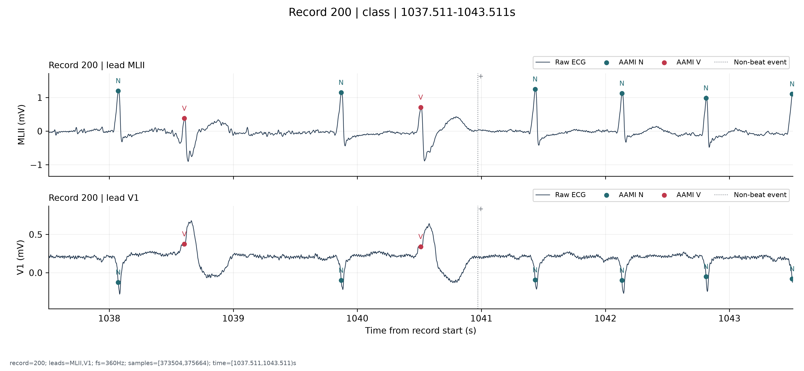

**读图目的**：以 V 类时间排序的中间有效心拍为中心观察约 6 秒节律上下文；对照原始波形、专家位置与类别。

**计算结果**：区间 [1037.511, 1043.511) s，8 个心拍；N=6, S=0, V=2, F=0, Q=0

**解释边界**：标注位置直接来自 .atr，不保证是每个导联上的精确 R 峰；同一标注重复显示在各导联，但心拍只统计一次。

**数据范围**：`record=200; leads=MLII,V1; fs=360Hz; samples=[373504,375664); time=[1037.511,1043.511)s`

#### B13 · Record 200 | class | 1068.908-1074.908s

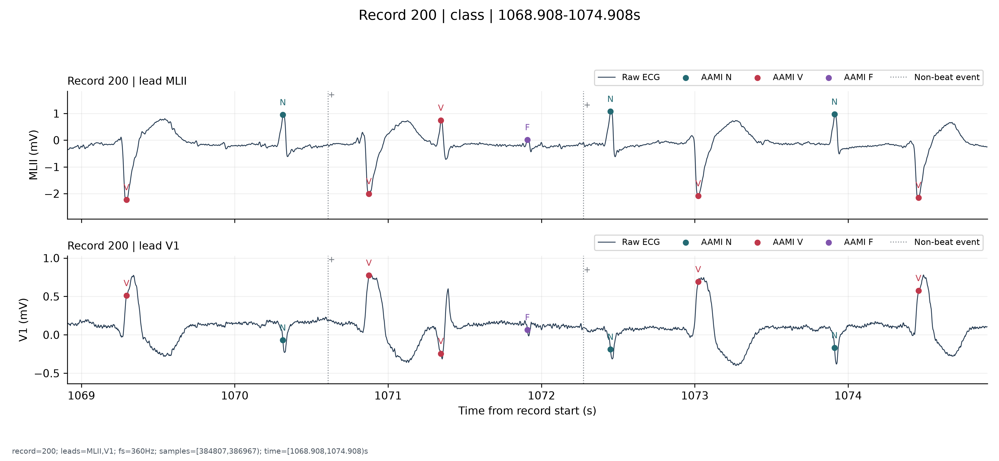

**读图目的**：以 F 类时间排序的中间有效心拍为中心观察约 6 秒节律上下文；对照原始波形、专家位置与类别。

**计算结果**：区间 [1068.908, 1074.908) s，9 个心拍；N=3, S=0, V=5, F=1, Q=0

**解释边界**：标注位置直接来自 .atr，不保证是每个导联上的精确 R 峰；同一标注重复显示在各导联，但心拍只统计一次。

**数据范围**：`record=200; leads=MLII,V1; fs=360Hz; samples=[384807,386967); time=[1068.908,1074.908)s`

#### B14 · Record comparison | same lead MLII | first 10 seconds

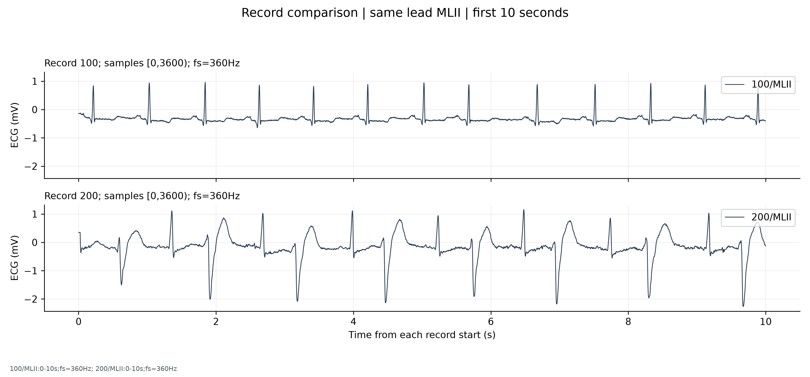

**读图目的**：在同导联、同时间长度和相同纵轴尺度下比较记录差异。

**计算结果**：100/MLII 前 10 s 幅值范围 -0.645–0.960 mV；200/MLII 前 10 s 幅值范围 -2.260–1.155 mV

**解释边界**：不同记录属于不同受试者/记录背景，不按外观推断疾病；不把不同导联混为一种形态。

**数据范围**：`100/MLII:0-10s;fs=360Hz; 200/MLII:0-10s;fs=360Hz`


### C. 单心拍形态

#### C01 · Lead MLII | AAMI N | 20 randomly sampled beats

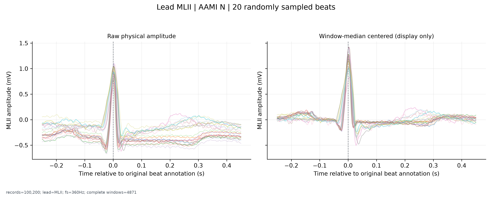

**读图目的**：固定种子随机选取最多 20 拍，观察类内幅值、基线与形态变化。

**计算结果**：该导联 N 类有 3979 个有效窗口，实际不放回抽取 20 个；样本标识见 plotted_heartbeat_windows.csv。

**解释边界**：不足 20 拍时全部展示，不复制稀有类；不同颜色只区分抽样曲线，不代表额外类别。

**数据范围**：`records=100,200; lead=MLII; fs=360Hz; complete windows=4871`

#### C02 · Lead MLII | AAMI N | class mean and variability

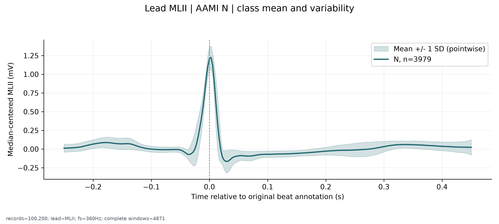

**读图目的**：用全部有效窗口的平均波形和逐采样点标准差补充少量示例。

**计算结果**：模板使用 3979 个窗口；各点标准差最大值 0.3561 mV。

**解释边界**：阴影是类内逐点标准差，不是均值置信区间；先各窗减中位数，不缩放幅值，不重新定位峰。

**数据范围**：`records=100,200; lead=MLII; fs=360Hz; complete windows=4871`

#### C03 · Lead MLII | AAMI N | representative and amplitude-diverse examples

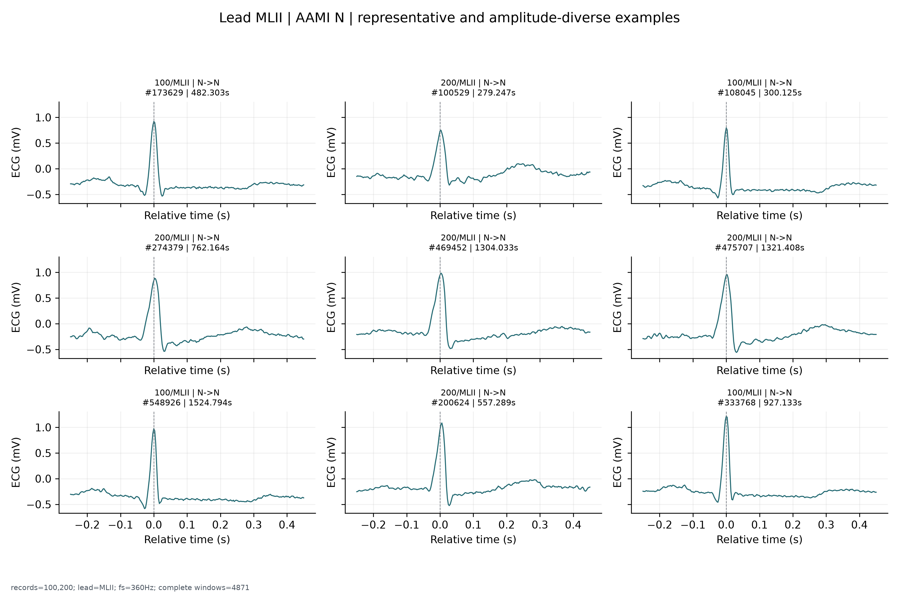

**读图目的**：选出最接近类均值的实际心拍，并补充不同峰峰值排序位置的实际片段。

**计算结果**：实际展示 9 个不同心拍；首格为减中位数后距离类均值最近的窗口，其余按峰峰值排序选取。

**解释边界**：代表性由明确数值准则定义，不是专家诊断；极端片段可能含基线或邻拍影响；只有 2 例不能建立稳定模板。

**数据范围**：`records=100,200; lead=MLII; fs=360Hz; complete windows=4871`

#### C04 · Lead MLII | AAMI S | 20 randomly sampled beats

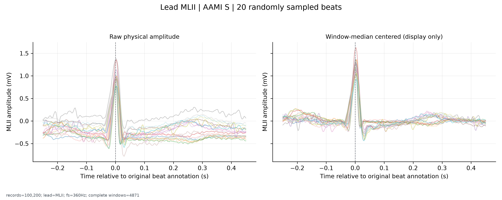

**读图目的**：固定种子随机选取最多 20 拍，观察类内幅值、基线与形态变化。

**计算结果**：该导联 S 类有 63 个有效窗口，实际不放回抽取 20 个；样本标识见 plotted_heartbeat_windows.csv。

**解释边界**：不足 20 拍时全部展示，不复制稀有类；不同颜色只区分抽样曲线，不代表额外类别。

**数据范围**：`records=100,200; lead=MLII; fs=360Hz; complete windows=4871`

#### C05 · Lead MLII | AAMI S | class mean and variability

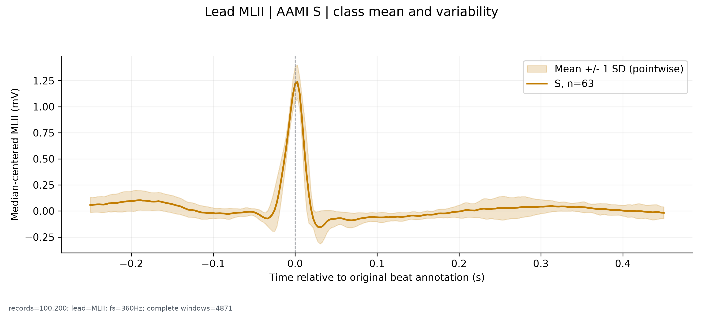

**读图目的**：用全部有效窗口的平均波形和逐采样点标准差补充少量示例。

**计算结果**：模板使用 63 个窗口；各点标准差最大值 0.3506 mV。

**解释边界**：阴影是类内逐点标准差，不是均值置信区间；先各窗减中位数，不缩放幅值，不重新定位峰。

**数据范围**：`records=100,200; lead=MLII; fs=360Hz; complete windows=4871`

#### C06 · Lead MLII | AAMI S | representative and amplitude-diverse examples

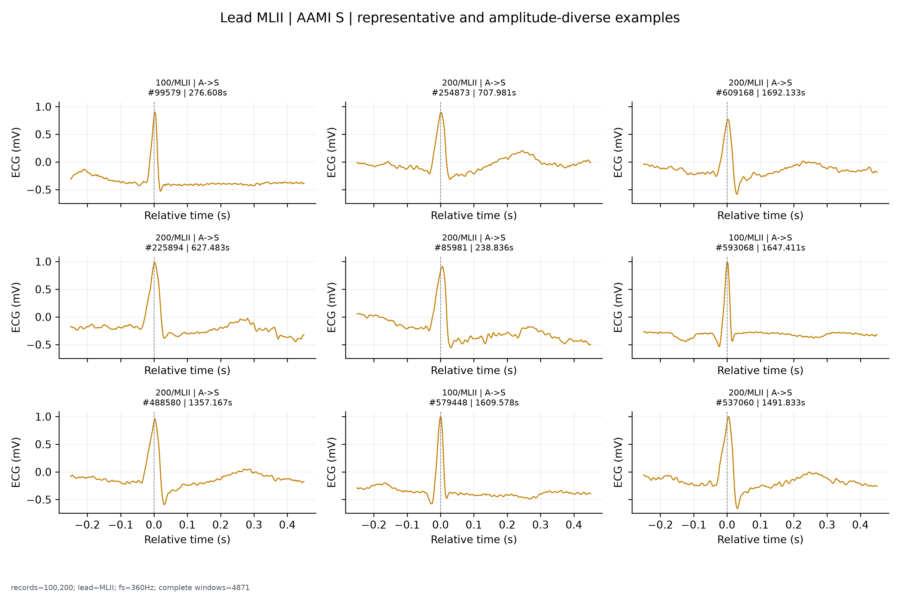

**读图目的**：选出最接近类均值的实际心拍，并补充不同峰峰值排序位置的实际片段。

**计算结果**：实际展示 9 个不同心拍；首格为减中位数后距离类均值最近的窗口，其余按峰峰值排序选取。

**解释边界**：代表性由明确数值准则定义，不是专家诊断；极端片段可能含基线或邻拍影响；只有 2 例不能建立稳定模板。

**数据范围**：`records=100,200; lead=MLII; fs=360Hz; complete windows=4871`

#### C07 · Lead MLII | AAMI V | 20 randomly sampled beats

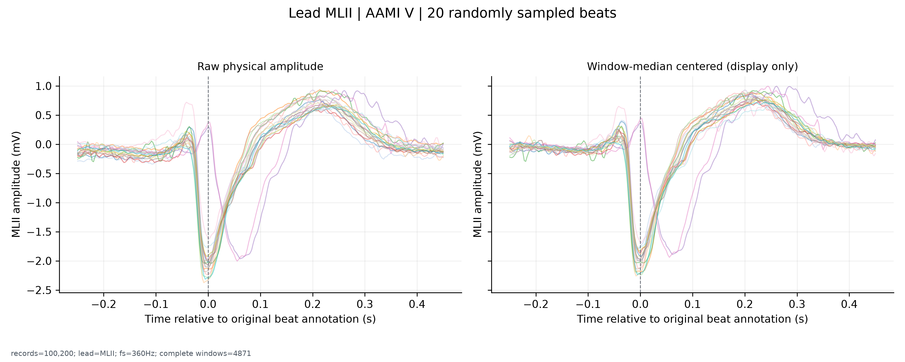

**读图目的**：固定种子随机选取最多 20 拍，观察类内幅值、基线与形态变化。

**计算结果**：该导联 V 类有 827 个有效窗口，实际不放回抽取 20 个；样本标识见 plotted_heartbeat_windows.csv。

**实际视觉核查**：多数抽样 V 窗口在中心附近有明显向下偏转，随后有较宽的向上波形；少数样本的偏转时刻和形态不同。减去各窗中位数后差异仍存在，因此不能全部归因于常量基线偏移，也不能据外观推翻专家标签。

**解释边界**：不足 20 拍时全部展示，不复制稀有类；不同颜色只区分抽样曲线，不代表额外类别。

**数据范围**：`records=100,200; lead=MLII; fs=360Hz; complete windows=4871`

#### C08 · Lead MLII | AAMI V | class mean and variability

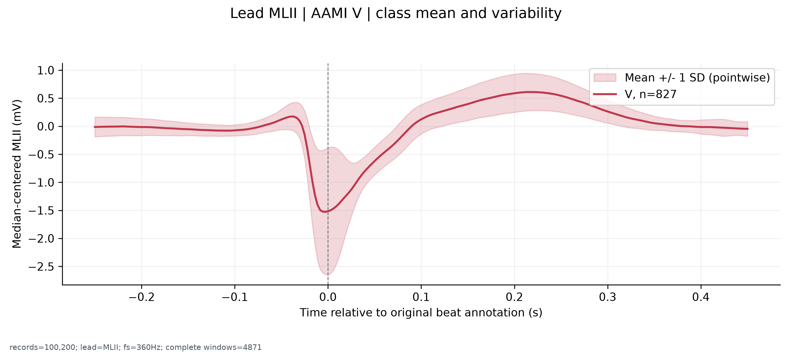

**读图目的**：用全部有效窗口的平均波形和逐采样点标准差补充少量示例。

**计算结果**：模板使用 827 个窗口；各点标准差最大值 1.1304 mV。

**解释边界**：阴影是类内逐点标准差，不是均值置信区间；先各窗减中位数，不缩放幅值，不重新定位峰。

**数据范围**：`records=100,200; lead=MLII; fs=360Hz; complete windows=4871`

#### C09 · Lead MLII | AAMI V | representative and amplitude-diverse examples

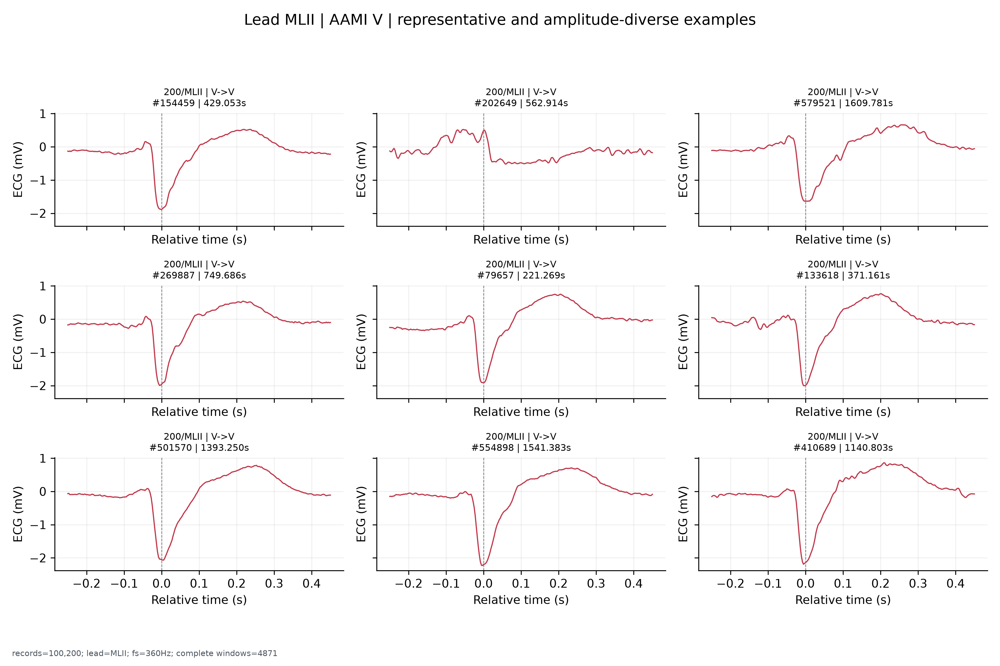

**读图目的**：选出最接近类均值的实际心拍，并补充不同峰峰值排序位置的实际片段。

**计算结果**：实际展示 9 个不同心拍；首格为减中位数后距离类均值最近的窗口，其余按峰峰值排序选取。

**解释边界**：代表性由明确数值准则定义，不是专家诊断；极端片段可能含基线或邻拍影响；只有 2 例不能建立稳定模板。

**数据范围**：`records=100,200; lead=MLII; fs=360Hz; complete windows=4871`

#### C10 · Lead MLII | AAMI F | 2 randomly sampled beats

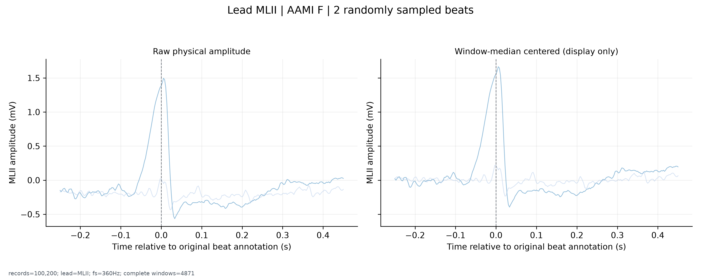

**读图目的**：固定种子随机选取最多 20 拍，观察类内幅值、基线与形态变化。

**计算结果**：该导联 F 类有 2 个有效窗口，实际不放回抽取 2 个；样本标识见 plotted_heartbeat_windows.csv。

**解释边界**：不足 20 拍时全部展示，不复制稀有类；不同颜色只区分抽样曲线，不代表额外类别。

**数据范围**：`records=100,200; lead=MLII; fs=360Hz; complete windows=4871`

#### C11 · Lead MLII | AAMI F | class mean and variability

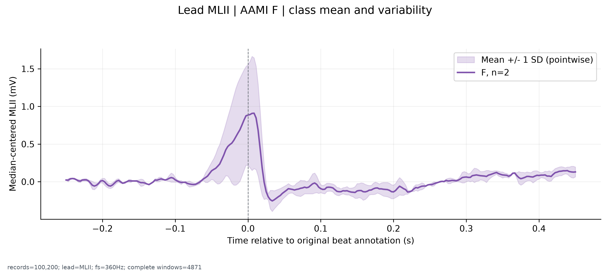

**读图目的**：用全部有效窗口的平均波形和逐采样点标准差补充少量示例。

**计算结果**：模板使用 2 个窗口；各点标准差最大值 0.7575 mV。

**解释边界**：阴影是类内逐点标准差，不是均值置信区间；先各窗减中位数，不缩放幅值，不重新定位峰。

**数据范围**：`records=100,200; lead=MLII; fs=360Hz; complete windows=4871`

#### C12 · Lead MLII | AAMI F | representative and amplitude-diverse examples

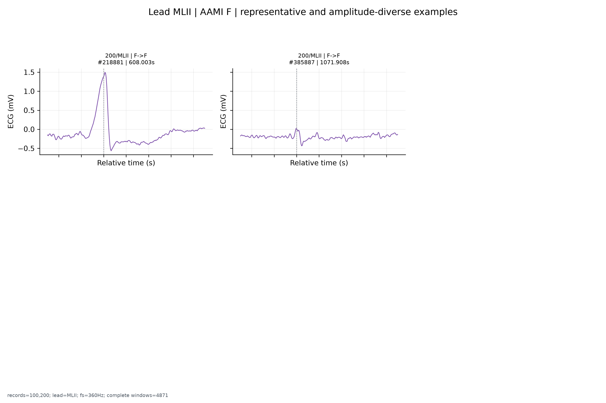

**读图目的**：选出最接近类均值的实际心拍，并补充不同峰峰值排序位置的实际片段。

**计算结果**：实际展示 2 个不同心拍；首格为减中位数后距离类均值最近的窗口，其余按峰峰值排序选取。

**解释边界**：代表性由明确数值准则定义，不是专家诊断；极端片段可能含基线或邻拍影响；只有 2 例不能建立稳定模板。

**数据范围**：`records=100,200; lead=MLII; fs=360Hz; complete windows=4871`

#### C13 · Lead MLII | AAMI Q | 0 randomly sampled beats

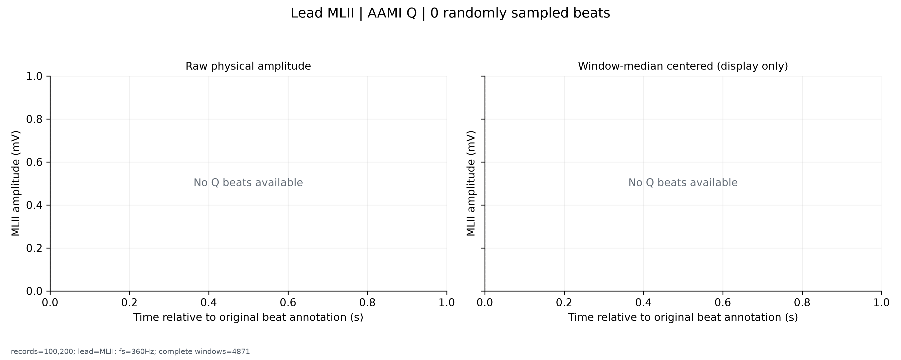

**读图目的**：固定种子随机选取最多 20 拍，观察类内幅值、基线与形态变化。

**计算结果**：该导联 Q 类有 0 个有效窗口，实际不放回抽取 0 个；样本标识见 plotted_heartbeat_windows.csv。

**解释边界**：不足 20 拍时全部展示，不复制稀有类；不同颜色只区分抽样曲线，不代表额外类别。

**数据范围**：`records=100,200; lead=MLII; fs=360Hz; complete windows=4871`

#### C14 · Lead MLII | AAMI Q | class mean and variability

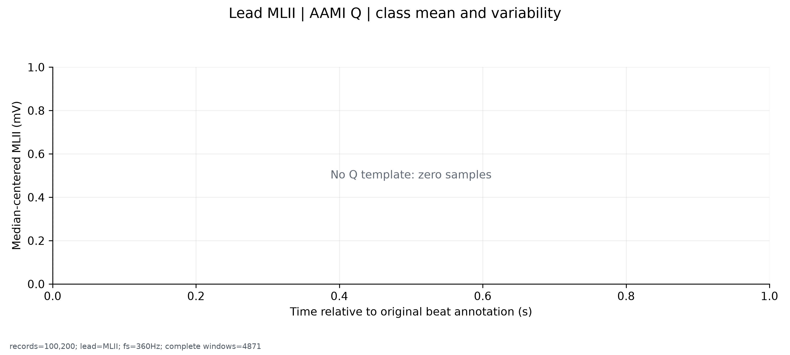

**读图目的**：用全部有效窗口的平均波形和逐采样点标准差补充少量示例。

**计算结果**：模板使用 0 个窗口；未生成虚构模板。

**解释边界**：阴影是类内逐点标准差，不是均值置信区间；先各窗减中位数，不缩放幅值，不重新定位峰。

**数据范围**：`records=100,200; lead=MLII; fs=360Hz; complete windows=4871`

#### C15 · Lead MLII | AAMI Q | representative and amplitude-diverse examples

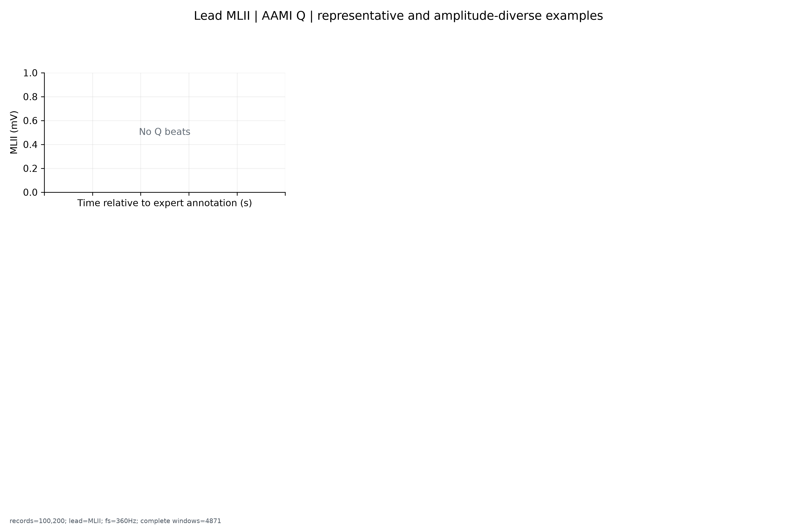

**读图目的**：选出最接近类均值的实际心拍，并补充不同峰峰值排序位置的实际片段。

**计算结果**：实际展示 0 个不同心拍；首格为减中位数后距离类均值最近的窗口，其余按峰峰值排序选取。

**解释边界**：代表性由明确数值准则定义，不是专家诊断；极端片段可能含基线或邻拍影响；只有 2 例不能建立稳定模板。

**数据范围**：`records=100,200; lead=MLII; fs=360Hz; complete windows=4871`

#### C16 · Lead MLII | compare class average waveforms

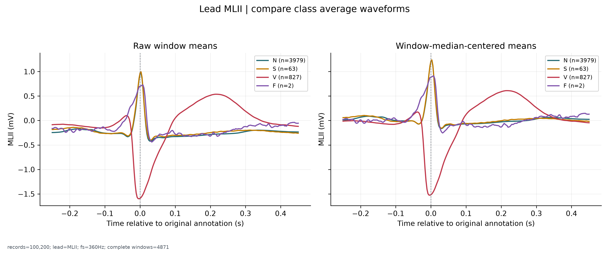

**读图目的**：比较类别模板，并观察减中位数前后的基线效应。

**计算结果**：N=3979; S=63; V=827; F=2; Q=0

**解释边界**：平均可能抹去少数形态或使正负偏转抵消；不同记录对模板的贡献按实际心拍数加权，不代表患者平均。

**数据范围**：`records=100,200; lead=MLII; fs=360Hz; complete windows=4871`

#### C17 · Lead MLII | heartbeat-window amplitude descriptors

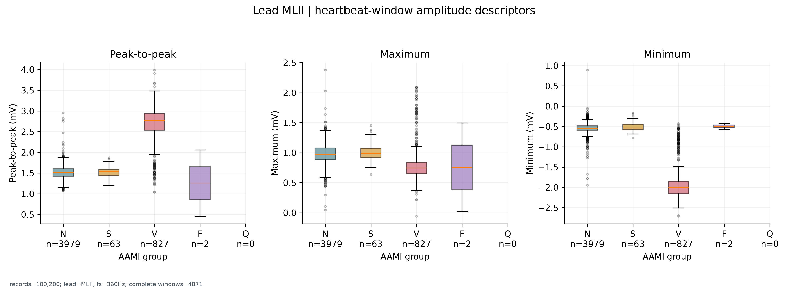

**读图目的**：比较各类完整窗口的峰峰值、最大值、最小值与离群范围。

**计算结果**：N/peak_to_peak 中位数=1.5150 mV；S/peak_to_peak 中位数=1.5300 mV；V/peak_to_peak 中位数=2.7700 mV；F/peak_to_peak 中位数=1.2575 mV；N/maximum 中位数=0.9750 mV；S/maximum 中位数=0.9900 mV；V/maximum 中位数=0.7450 mV；F/maximum 中位数=0.7575 mV；N/minimum 中位数=-0.5400 mV；S/minimum 中位数=-0.5350 mV；V/minimum 中位数=-2.0100 mV；F/minimum 中位数=-0.5000 mV

**实际视觉核查**：N 与 S 的三个描述量分布有明显重叠；V 组峰峰值的主体更大、最小值主体更负，但也存在与其他组重叠的窗口。仅凭一个幅值阈值难以完整描述这些类别；F 只有两例，其箱体不代表稳定的总体分布。

**解释边界**：箱体为四分位区间、须为 1.5 IQR，点为须外数值，不等于医学异常；描述整个窗口而非已分割 QRS。

**数据范围**：`records=100,200; lead=MLII; fs=360Hz; complete windows=4871`

#### C18 · Lead MLII | physical window energy distribution

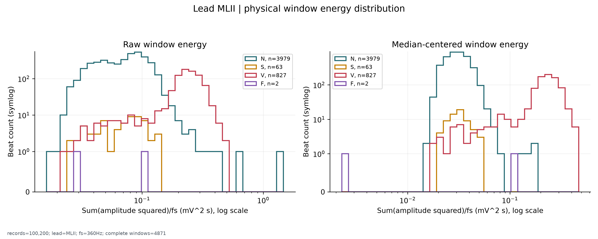

**读图目的**：比较幅值平方积分，并展示原始基线对能量的影响。

**计算结果**：N/energy_raw 中位数=0.07425 mV²·s；S/energy_raw 中位数=0.07532 mV²·s；V/energy_raw 中位数=0.23752 mV²·s；F/energy_raw 中位数=0.06818 mV²·s；N/energy_centered 中位数=0.03039 mV²·s；S/energy_centered 中位数=0.03108 mV²·s；V/energy_centered 中位数=0.22781 mV²·s；F/energy_centered 中位数=0.05414 mV²·s

**解释边界**：能量定义为 sum(x²)/fs，不是心脏机械能或病理指标；零能量不会出现在 log 横轴，数量另见特征表。

**数据范围**：`records=100,200; lead=MLII; fs=360Hz; complete windows=4871`

#### C19 · Lead MLII | amplitude versus centered energy

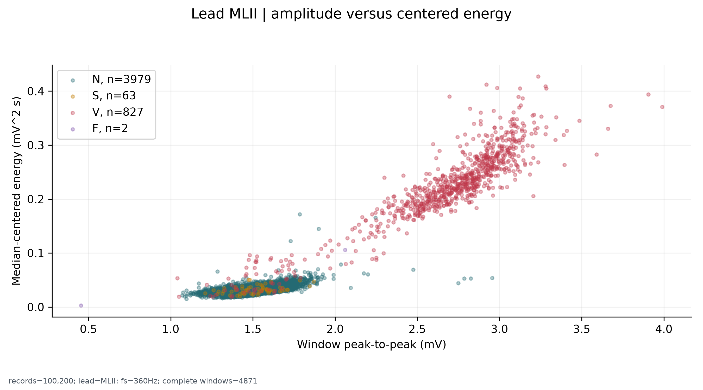

**读图目的**：检查幅值与能量的联合变化以及类间重叠。

**计算结果**：全部 4871 个有效窗口；峰峰值与中心化能量 Pearson 相关系数=0.9608。

**解释边界**：相关性是同一窗口两个数学描述量之间的相关；不构成独立诊断证据或分类效果。

**数据范围**：`records=100,200; lead=MLII; fs=360Hz; complete windows=4871`


### D. 节律分析

#### D01 · Records 100, 200 | RR distribution

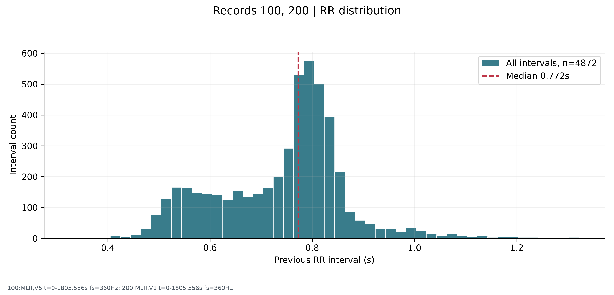

**读图目的**：观察原始专家心拍间隔的分布宽度与多峰结构。

**计算结果**：有效 RR=4872；范围 0.3250–1.3222 s，中位数 0.7722 s。

**解释边界**：RR 来自相邻已识别心拍的标注间隔，不跨记录拼接；包含异位心拍，不是仅正常 NN 间期或临床 HRV 分析。

**数据范围**：`100:MLII,V5 t=0-1805.556s fs=360Hz; 200:MLII,V1 t=0-1805.556s fs=360Hz`

#### D02 · Records 100, 200 | previous RR versus next RR, colored by current beat

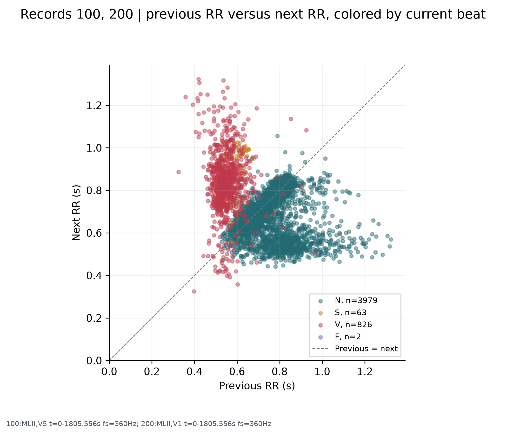

**读图目的**：检查当前心拍前后节律上下文和局部时间关系。

**计算结果**：F: n=2, 前/后 RR 中位数=0.6319/0.6542 s；N: n=3979, 前/后 RR 中位数=0.7889/0.7611 s；S: n=63, 前/后 RR 中位数=0.5917/0.9389 s；V: n=826, 前/后 RR 中位数=0.5444/0.8389 s

**实际视觉核查**：不少 V 点位于 previous=next 参考线上方，表现为前一间隔相对短、后一间隔相对长；N 点也有多种前后间隔组合。这里展示的是与既有标签相对应的时间关系，不作新诊断，也不把散点区域直接作为标签规则。

**解释边界**：颜色来自当前拍原始标签的 AAMI 映射；首末拍缺少邻居会被排除，但不因此删去原始计数；不按散点位置重标注。

**数据范围**：`100:MLII,V5 t=0-1805.556s fs=360Hz; 200:MLII,V1 t=0-1805.556s fs=360Hz`

#### D03 · Records 100 | RR distribution

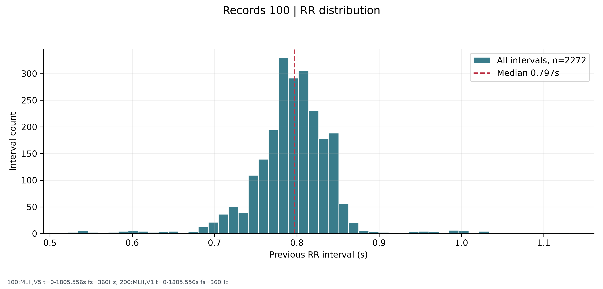

**读图目的**：观察原始专家心拍间隔的分布宽度与多峰结构。

**计算结果**：有效 RR=2272；范围 0.5222–1.1306 s，中位数 0.7972 s。

**解释边界**：RR 来自相邻已识别心拍的标注间隔，不跨记录拼接；包含异位心拍，不是仅正常 NN 间期或临床 HRV 分析。

**数据范围**：`100:MLII,V5 t=0-1805.556s fs=360Hz; 200:MLII,V1 t=0-1805.556s fs=360Hz`

#### D04 · Records 100 | previous RR versus next RR, colored by current beat

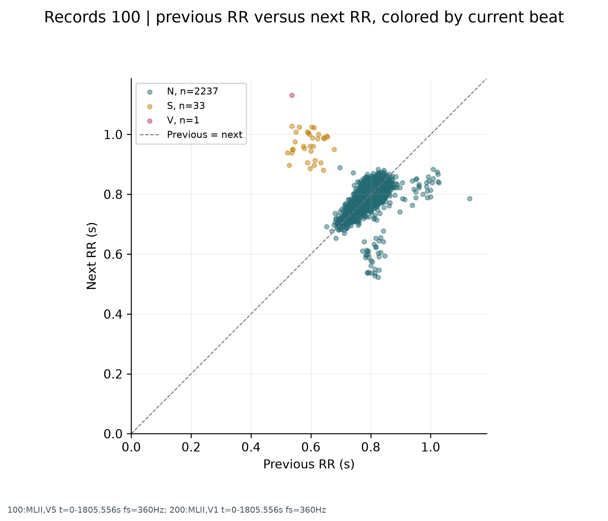

**读图目的**：检查当前心拍前后节律上下文和局部时间关系。

**计算结果**：N: n=2237, 前/后 RR 中位数=0.7972/0.7972 s；S: n=33, 前/后 RR 中位数=0.5972/0.9611 s；V: n=1, 前/后 RR 中位数=0.5361/1.1306 s

**解释边界**：颜色来自当前拍原始标签的 AAMI 映射；首末拍缺少邻居会被排除，但不因此删去原始计数；不按散点位置重标注。

**数据范围**：`100:MLII,V5 t=0-1805.556s fs=360Hz; 200:MLII,V1 t=0-1805.556s fs=360Hz`

#### D05 · Records 200 | RR distribution

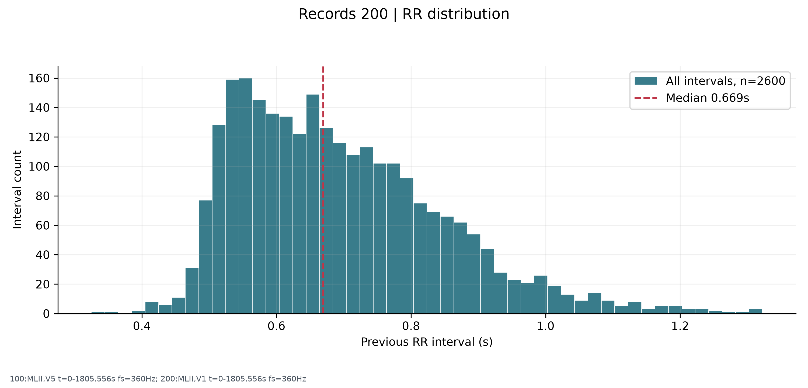

**读图目的**：观察原始专家心拍间隔的分布宽度与多峰结构。

**计算结果**：有效 RR=2600；范围 0.3250–1.3222 s，中位数 0.6694 s。

**解释边界**：RR 来自相邻已识别心拍的标注间隔，不跨记录拼接；包含异位心拍，不是仅正常 NN 间期或临床 HRV 分析。

**数据范围**：`100:MLII,V5 t=0-1805.556s fs=360Hz; 200:MLII,V1 t=0-1805.556s fs=360Hz`

#### D06 · Records 200 | previous RR versus next RR, colored by current beat

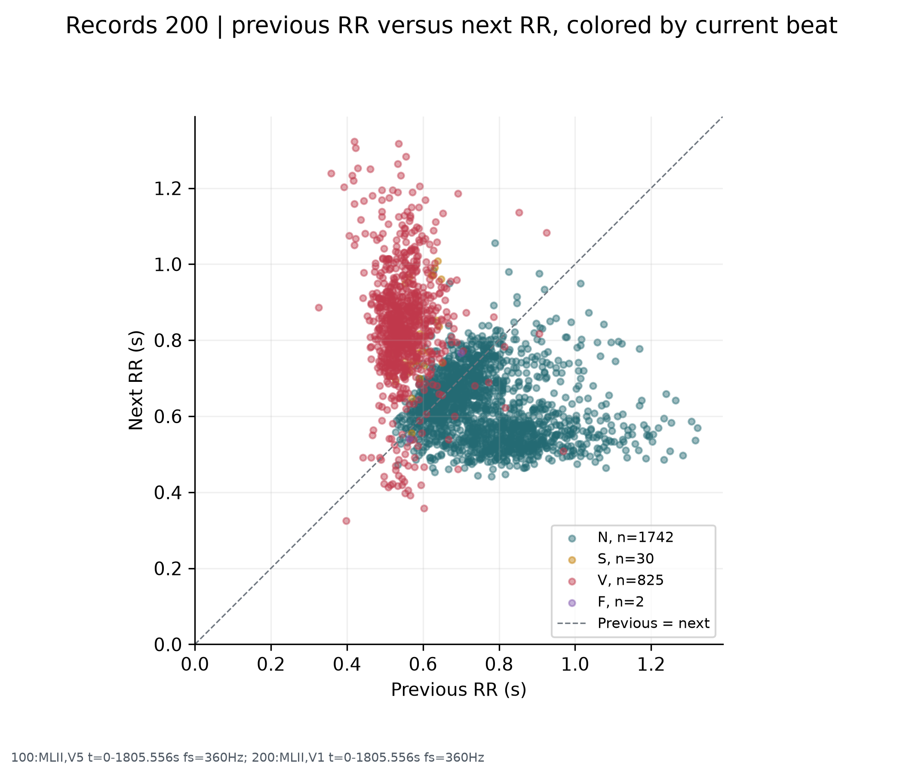

**读图目的**：检查当前心拍前后节律上下文和局部时间关系。

**计算结果**：F: n=2, 前/后 RR 中位数=0.6319/0.6542 s；N: n=1742, 前/后 RR 中位数=0.7417/0.6139 s；S: n=30, 前/后 RR 中位数=0.5875/0.7639 s；V: n=825, 前/后 RR 中位数=0.5444/0.8389 s

**解释边界**：颜色来自当前拍原始标签的 AAMI 映射；首末拍缺少邻居会被排除，但不因此删去原始计数；不按散点位置重标注。

**数据范围**：`100:MLII,V5 t=0-1805.556s fs=360Hz; 200:MLII,V1 t=0-1805.556s fs=360Hz`

#### D07 · Record 100 | RR interval over the full record

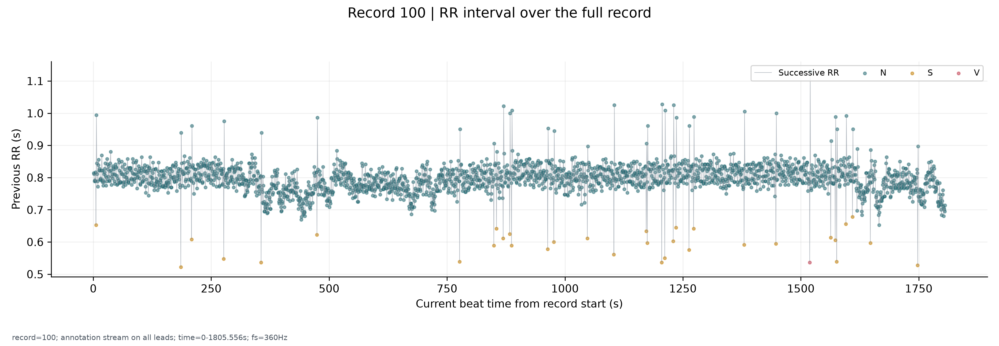

**读图目的**：定位短长间隔和节律变化发生的时间。

**计算结果**：2272 个间隔；均值 0.7946 s，标准差 0.0488 s；未做生理阈值裁剪。

**解释边界**：曲线由相邻事件连接，不是连续测量的瞬时 RR；包含异位心拍，不能直接解释为自主神经功能。

**数据范围**：`record=100; annotation stream on all leads; time=0-1805.556s; fs=360Hz`

#### D08 · Record 200 | RR interval over the full record

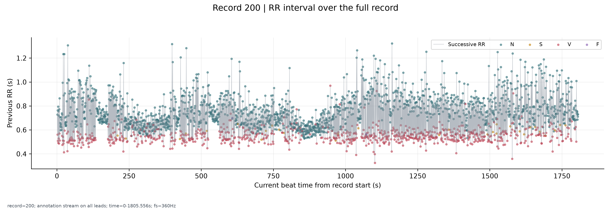

**读图目的**：定位短长间隔和节律变化发生的时间。

**计算结果**：2600 个间隔；均值 0.6941 s，标准差 0.1521 s；未做生理阈值裁剪。

**解释边界**：曲线由相邻事件连接，不是连续测量的瞬时 RR；包含异位心拍，不能直接解释为自主神经功能。

**数据范围**：`record=200; annotation stream on all leads; time=0-1805.556s; fs=360Hz`

#### D09 · Each record | mean and standard deviation of RR


**读图目的**：比较不同记录的平均心拍间隔和分散程度。

**计算结果**：100: 均值 0.7946 s，SD 0.0488 s，n=2272；200: 均值 0.6941 s，SD 0.1521 s，n=2600

**解释边界**：误差线为该记录间隔的标准差，不是受试者间差异或均值置信区间。

**数据范围**：`100:MLII,V5 t=0-1805.556s fs=360Hz; 200:MLII,V1 t=0-1805.556s fs=360Hz`


### E. 数据质量

#### E01 · All records and leads | observed amplitude range


**读图目的**：逐记录、逐导联比较原始幅值的最小至最大范围。

**计算结果**：100/MLII: -2.715–1.435 mV；100/V5: -2.465–1.225 mV；200/MLII: -2.695–2.380 mV；200/V1: -4.890–4.940 mV

**解释边界**：全局极值可能来自一个短片段；幅值大不必然是疾病或噪声，必须回看具体时间。

**数据范围**：`100:MLII,V5 t=0-1805.556s fs=360Hz; 200:MLII,V1 t=0-1805.556s fs=360Hz`

#### E02 · All records and leads | signal standard deviation


**读图目的**：比较完整信号的总变异强度，作为质量复核线索。

**计算结果**：100/MLII: SD=0.1932 mV；100/V5: SD=0.1482 mV；200/MLII: SD=0.3801 mV；200/V1: SD=0.4947 mV

**解释边界**：标准差同时受心拍幅值、心率、基线与噪声影响，不是验证过的信号质量评分。

**数据范围**：`100:MLII,V5 t=0-1805.556s fs=360Hz; 200:MLII,V1 t=0-1805.556s fs=360Hz`

#### E03 · Heartbeat extraction | boundary and validity accounting


**读图目的**：说明全心拍统计与可视化可用窗口之间的差别，显式审计边界丢失。

**计算结果**：共 4874 个已识别心拍；有效映射窗口 4871；left=1；right=2；both=0；nonfinite=0；unmapped=0

**解释边界**：越界、非有限或未映射的窗口不用于形态/降维，但其原始标注和计数仍保留；valid 不等于信号质量良好。

**数据范围**：`100:MLII,V5 t=0-1805.556s fs=360Hz; 200:MLII,V1 t=0-1805.556s fs=360Hz`

#### E04 · Record 100 | MLII | baseline/amplitude drift candidate


**读图目的**：展示块中位数变化最大的候选片段，阈值仅为可视化选择规则（≥0.5 mV）。

**计算结果**：区间 1620.000–1630.000 s；原始幅值 -0.765–1.315 mV；1 s 块中位数范围 0.538 mV。

**解释边界**：块中位数不是分离出的真实基线，也会受宽心拍和其他伪迹影响；本图不自动诊断漂移来源，不据此删样本。

**数据范围**：`record=100; lead=MLII; samples=[583200,586800); fs=360Hz; relative time=1620.000-1630.000s`

#### E05 · Record 100 | V5 | baseline/amplitude drift candidate


**读图目的**：展示块中位数变化最大的候选片段，阈值仅为可视化选择规则（≥0.5 mV）。

**计算结果**：区间 350.000–360.000 s；原始幅值 -1.215–0.600 mV；1 s 块中位数范围 0.805 mV。

**解释边界**：块中位数不是分离出的真实基线，也会受宽心拍和其他伪迹影响；本图不自动诊断漂移来源，不据此删样本。

**数据范围**：`record=100; lead=V5; samples=[126000,129600); fs=360Hz; relative time=350.000-360.000s`

#### E06 · Record 200 | MLII | baseline/amplitude drift candidate


**读图目的**：展示块中位数变化最大的候选片段，阈值仅为可视化选择规则（≥0.5 mV）。

**计算结果**：区间 230.000–240.000 s；原始幅值 -2.105–2.380 mV；1 s 块中位数范围 2.042 mV。

**解释边界**：块中位数不是分离出的真实基线，也会受宽心拍和其他伪迹影响；本图不自动诊断漂移来源，不据此删样本。

**数据范围**：`record=200; lead=MLII; samples=[82800,86400); fs=360Hz; relative time=230.000-240.000s`

#### E07 · Record 200 | V1 | baseline/amplitude drift candidate


**读图目的**：展示块中位数变化最大的候选片段，阈值仅为可视化选择规则（≥0.5 mV）。

**计算结果**：区间 880.000–890.000 s；原始幅值 -4.190–3.065 mV；1 s 块中位数范围 5.418 mV。

**解释边界**：块中位数不是分离出的真实基线，也会受宽心拍和其他伪迹影响；本图不自动诊断漂移来源，不据此删样本。

**数据范围**：`record=200; lead=V1; samples=[316800,320400); fs=360Hz; relative time=880.000-890.000s`

#### E08 · Record 200 | V1 | baseline/amplitude drift candidate


**读图目的**：展示第一处非初始专家信号质量变化事件附近的最后一个导联，观察低频漂移与心拍可辨性。

**计算结果**：区间 218.192–228.192 s；原始幅值 -0.880–0.570 mV；1 s 块中位数范围 1.180 mV。

**实际视觉核查**：在 218.192–228.192 s 的 V1 原始信号上，可以直接看到先缓慢向下再明显向上的大幅低频漂移，心拍细节相对较小。1 s 块中位数追随了这一总体变化，适合作为报告中的漂移示意；它并未独立分离出真实基线。

**解释边界**：块中位数不是分离出的真实基线，也会受宽心拍和其他伪迹影响；本图不自动诊断漂移来源，不据此删样本。

**数据范围**：`record=200; lead=V1; samples=[78549,82149); fs=360Hz; relative time=218.192-228.192s`


### F. 降维探索

#### F01 · Lead MLII | PCA | median_centered | all valid windows


**读图目的**：观察波形主要变化方向，并用相同坐标按类别和记录分别着色以检查记录效应。

**计算结果**：输入 4871×253；PC1/PC2 解释率 86.419%/5.336%，合计 91.755%；N=3979; S=63; V=827; F=2; Q=0

**实际视觉核查**：多数 V 点与 N/S 主体沿 PC1 分开，但有部分 V 仍落在其他点附近；N 与 S 有明显重叠。将完全相同的坐标按记录着色后，N 主体中的不同区域与记录 100、200 对应，说明二维结构同时受到记录差异影响。

**解释边界**：只做无监督投影；标签仅用于着色。减窗中位数后保留原幅值，unit_rms 版本另移除每窗幅值尺度。投影分离不等于模型准确率或诊断。

**数据范围**：`records=100,200; lead=MLII; fs=360Hz; complete windows=4871`

#### F02 · Lead MLII | t-SNE | median_centered | perplexity=15


**读图目的**：检查局部形态相似性，并比较不同 perplexity 和幅值处理下的可视化稳定性。

**计算结果**：按记录×类别不放回抽样 1566 拍；N=1000; S=63; V=501; F=2; Q=0；预 PCA=50 维，保留方差 99.776%；运行 999 轮，KL=1.15246。

**解释边界**：图已受分层抽样影响，不反映原始类别频率；不同图的坐标方向/簇间距离不可直接比较，KL 不是分类性能；没有训练分类器或深度模型。

**数据范围**：`records=100,200; lead=MLII; fs=360Hz; complete windows=4871; embedding subset=1566; exact point IDs: results/visualization/embedding_coordinates.csv`

#### F03 · Lead MLII | t-SNE | median_centered | perplexity=40


**读图目的**：检查局部形态相似性，并比较不同 perplexity 和幅值处理下的可视化稳定性。

**计算结果**：按记录×类别不放回抽样 1566 拍；N=1000; S=63; V=501; F=2; Q=0；预 PCA=50 维，保留方差 99.776%；运行 999 轮，KL=0.89935。

**实际视觉核查**：V 的主要点群与 N/S 多数点群分开，N 和 S 在若干区域混合；右图按记录着色后，不同记录形成明显区域。这提示不能把图中的分簇全部解释为心拍类别，也不能将其当作患者独立泛化表现。

**解释边界**：图已受分层抽样影响，不反映原始类别频率；不同图的坐标方向/簇间距离不可直接比较，KL 不是分类性能；没有训练分类器或深度模型。

**数据范围**：`records=100,200; lead=MLII; fs=360Hz; complete windows=4871; embedding subset=1566; exact point IDs: results/visualization/embedding_coordinates.csv`

#### F04 · Lead MLII | PCA | median_centered_unit_rms | all valid windows


**读图目的**：观察波形主要变化方向，并用相同坐标按类别和记录分别着色以检查记录效应。

**计算结果**：输入 4871×253；PC1/PC2 解释率 73.510%/14.558%，合计 88.068%；N=3979; S=63; V=827; F=2; Q=0

**解释边界**：只做无监督投影；标签仅用于着色。减窗中位数后保留原幅值，unit_rms 版本另移除每窗幅值尺度。投影分离不等于模型准确率或诊断。

**数据范围**：`records=100,200; lead=MLII; fs=360Hz; complete windows=4871`

#### F05 · Lead MLII | t-SNE | median_centered_unit_rms | perplexity=15


**读图目的**：检查局部形态相似性，并比较不同 perplexity 和幅值处理下的可视化稳定性。

**计算结果**：按记录×类别不放回抽样 1566 拍；N=1000; S=63; V=501; F=2; Q=0；预 PCA=50 维，保留方差 99.582%；运行 999 轮，KL=1.18500。

**解释边界**：图已受分层抽样影响，不反映原始类别频率；不同图的坐标方向/簇间距离不可直接比较，KL 不是分类性能；没有训练分类器或深度模型。

**数据范围**：`records=100,200; lead=MLII; fs=360Hz; complete windows=4871; embedding subset=1566; exact point IDs: results/visualization/embedding_coordinates.csv`

#### F06 · Lead MLII | t-SNE | median_centered_unit_rms | perplexity=40


**读图目的**：检查局部形态相似性，并比较不同 perplexity 和幅值处理下的可视化稳定性。

**计算结果**：按记录×类别不放回抽样 1566 拍；N=1000; S=63; V=501; F=2; Q=0；预 PCA=50 维，保留方差 99.582%；运行 999 轮，KL=0.92407。

**解释边界**：图已受分层抽样影响，不反映原始类别频率；不同图的坐标方向/簇间距离不可直接比较，KL 不是分类性能；没有训练分类器或深度模型。

**数据范围**：`records=100,200; lead=MLII; fs=360Hz; complete windows=4871; embedding subset=1566; exact point IDs: results/visualization/embedding_coordinates.csv`

#### F07 · Lead MLII | PCA variance spectrum


**读图目的**：说明二维投影丢失了多少波形变化，并比较保留幅值与单位 RMS 形态的差异。

**计算结果**：median_centered: 前 2 维 91.755%，前 50 维 99.626%；median_centered_unit_rms: 前 2 维 88.068%，前 50 维 99.215%

**解释边界**：解释率取决于预处理和当前数据分布，不能解释为分类准确率。

**数据范围**：`records=100,200; lead=MLII; fs=360Hz; complete windows=4871`

#### F08 · Lead MLII | correlation between class-average templates


**读图目的**：比较平均波形形状的相似与反向关系，缺失或常量模板以 NA 表示。

**计算结果**：N–S: r=0.9917；N–V: r=-0.5920；N–F: r=0.8409；S–V: r=-0.5774；S–F: r=0.8206；V–F: r=-0.6091

**实际视觉核查**：N 与 S 的平均模板相关很高，而 V 与二者的相关为负，与平均波形的主偏转差异相符。F 只由两拍构成，相关值不稳定；Q 的整行整列以 NA 展示，明确区分缺失模板与相关系数为零。

**解释边界**：模板可能受大记录和幅值差异支配；类均值相关不代表逐拍可分性；F 极少时模板不稳定，Q 缺失不可填成 0。

**数据范围**：`records=100,200; lead=MLII; fs=360Hz; complete windows=4871`

